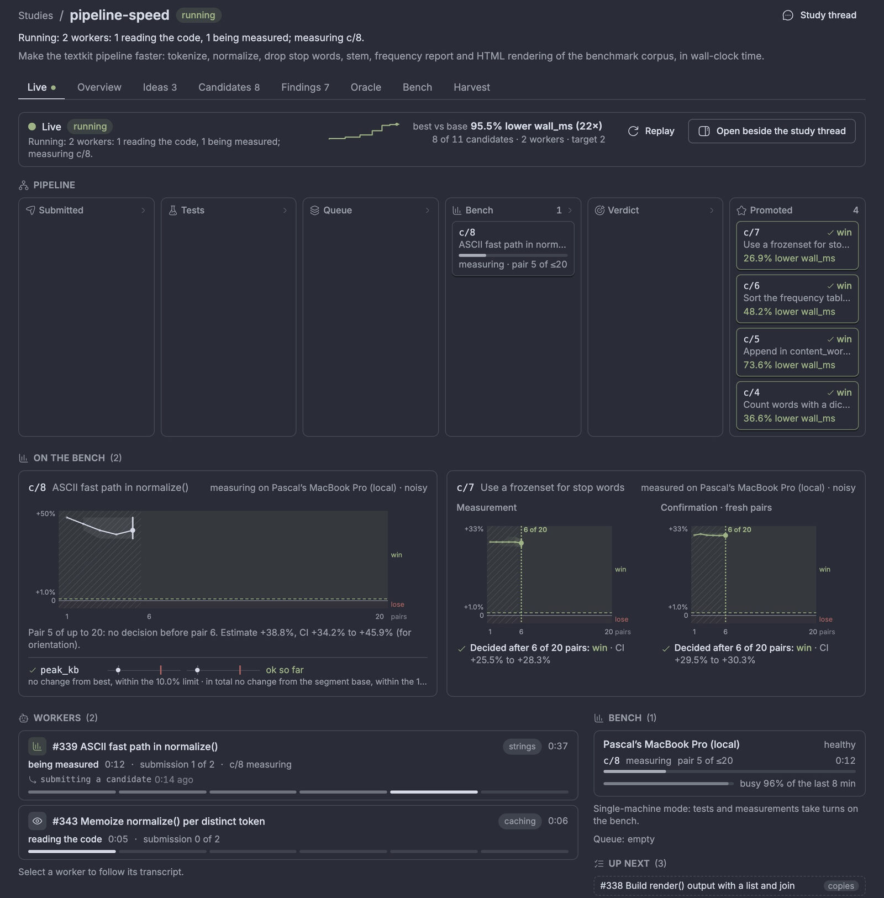
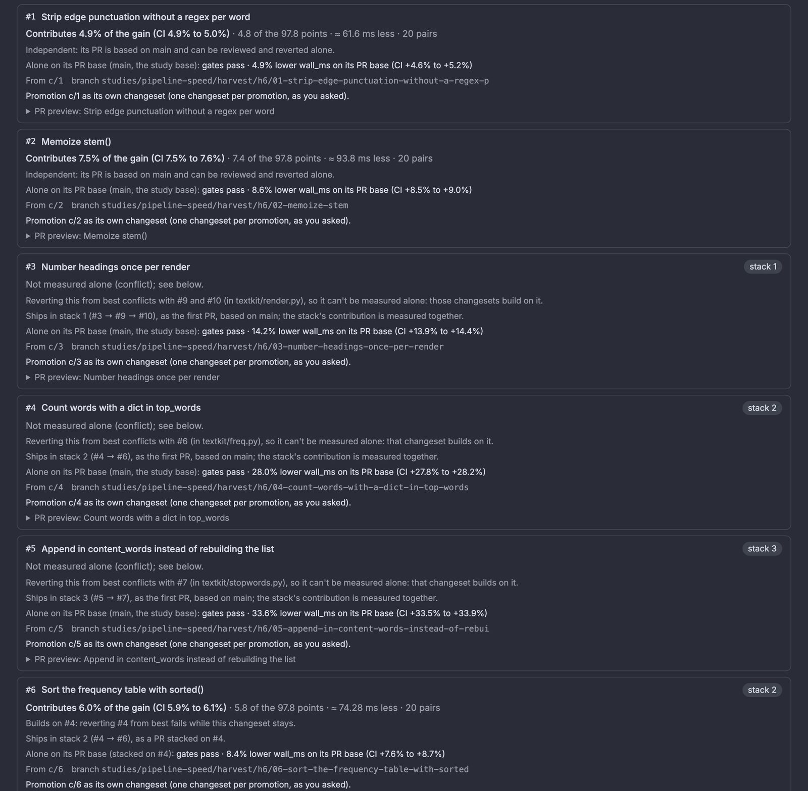

# bb-autoresearch

A BB plugin for long-running, measured code-optimization studies. Short-lived
agent workers propose changes in parallel; the plugin owns the loop, the
measurements, and every keep or discard decision, then turns the wins into
reviewable PRs whose contributions are measured by ablation.



Design and status: [docs/design.md](docs/design.md). The "Status" section says
which milestone exit criteria were validated (short version: everything is
built; it has run on toy repositories and once, blind, against another
autoresearch loop on a real-world CLI performance task), and the "Implementation notes"
sections record how the code works and every deviation from the design.

## Install

```sh
bb plugin install https://github.com/pascal-de-ladurantaye/bb-autoresearch
```

The plugin id is `bb-autoresearch`; it shows up in BB as **Autoresearch**.
To install from a checkout instead:

```sh
pnpm install
bb plugin build
bb plugin install . --yes
bb plugin enable bb-autoresearch
```

Requires BB ≥ 0.45, git ≥ 2.38 on every machine a study uses (for
`git merge-tree --write-tree`), and the GitHub CLI (`gh`) only if you publish
PRs.

## Run a study

The **Studies** page in the sidebar is where you run a study; every step
also has a `bb study` command. Each page leads with what needs you
(approvals, system pauses, a failed calibration, a harvest ready for review),
and the sidebar entry and the study thread's header badge show how many items
wait.

1. **Create.** Studies → **New study** opens bb's composer with a prefilled
   request for the `study-create` skill and the current project selected
   (the latest active study's when the page has none); describe the goal. The skill interviews you, drafts the spec (TOML: objective, metric,
   guardrails, scope, oracle commands, noise class, bench hosts, budget) and
   submits it with `study_propose`. That thread becomes the **study thread**:
   the conversation with the strategist.

   Guardrails have two limits: how much worse one change may make a
   secondary metric than the current best (`max_regression`), and how much
   worse best may get than the segment base over all promotions
   (`max_total_regression`). Both are judged on a CI: a guardrail breaks a
   win only when its whole CI is beyond a limit, and is flagged
   *inconclusive* when the CI straddles one. Worker snapshots never commit
   untracked build outputs and caches (`[scope] ignore`, with defaults for
   Python, Node, Rust/Java and coverage), so a repo without a `.gitignore`
   works.
2. **Approve and calibrate.** Needs you → *Approve spec v1 and calibrate*
   (review the spec on the Oracle tab first). Calibration runs the gates on the
   base commit and A/A measurements on every bench host, and reports the
   smallest win it can detect (MDE), each guardrail's noise (with a warning
   when it exceeds the limit), and the cost per evaluation. If it fails,
   the page says why; ask the study thread for a revised spec and approve that.
   CLI: `bb study calibrate <slug> [--wait]`.
3. **Start.** Seed ideas on the Ideas tab, then Needs you → *Approve and
   start*. Hidden worker threads spawn in managed worktrees from
   `studies/<slug>/best`, submit candidates, and get verdicts as messages.
   Gates run in parallel (in single-machine mode, below, they take turns
   with measurements); each bench host measures one candidate at a time;
   wins are confirmed (and checked against a hidden holdout when configured)
   before they are squashed onto best. CLI: `bb study start <slug>`.
4. **Watch and steer.**
   - Live (the default tab while the study runs): one lane per worker with its idea, phase (reading, editing, testing, waiting for the bench, being measured, verdict received, refining, finishing), time in phase and submissions used; candidate cards moving from Submitted through Tests, Queue and Bench to a verdict or Promoted, with pair progress and the improvement once known; each bench host with what it measures, the queue and how busy it was; the ideas up next; a feed of what just happened, grouped by candidate; and one worker's transcript at a time (select its lane). Each measurement on the bench gets a **CI band**: the estimate and its confidence interval narrowing pair by pair against zero and the win threshold, with the test's lose / continue / win regions shaded, the pairs before `n_min` hatched, and the stop marked ("decided after 9 of 20 pairs: win"); the confirmation is a second phase, deterministic measurements show the run against the tolerance, expensive ones the runs against the calibrated σ band, and guardrails sit underneath (the step and the total against their limits). Each lane shows its worker's **last action** ("editing src/toy.py", "running pytest -q"; shortened, secrets and URL credentials removed, never message text). When best moves, the card lands in Promoted, the header counts up to the new best and its trajectory steps, and the other lanes say "best moved: rebases on next submit". Up next is in the order the scheduler will pick (the theme cap can put a later idea first). It is read only, follows realtime updates, and respects reduced motion.
   - **Replay** (Live tab → Replay, the Overview's Replay button, or the Replay switch in the side panel): the whole Live view of any study (finished, archived, or a running one rewound) rebuilt at any moment from its recorded events and samples. A timeline shows event density and milestones (wins, best moves, pauses, segment and harvest changes); play/pause, 1×, 10×, 60× and 600×, "Next win", and the keyboard (Space, ←/→, Shift for bigger steps, Home/End, N/P for next/previous win, 1-4 for the speed). The position is in the URL (`studies/<slug>/live/replay/<ms>`), so a moment can be reopened or shared. Transcripts are not time-synced: a worker's transcript in a replay is its current one, and says so. **Open beside the study thread** (or the **Live** button on the study thread's header badge, or "Study live view" in a thread's right-panel launcher) shows the same view in the thread's split pane, so you can watch while talking to the strategist.
   - Overview: Needs you; best vs base in words with raw values and CI; what's running; the trajectory; secondary metrics, and each guardrail's cumulative position against its total limit with the CI and the room left; controls (pause, resume, max workers, harvest, archive); notices, each with the action it asks for.
   - Ideas: add, reorder, pin, veto (with a reason).
   - Candidates: verdict, improvement, CI and guardrail status per row (ok, near limit, inconclusive, BROKEN, and whether the step or the total is the problem); each opens its measurement's CI band (how the verdict formed), every recorded metric, samples, diffs, and the worker thread.
   - Findings: searchable, with counts per outcome, theme and verdict.
   - Oracle: spec, versions, pending spec with its diff, calibration with its approval and guardrail noise, segments.
   - Bench: hosts, queue, health (latest marked), drift, bundles.
   - Harvest: below.

   The study thread shows one line per plugin message (strategist round,
   verdict); the full detail goes to the agent as an agent-only block.
   Notices (new best, stall, budget thresholds, broken oracle, drift, rate
   limits, harvest ready) mark the study thread unread. A "?" next to each
   statistical term (MDE, CI, noise floor, ablation, dependency) explains it.
5. **Harvest.** When the budget is used up the study pauses and Needs you
   offers *Start harvest* (or start one any time from the Overview; CLI
   `bb study harvest <slug>`). It freezes best and works through the
   promotions:
   - The strategist groups the promotions into changesets (or one per promotion, if you tick that in the dialog or pass `--one-per-promotion`).
   - Each changeset is ablated: best with it reverted is measured against best. Its contribution is shown as a share of the base→best gain, in points and metric units, with the CI. A revert conflict or a gate failure becomes a dependency, explained in words, and dependent changesets form a stack.
   - Dependent changesets form a stack in dependency order (from the detected edges and the files their commits share). Each layer is gated (and measured) on its PR base; one that doesn't apply or pass its gates there is folded into the layer it needs, and the page and PR body say why. Only layers that apply and pass are drafted, as local branches `studies/<slug>/harvest/h<N>/*` (N counts this study's harvests) with a PR body you can preview. The bodies and `report.md` are exported under the plugin's data dir.

   Then: **Publish draft PRs…** shows exactly which branches go to which
   remote and which draft PRs open (and refuses without a GitHub remote), and
   keeps the PR URLs or errors on the page afterwards; droppable changesets can
   be kept or dropped first. Or *Keep exploring* (resume), or *Archive*. CLI:
   `bb study harvest <slug> --publish`, `bb study resume <slug>`,
   `bb study archive <slug>`.

   

### One machine for everything

On a laptop the edit host is also the bench host, and gates (tests, type
checks, renders) running next to a timing run add noise to it. The spec's
`[oracle]` table has two scheduling settings for this; neither is part of the
oracle hash, so changing them never needs a recalibration:

| Key | Default | What it does |
|---|---|---|
| `single_machine` | `"auto"` | `"auto"`, `"on"` or `"off"`. When on, gates take the same per-host bench lock as measurements, in one queue with them (oldest first), so a gate never overlaps a measurement. `"auto"` is on when a bench host is the edit machine (`bench_hosts = ["local"]`, the default, or the edit machine's own name or id) and the oracle is `noisy` or `expensive`. Gate time then counts as bench time: in utilization, and in the worker target W (gate + measure time per candidate). |
| `quiet_bench` | `false` | While a measurement runs on a machine, a new worker turn there waits to start (BB's dispatch hook; the thread's queued card says why). Turns already running are not interrupted, and a held turn waits for at most one measurement. |

The Oracle tab, the calibration report and `bb study show` say whether
single-machine mode is on and why; the Overview, Bench and Live views show
"testing c/N" on the bench host while a gate holds it.

### Measurement protocol (noisy oracles)

`[oracle.protocol]` keys that decide how much bench time a candidate takes. They are part of the oracle hash (changing one recalibrates), except where noted:

| Key | Default | What it does |
|---|---|---|
| `n_min`, `n_max` | 6, 20 | Pairs before a win can be declared, and the cap. |
| `futility` | `true` | After `n_min`, stop as inconclusive once the CI's upper bound is below the win threshold: more pairs couldn't make it a win. |
| `early_lose_from`, `early_lose_confidence` | 3, 0.99 | From 3 pairs, a clear loss (a t interval at 99% entirely below 0) stops before `n_min`. `0` turns it off. |
| `confirm`, `skip_confirm_factor` | `true`, 3 | Wins are re-measured with fresh pairs, unless the CI's lower bound is at least 3× the win threshold (the verdict says it skipped). `0` always confirms. |
| `side_runs`, `min_side_seconds` | `"auto"`, 5 | Runs of `measure` per side of a pair, keeping each metric's best value. `"auto"` picks the count at calibration so a side lasts at least 5 s. |

`[oracle.drift] recalibrate_below = 0.6` (not hashed): when best's runs take less than 60% of their calibrated time (code that got several times faster is noisier relative to itself), the plugin recalibrates on best at the next free bench slot, in a new segment with the same oracle, instead of letting a drift check pause the study. Noise that grows at the same run time still pauses it, and nothing more is measured on that machine until you resume. Best vs base compounds every segment ("81.8% lower time (5.5×) across 3 segments · this segment 3.62 → 2.04 s"). Simulated error rates and bench savings are in the design notes ("Implementation notes: v0.2.4").

### Commit identity

The plugin commits in the studied repository: worker snapshots, candidates,
promotions on `studies/<slug>/best`, and harvest branches. `[git] identity`
says as whom:

| Value | Commits are authored and committed as |
|---|---|
| `"repo"` (default) | The identity git resolves in the repository on the edit host (`user.name` / `user.email`, repo-local then global), so a work repo carries your work identity. With none configured, `autoresearch <autoresearch@bb.local>`, and the calibration report and a notice say so. |
| `"plugin"` | Always `autoresearch <autoresearch@bb.local>`. |

It's resolved on the edit host and passed explicitly to every commit, so a
bench host's clone sees exactly the same commits. Not part of the oracle hash.

Every number reads the same everywhere: **better is positive, in the
metric's own terms** ("74.7% fewer ops (4.0×)", "+74.7%"), with raw values
next to it. Nothing is pushed before you publish. Every candidate stays under
`refs/studies/<slug>/c/<n>`.

## CLI

| Command | What it does |
|---|---|
| `bb study list` | Studies (active first) with state, what needs you, best vs base, budget |
| `bb study needs [slug]` | What needs you, one line each with the command that resolves it |
| `bb study show <slug> [--events N]` | Spec summary, calibration, best, budget, usage, bench hosts, ideas, candidates, workers, notices, events |
| `bb study calibrate <slug> [--wait]` | Approve the spec and calibrate; mid-run, an oracle change (new segment) |
| `bb study approve <slug>` | Apply a pending spec whose oracle is unchanged |
| `bb study start <slug>` | Approve calibration and run (or resume) |
| `bb study pause` / `resume <slug>` | Pause; resume (from Harvesting: keep exploring) |
| `bb study concurrency <slug> <n\|auto>` | Lower max workers (clamped to the spec) |
| `bb study ideas add <slug> "<title>" [...]` / `ideas list <slug>` | The idea board |
| `bb study workers <slug>` | Worker threads |
| `bb study bench <slug>` | Health checks, bundle transfers, drift checks, segments |
| `bb study drift <slug>` | Request an A/A drift check on every bench host |
| `bb study harvest <slug> [--wait] [--restart] [--one-per-promotion] [--no-measure-standalone]` | Start or show a dry-run harvest |
| `bb study harvest <slug> --publish` | Publish the ready harvest as DRAFT PRs on GitHub |
| `bb study report <slug>` | The study report (Markdown) |
| `bb study archive <slug> [--archive-thread]` | Stop for good: workers, bench checkouts and clones, a running harvest; `--archive-thread` also archives the study thread (the app's archive dialog does by default) |

Every command takes `--json` (one JSON document from the same view models as
the page; errors carry a hint with the next command). Approval and publishing
work in the app or the CLI; both are deliberate, audited the same way, and the
CLI refuses human controls from a study's own worker and study threads (see
the threat model in the design).

## Limits

- **Trust.** Oracle commands run with full trust on edit and bench hosts, and agents with shell access can reach the plugin's RPC and CLI (see the threat model). Run studies whose results matter with the bench, and the holdout, on a machine the workers can't reach.
- **Edit host.** The edit host is the BB server's own machine. Remote edit hosts aren't built.
- **Budgets.** Max workers, candidates, bench hours, deadline, and tokens (per-thread usage as BB reports it) are enforced. Dollar cost isn't available to plugins.
- **Provider limits.** Rate-limited turns are retried at the window reset, and spawns hold until then. A tight usage window halves W. Neither path has been seen live yet.
- **Snapshots.** Workers' worktrees are committed with `git add -A`: give the repo a `.gitignore` for build outputs.
- **Harvest.** Dependencies are detected only through revert conflicts, gate failures and changed files. Stacks are ordered by dependency; a layer that doesn't apply or pass its gates on its PR base is folded into the layer it needs, so a stack can have fewer PRs than changesets. Contributions are measured relative to best and shown as shares of the gain.

## Layout

| Path | What |
|---|---|
| `server.ts` | Factory: storage, host client, tools, RPC, CLI, events, the engine service (reconcile, then tick) |
| `app.tsx`, `src/app/` | Studies nav panel (with the needs-you count), study page (Live, Overview, Ideas, Candidates, Findings, Oracle, Bench, Harvest), confirmed actions, header badge, rpc data hooks |
| `src/app/live/` | The Live view (Live tab and the thread-pane Live panel): lanes, pipeline cards, CI bands, bench strip, feed, transcript, replay player and scrubber, motion, realtime deltas |
| `src/live-model.ts`, `src/live.ts`, `src/live-feed.ts` | Live view model shared by server and app (phases, columns, deltas, replay skeleton), the feed, and the server side: phase and last-action recorder, CI band cache, throttled deltas, view and replay bundle |
| `src/band.ts`, `src/replay.ts`, `src/action.ts` | CI band of a measurement from its samples (seeded like the decision), the replay model (keyframes, the view at any t), and the sanitized "last action" labels |
| `src/present.ts` | The improvement convention (better is positive), shared by the page, CLI, report and agent messages |
| `host.ts`, `src/host/` | `bb.host` entry and ops: git (snapshot, prepare, compose/revert, logs), background jobs, bundles, bench clones, health, exports |
| `src/engine.ts` | Lifecycle, control loop, worker/strategist tools, budgets, rate limits, notices, harvest control, reconciliation |
| `src/pipeline.ts` | Candidate pipeline and job launcher (parallel gates, one measurement per bench lock) |
| `src/harvest.ts`, `src/harvest-math.ts` | Harvest phases (grouping, ablation, dependencies, stacks, standalone, drafting) and their pure math |
| `src/publisher.ts` | `PrPublisher`: dry-run (local branches + files) and GitHub (draft PRs via `gh`) |
| `src/report.ts` | PR bodies and the Markdown study report |
| `src/bench.ts`, `src/transfer.ts`, `src/health.ts`, `src/drift.ts`, `src/holdout.ts` | Bench sites, git bundle relay, health checks, drift checks, the private holdout |
| `src/spec.ts`, `src/scope.ts`, `src/stats.ts`, `src/noise.ts`, `src/verdict.ts`, `src/calibration.ts` | Spec, scope check, statistics, noise classes, verdicts, calibration |
| `src/scheduler.ts` | Pure policy: adaptive W, backpressure, provider-limit W, idea choice, budgets, strategist triggers, idle handling |
| `src/views.ts`, `src/rpc.ts`, `src/cli.ts`, `src/tools.ts`, `src/prompts.ts` | View models, RPC, `bb study`, role-gated agent tools, agent-facing text |
| `src/db/` | SQLite schema (append-only migrations) and typed store |
| `skills/` | `study-create` and `autoresearch` (usage, strategist, harvest) |

## Develop

```sh
pnpm test          # vitest: backend, real-git host and harvest tests, rpc, jsdom frontend
pnpm typecheck     # tsc --noEmit
bb plugin build
bb plugin install . --yes && bb plugin reload bb-autoresearch
```

Tests never depend on the machine's load: real-git tests use `localRunner()`
(test/helpers.ts), which injects fixed health readings.

## Credits

Inspired by [karpathy/autoresearch](https://github.com/karpathy/autoresearch) and [davebcn87/pi-autoresearch](https://github.com/davebcn87/pi-autoresearch).

## License

MIT. See [LICENSE](LICENSE).
