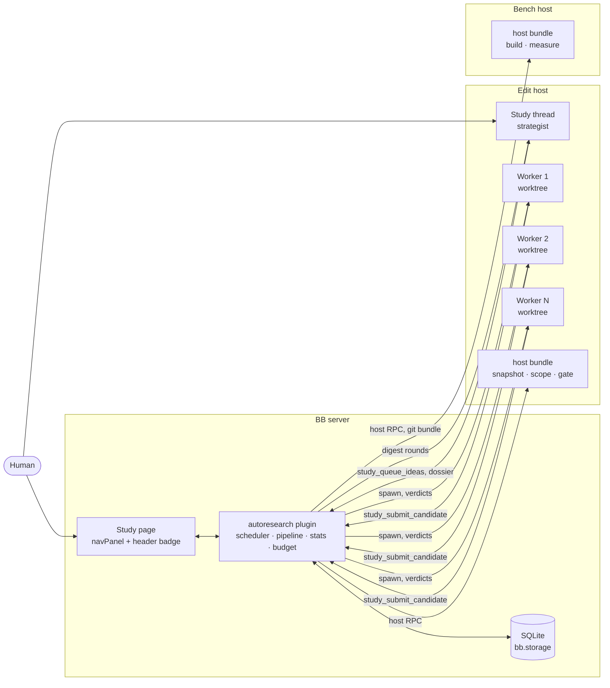
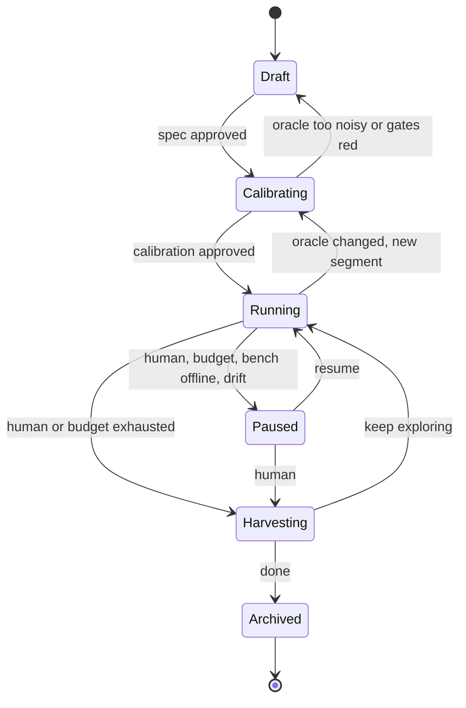
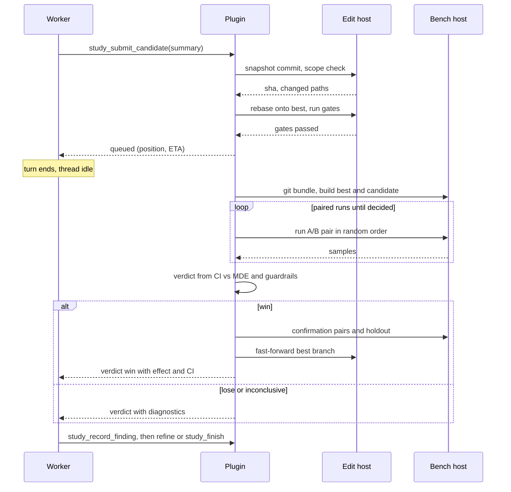

# Autoresearch for BB

> Autoresearch works like a merge queue. The CI is a benchmark, and the authors are short-lived agents. The plugin runs the loop, measures every candidate, and decides what to keep. Agents only propose changes and explain what they learned.

## Status

All four milestones are built (BB 0.45, plugin SDK 0.6.14). Each was smoke-tested live on toy repositories on one MacBook; no milestone has run on a real workload. The exit criteria:

| Milestone | Exit criterion | Validated? |
|---|---|---|
| M0: test the main assumption | Equal or better improvement than a serial single-agent loop at equal tokens, and a measured false-win rate | **No.** The head-to-head against a serial loop was never run. False-win rates are measured in simulation only (stats and expensive-class tests). |
| M1: parallel | Bench busy > 80% of Running time; time to target clearly below M0 at similar tokens per win | **No.** Toy studies reached 85% in steady state when eval > think, but they are too short; no real workload, no M0 comparison. |
| M2: remote bench and trust | A study runs a full day on a remote x86 bench host without a human stepping in | **No.** Only one BB machine existed; the remote path ran against the server's own machine in clone mode for minutes. |
| M3: harvest and operations | A harvested PR set whose measured contributions add up to the total gain within the CI | **On a toy only.** Harvest h4 of `toy-m3b`: sum of contributions +290.7% ± 1.4% vs measured total +293.9% (CI half-width of the gap 3.7%). See the M3 notes. |

After M3, a dedicated human interface pass reworked the Studies page, the study thread messages, notices and the CLI around one way of expressing improvement, and moved approval and publishing into the app (see "Implementation notes: human interface").

The last pass before release closed two guardrail gaps and three usability issues (see "Implementation notes: guardrails and pre-release fixes"). Guardrails now have a cumulative limit against the segment base next to the per-step one, and both are judged on a confidence interval like the primary metric. In simulation that cut false rejections of real wins by a noisy guardrail from 13.3% to 0.0%, with real regressions still rejected. Worker snapshots no longer commit build outputs (`[scope] ignore`), the new-study composer opens on the current project, and archiving a study can archive its study thread too.

What has not been exercised live at all: GitHub publishing (only against a mock `gh`), provider usage windows (this machine's providers report none), rate-limit retries (no rate limit occurred), remote edit hosts (not built).

## Problem

We want an agent to improve one measurable property of a codebase over hours or days, for example p99 latency, test-suite runtime, or bundle size. It should keep only changes that really help.

The simple form is one long-lived agent that edits, benchmarks, and decides, in a loop. It fails in predictable ways:

- **The agent decides on its own results.** It runs the benchmark, reads the numbers, and chooses to keep. Noise, wishful reading, and edits to the benchmark all go unchecked.
- **Context grows without limit.** Every iteration adds to the transcript. Compaction loses detail, and the agent slowly forgets what it already tried.
- **It's serial.** One agent and one working tree. Most wall time is the agent thinking, while the benchmark machine sits idle.
- **Measurements are taken on the wrong hardware.** The benchmark runs wherever the agent runs, usually a laptop. That isn't the production architecture, and other work on the same machine adds noise.
- **The output is a messy branch.** Hundreds of commits and reverts that someone then has to untangle by hand.

BB already has the building blocks: worktrees, cheap threads, multiple providers, remote machines, plugins with a server, a host daemon and UI. A design built for BB can fix each of these.

## Goals

- A **study** runs unattended for days. The human sets its direction but doesn't drive it.
- Every keep or discard is a **statistical decision made by the plugin** against a pinned oracle, on suitable hardware.
- Agents think **in parallel**, and timing runs happen **one at a time** on quiet machines.
- **Nothing is lost.** Every attempt, win or lose, can be inspected and revisited.
- The result is **a set of reviewable PRs**. Each PR's contribution is measured by removing it from the final result and benchmarking again.

## Non-goals

- Hyperparameter sweeps with no code change. They can be expressed as a study, but they aren't the target.
- Multi-objective Pareto search. v1 optimizes one primary metric and treats others as guardrails.
- Studies that span projects, or that are shared across users.
- Replacing CI. Gates reuse your test commands, they don't replace your pipeline.

## Principles

1. **The plugin runs the loop; agents make the judgment calls.** Scheduling, retries, budgets, and verdicts are plugin code. There's no "never stop" prompt.
2. **The plugin owns the oracle.** Agents submit candidates. They can't edit the benchmark, can't keep a regression, and can't touch protected files.
3. **Many short-lived workers, not one long-lived agent.** One worker gets one idea, a fresh context, and its own worktree, and is archived when done. Long context stops being a problem.
4. **Edit in parallel, measure one at a time.** N worktrees edit at once, and each benchmark machine runs one measurement at a time.
5. **Git stores every experiment.** Every candidate is a commit kept under a ref. Nothing is lost to a revert.
6. **Humans steer the list of ideas, not a chat.** You change direction by editing the idea queue, scope, and budget. Chat is optional.
7. **Output is evidence.** PRs carry measured contributions with confidence intervals.

With concurrency 1, the same design reduces to a classic serial loop. It isn't a separate mode.

## Concepts

| Term | Meaning |
|---|---|
| **Study** | A long-running optimization effort: objective, metric, guardrails, scope, oracle, budget. |
| **Oracle** | How a commit is judged: `build`, `gate` (correctness), `measure` (metrics). Pinned by hash. |
| **Segment** | A period of a study with a fixed oracle version. Changing the oracle starts a new segment. |
| **Idea** | A queued thing to try, with a rationale, a theme, a priority, and a source. |
| **Worker** | A short-lived agent thread that works on one idea in its own worktree. |
| **Strategist** | The agent role that maintains the idea queue and the dossier. It runs in the study thread. |
| **Candidate** | One submitted attempt: a commit plus its samples and verdict. |
| **Verdict** | `win`, `lose`, `inconclusive`, `gate_failed`, `conflict`, or `rejected` (scope). |
| **Best** | The current best commit. Only the plugin advances it, by promoting a winning candidate. |
| **Finding** | What a worker learned: outcome, why, and when the idea would be worth revisiting. |
| **Dossier** | The strategist's running map of the codebase: hot paths, what's been learned, dead ends. |
| **Bench host** | A BB machine dedicated to measurement. It runs one measurement at a time. |
| **Harvest** | Turning base→best into reviewable PRs with contributions measured by removing each one (ablation). |

## Architecture



### Components

- **Plugin server.** The scheduler, the candidate pipeline, statistics, budget enforcement, the SQLite state, RPC for the UI, and the CLI. It's the only component allowed to advance `best`.
- **Host bundle (`bb.host`).** One full-trust Node entry that runs on every machine the study uses. On edit hosts it snapshots worktrees, checks scope, rebases, and runs gates. On bench hosts it builds, runs measurements, and reports machine health. It streams progress back to the server through host signals.
- **Study thread.** One visible thread per study. It starts as the conversation that creates the study. After that it's where strategist rounds run and where the human talks to the study.
- **Worker threads.** Hidden threads, one per idea. Each runs in its own managed worktree, branched from `best`.
- **Frontend.** A Studies nav panel, the study page, and a header badge on study and worker threads.

## Study lifecycle



- **Draft.** The `study-create` skill interviews the human, reads the code, and drafts the spec and oracle commands. It submits them with `study_propose`. The plugin validates them and shows them on the study page for approval.
- **Calibrating.** The plugin runs the gates on the base commit, then runs repeated base-vs-base (A/A) measurements. The result is the noise floor, the smallest detectable effect, and the cost of one evaluation. The human approves, or tunes the oracle and calibrates again.
- **Running.** Workers are spawned, candidates evaluated, and the strategist runs rounds. The study stays in this state for days.
- **Paused.** No new workers start. Workers already running finish their current submission. A pause triggered by the system (budget, bench offline, noise drift) always notifies the human.
- **Harvesting.** Ablations run and PRs are drafted. The study can go back to Running afterwards.

## Candidate pipeline

Each submission goes through one pipeline, all in plugin code.



1. **Snapshot.** The plugin commits the worker's worktree for it and records the SHA. It also writes the ref `refs/studies/<slug>/c/<n>`. Every submission gets a ref, whatever the verdict.
2. **Scope check.** Changed paths must all fall under `editable`, and none may fall under `protected`. Diff size must be within limits. If not, the verdict is `rejected` and nothing is measured.
3. **Rebase.** If `best` moved since the worker started, the plugin rebases the candidate onto the current `best`. A conflict returns verdict `conflict`, and the worker resolves it, since it has the context.
4. **Gate.** Correctness commands run on the edit host. They run in parallel across workers, since gates don't need a quiet machine. A failure returns verdict `gate_failed` with the last lines of output.
5. **Queue.** The worker gets a ticket with its queue position and an estimated wait, then ends its turn. Waiting never holds a tool call open.
6. **Measure.** The bench host measures the candidate against the current `best` using the protocol in [The oracle](#the-oracle).
7. **Decide.** The plugin applies the decision rule, then the guardrails.
8. **Promote.** Wins get a confirmation measurement with fresh samples and a holdout check. The plugin then squashes the candidate into one commit and fast-forwards `studies/<slug>/best`. Running workers are told that `best` moved. They'll be rebased when they next submit.
9. **Report.** The plugin sends the verdict to the worker as a message, which starts its next turn. The message carries the effect, CI, guardrail deltas, and diagnostics.

Promotions are serialized per study, so `best` is a linear chain where each commit is one promoted idea.

## The oracle

### Spec

A study spec is authored as TOML and stored in plugin storage, versioned and hash-pinned. It isn't kept in the repo, so workers can't reach it. The benchmark harness can live in the repo, but those paths must be listed as `protected`. Their content hash is part of the oracle version.

```toml
[study]
slug = "routing-p99"
objective = "Reduce p99 latency of the routing filter under the replay workload."
base = "main"

[metric]
name = "p99_us"
unit = "us"
direction = "lower"

[[guardrail]]
name = "rss_mb"
max_regression = "5%"            # per step: a candidate vs the current best
max_total_regression = "10%"     # in total: best vs the segment base (default: max_regression)

[[guardrail]]
name = "throughput_rps"
direction = "higher"
max_regression = "2%"

[scope]
editable = ["source/filters/routing/**", "source/common/matcher/**"]
protected = ["bench/**", "test/**"]
ignore = ["bazel-*/", "*.pyc"]   # untracked build outputs snapshots never commit (default: common ones)

[oracle]
build = "bazel build //source/exe:envoy-static -c opt"
gate = ["bazel test //test/filters/routing/... -c opt"]
measure = "bench/replay.sh --workload=prod-sample"
noise = "noisy"                 # deterministic | noisy | expensive
bench_hosts = ["bench-x86-01"]

[oracle.holdout]
measure = "/srv/holdout/replay.sh --workload=holdout-a"   # lives on the bench host only

[budget]
max_workers = 4
max_candidates = 200
max_bench_hours = 24
deadline = "2026-10-16"

[agents]
strategist = { provider = "claude-code" }
worker = { provider = "codex" }
max_submissions_per_worker = 3
```

`measure` prints `METRIC name=value` lines, plus optional `DIAG` lines (phase timings, profile summaries) that are passed to agents as diagnostics.

### Noise classes

| Class | Examples | Protocol | Bench lock |
|---|---|---|---|
| `deterministic` | Bundle size, instruction counts, allocation counts | One run. Wins if strictly better beyond a tolerance. | No. Runs on any host. |
| `noisy` | Latency, test runtime, throughput | Paired, interleaved, sequential test against `best`. | Yes, one measurement per bench host. |
| `expensive` | Model training, long load tests | One run per candidate, compared against the calibrated noise floor. Wins are confirmed with k extra runs. | Yes. |

### Measurement protocol for `noisy`

- The plugin builds `best` once per promotion and caches the build on the bench host. Candidates are built fresh.
- Each side gets `w` warmup runs.
- **Paired, interleaved runs.** Each pair runs `best` and the candidate back to back, in random order. Machine drift hits both sides of a pair equally and cancels out.
- **Statistic.** The plugin takes the paired relative difference for each pair and computes a bootstrap confidence interval of the median.
- **Sequential decision.** After `n_min` pairs, it stops early when the result is clear:
  - clearly worse (the CI is entirely on the regression side): `lose`
  - clearly better (the lower bound clears the minimum detectable effect): `win`
  - still ambiguous at `n_max` pairs: `inconclusive`

  Most candidates are clear losses, so stopping early saves most of the bench time.
- **Confirmation.** A `win` is measured again with fresh pairs before promotion. Many candidates against a noisy benchmark produce false wins by chance, and a false promotion compounds.

### Calibration and drift

Calibration runs the full protocol with base against itself (A/A), several times. It produces a report like this:

> Detects changes of 1.8% or more with 20 pairs. About 6 minutes per evaluation, so about 10 evaluations per hour per bench host. Gates take 3 minutes on the edit host.

If the minimum detectable effect is larger than any plausible win, the study goes back to Draft. That costs minutes instead of a week of tokens.

During Running, a schedule repeats an A/A run on `best` every N evaluations. If noise grows past 2× the calibrated level, the study pauses and notifies the human. A disturbed bench machine would otherwise hand out random verdicts.

### Guardrails and holdout

- **Guardrails** are secondary metrics with two limits. **Per step**, a candidate may be at most `max_regression` worse than the current `best`. **In total**, `best` after the promotion may be at most `max_total_regression` (default: `max_regression`) worse than the segment base, so small regressions can't creep across many kept wins: ten promotions that each add 4.9% memory pass a 5% per-step limit and end 61% above the base. The total is the promotion chain base → best compounded, with the candidate's own step on top.
- Guardrails get the primary metric's statistics. A guardrail **breaks** only when its whole CI is beyond a limit, and then a win is a `lose` with the reason in words ("rss 3.1% worse than best, within the 5.0% limit; 5.4% worse than the segment base, beyond the 5.0% total limit"). When the CI straddles a limit it is **inconclusive**: not a rejection, but flagged in the verdict, on the page (warn state) and in the strategist's digest. The same rule applies to every noise class: paired bootstrap CIs for `noisy`, the tolerance band for `deterministic`, and t·σ bands from calibrated per-run noise for `expensive`.
- Calibration measures each guardrail's A/A noise and the CI half-width an evaluation gets, and warns when that exceeds the limit: such a guardrail can never be shown within it.
- Workers and the strategist see each guardrail's remaining headroom under its total limit.
- **Holdout** is a workload kept only on the bench host. It's evaluated on candidates about to be promoted. Workers never see its inputs or numbers, only pass or fail. It catches changes that special-case the benchmark input.

## Scheduling

### How many workers

Throughput depends on two durations: how long a worker thinks before it submits (T_think), and how long the bench takes per evaluation (T_eval). The scheduler aims for:

`W = min(max_workers, ceil(T_think / T_eval) + 1)`

It learns both durations online. It doesn't spawn a worker while the bench queue is at least `W` deep. This backpressure keeps workers from waiting hours for a verdict.

### What to try next

- Ideas are taken in strategist priority order. Ideas the human pins go first.
- **Diversity.** At most `ceil(W / 2)` workers run on the same theme at once.
- **No repeats.** An idea whose lineage already lost isn't assigned again unless the strategist explicitly re-queues it as a variation.
- **Ideas can start from a candidate.** An idea may name a losing candidate's ref as its base, for example "combine c/12 and c/19, both near misses". This works because nothing is reverted away.

### When the strategist runs

The plugin starts a strategist round in the study thread when one of these happens:

- K verdicts have arrived since the last round.
- Fewer ready ideas remain than `W`.
- **Stall:** no win in the last N verdicts. The round prompt then asks for structurally different directions.
- The human sends a message.

Only one round runs at a time. Each round prompt starts with a self-contained digest built by the plugin: recent verdicts, findings, the idea board, best's diagnostics, and budget. So the thread can be compacted without losing study state.

## Agents

### Strategist (study thread)

- **Model.** A strong reasoning model. It runs rarely and its decisions shape everything else.
- **Inputs.** The round digest, the dossier, and the findings, which it can search with tools.
- **Responsibilities.**
  - keep the idea queue full and diverse
  - retire dead directions
  - maintain the dossier
  - draft harvest groupings
  - answer the human
- **Not responsible for.** Verdicts, scheduling, or editing code.

### Worker

- **Spawn.** The plugin spawns a hidden thread in a managed worktree, branched from `studies/<slug>/best` or from the idea's starting ref. It uses the spec's provider and model and is placed in the study's thread section. Its metadata is `{ study, role: "worker", idea }`.
- **Brief.** The spawn prompt includes:
  - the objective, scope, and rules
  - the dossier
  - best's diagnostics
  - the assigned idea with related findings
  - its limits: max submissions and turn cap
- **Loop.**
  1. Understand the code.
  2. Edit, then run a fast local check.
  3. Call `study_submit_candidate`, then go idle.
  4. Read the verdict message, then refine or stop.
- **Exit.** `study_finish` refuses until `study_record_finding` has been called. Once the worker finishes, the plugin archives the thread and removes the worktree. Candidate refs are kept.
- **Timeouts.** A worker idle past a deadline gets one nudge. If it's still idle after that, it's stopped and the idea is marked `abandoned`.

### Tools

| Tool | Role | Purpose |
|---|---|---|
| `study_submit_candidate` | worker | Submit the worktree with a summary. Returns a ticket. The verdict arrives later as a message. |
| `study_record_finding` | worker | Outcome, what was learned, when the idea would be worth revisiting, evidence. |
| `study_propose_idea` | worker | Add an idea it noticed but won't pursue. The strategist triages it. |
| `study_request_profile` | worker | Profile `best` or its own candidate on the bench host. This uses bench time and counts against the budget. |
| `study_finish` | worker | End the assignment. |
| `study_propose` | creator | Submit a spec and oracle for validation and approval. |
| `study_queue_ideas` | strategist | Add or reorder ideas, each with a rationale, theme, and optional starting ref. |
| `study_retire_idea` | strategist | Close a direction, with a reason. |
| `study_update_dossier` | strategist | Replace the dossier. |
| `study_search_findings` | strategist | Search findings and candidates by text, theme, or verdict. |
| `study_propose_harvest` | strategist | Propose how to group promotions into changesets. |

Every agent tool carries the `study_` prefix so it can't collide with another plugin's tools. No agent has a keep, discard, or promote tool. Concurrency, budget, the oracle, and pausing are human controls.

The tool set depends on the role. `bb.agents.configure` selects tools from the thread's metadata, and then the plugin checks the role again against its own `threads` table on every call. Thread metadata can be written by the thread's own agent, so it can't be the only check.

## Git model

| Ref | Contents |
|---|---|
| `studies/<slug>/best` | Branch. Linear. The first commit is the segment base. Each later commit is one promoted idea, squashed, with a message carrying the idea title, effect, CI, and candidate id. |
| `refs/studies/<slug>/c/<n>` | Every submitted candidate, win or lose. |
| `refs/studies/<slug>/segment/<k>` | The baseline commit of each oracle segment. |
| `studies/<slug>/w/<n>` | Each worker's worktree branch. Deleted when the worker is archived. |

- Workers' managed worktrees share the project's object store on the edit host, so candidates are visible locally without pushing.
- A remote bench host keeps its own clone of the project. Candidates reach it as a `git bundle` covering `best..candidate`, sent through host RPC. That's small for typical diffs and well under the 32 MiB input limit.
- **Nothing is pushed to origin before harvest.**

## Harvest

Harvest turns base→best into reviewable PRs, and backs each one with a measurement.

1. **Group.** The strategist proposes changesets from the promotion commits on `best`, grouped by theme.
2. **Ablate.** For each changeset S, the plugin builds `best` with S reverted and measures it against `best`. The result is S's contribution with a CI.
   - If reverting S conflicts or breaks gates, something else depends on S. That edge is recorded.
   - If removing S costs nothing, S is dropped, unless it's a simplification the human wants anyway.
3. **Check alone.** The plugin applies each independent changeset to the base and runs gates on it.
4. **Draft PRs.** Independent changesets become one PR each. Dependent changesets become a stack in dependency order. Each PR body includes:
   - what changed and why
   - the contribution measured by ablation
   - the standalone effect
   - linked findings
   - a link to the study

   All PRs start as drafts.
5. **Report.** The plugin exports a Markdown study report: the trajectory, the wins, the notable losses and why they lost, the dossier, and the calibration.

The sum of the measured contributions should roughly equal the total gain. A large gap means the changes interact, and the report says so.

## Human surface

### Study page

A **Studies** nav panel lists every study with its state, what needs the human, best vs. base, and budget spent; its sidebar entry carries a count of what needs the human. The study page is the primary surface: what you see first is the state and what the study is doing now, then **Needs you** (pending approvals, system pauses, drift alarms, a failed calibration, a harvest ready for review), then best vs. base and what is running. The study page has these tabs:

- **Overview.** Needs you, best vs. base in words with raw values and CI, what's running now, a trajectory chart (every candidate as a mark, best as a step line), secondary metrics and guardrails against their limits, budget, controls (pause, resume, concurrency, harvest, archive), and notices that each name the action they ask for.
- **Ideas.** A board: queued, running, won, lost, abandoned. You can add, reorder, pin, or veto.
- **Candidates.** A filterable table. Each row opens its diff, samples, verdict, and worker thread.
- **Findings.** A searchable list.
- **Oracle.** The spec, its version history, calibration reports, and approval of specs and calibrations.
- **Bench.** Machines, queue, health, and drift checks.
- **Harvest.** Proposed changesets, their contributions as shares of the gain, dependencies in words, PR previews, keep/drop for droppable changesets, and publishing the drafted PRs.

Deliberate steps (approving a spec, approving a calibration and starting, publishing, archiving) run from the page behind a confirmation that states exactly what will happen, or from the CLI; both paths are equivalent and audited the same way (see the threat model).

Every number follows one convention: **better is positive, in the metric's own terms** ("74.7% fewer ops (4.0×)", "+74.7%"), with the raw values next to it ("210,802 → 53,300 opcodes"). See "Implementation notes: human interface".

Live updates use `bb.realtime` signals, and the page refetches through `bb.rpc`.

### Threads

- The **study thread** is visible, and it's the one place to talk to the study. A header badge shows `run 84 · best −23.4% ±1.1 · 3 workers · queue 2`.
- **Worker threads** are hidden and grouped in a thread section per study. The study page links to them. Their header badge shows `routing-p99 · idea #31 · submission 2/3 · queued 4th`.
- Workers aren't children of the study thread. Otherwise child lifecycle notices would start a strategist turn every time a worker exits.

### CLI

```bash
bb study list
bb study show routing-p99
bb study calibrate routing-p99
bb study start|pause|resume routing-p99
bb study ideas add routing-p99 "Precompile header matchers into a trie"
bb study workers routing-p99
bb study harvest routing-p99
bb study archive routing-p99
```

### Notifications

Milestones reach the human as notices: a new best, a stall, a budget threshold, a broken oracle, noise drift, a rate limit, and a harvest that is ready. Each notice shows on the study page and in `bb study show`, marks the study thread unread (without starting a turn), and rides along in the next strategist round. BB gives plugins no push or Slack channel (see the M3 notes).

## Data model

SQLite through `bb.storage.database()`:

| Table | Key columns |
|---|---|
| `studies` | id, slug, project_id, state, spec_version, best_sha, budget, created_at |
| `spec_versions` | study_id, version, spec_toml, oracle_hash, approved_at |
| `segments` | study_id, k, baseline_sha, oracle_hash, noise_floor, mde, eval_seconds |
| `ideas` | id, study_id, title, rationale, theme, source, priority, status, start_ref |
| `threads` | thread_id, study_id, role, idea_id, state, submissions, spawned_at |
| `candidates` | id, study_id, idea_id, thread_id, sha, parent_sha, against_sha, verdict, effect, ci_lo, ci_hi, metrics_json |
| `samples` | candidate_id, pair, side, metric, value, host_id, at |
| `findings` | id, study_id, idea_id, candidate_id, outcome, learned, revisit_if |
| `events` | Append-only audit log of every state change and decision |

The dossier is stored as a versioned text blob per study. Git refs are the source of truth for code, and SQLite for everything else.

## BB integration map

| Need | BB surface | Stability |
|---|---|---|
| Role-specific agent tools | `bb.agents.registerTool`, `bb.agents.configure` | Public |
| Workers in their own worktrees | `bb.sdk.threads.spawn` with a host environment and managed worktree from a named base branch, `visibility: "hidden"`, `sectionId`, `pluginMetadata`, `providerId`, `model` | Public |
| Deliver verdicts | `bb.sdk.threads.send` with `mode: "auto"` | Public |
| React to idle, failure, rate limits | `thread.idle`, `thread.failed`, `turn.failed` events; `bb.sdk.threads.retry` with `sendAt` | Public |
| Pause a study's threads | `message.dispatch` hook returning `wait`; `recheck` on resume | Experimental |
| Git, gates, builds, benchmarks on machines | `bb.host` entry with `bb.hosts.experimental_client`, host signals for progress | Experimental |
| State | `bb.storage.database()` (SQLite), `bb.storage.kv` | Public |
| Drift checks, sweeps, reconciliation | `bb.background.schedule`, `bb.background.service` | Public |
| UI | `navPanel`, `threadHeader`, `threadPanelAction`; `bb.rpc`, `bb.realtime` | Public |
| CLI | `bb.cli` | Public |
| Study creation and harvest prompts | `skills/study-create`, `skills/study-harvest` | Public |
| Keep the study thread small | `bb.sdk.threads.compact` | Public |
| Clean up workers | `bb.sdk.threads.archive` | Public |

## Failure handling

| Failure | Behavior |
|---|---|
| Bench host offline | The pipeline pauses at the measure step. Workers keep editing until backpressure stops new spawns. The human is notified after a grace period. |
| Host worker restarts mid-measurement | The plugin reconciles from SQLite. The in-flight measurement restarts from scratch, and partial samples are discarded. |
| Plugin reload or server restart | On load, the plugin registers handlers, then reconciles every study: running workers, queued candidates, in-flight host calls. Handlers are idempotent. |
| Gates fail on `best` | The oracle or the environment is broken. The study pauses and the human is notified. |
| Flaky gate | One automatic retry. The flake rate is tracked and shown on the Bench tab. |
| Noise drift | The study pauses after a failed A/A check. The human is notified. |
| Worker stuck or looping | One nudge, then the worker is stopped, the idea marked `abandoned`, and the worktree removed. |
| Provider rate limit | `turn.failed` with a rate-limit category triggers a retry at the window reset. The scheduler lowers `W` while limits are tight. |
| Budget exhausted | No new workers start. Running workers finish their current submission. The study pauses and proposes a harvest. |

## Security and trust

- **Oracle commands are arbitrary code.** Build, gate, and measure run with full trust on edit and bench hosts. Bench hosts should be dedicated machines without credentials beyond what the build needs.
- **Scope is enforced at submission, not at edit time.** Workers can read anything in their worktree, the same as any agent thread, so keep secrets out of the project.
- **Metadata can be forged.** Tool gating checks the plugin's own `threads` table, not only thread metadata.
- **Holdout data never enters agent context.** Workers only see a pass or fail.
- **Nothing leaves the machine before harvest,** and harvest PRs start as drafts.

### Threat model

**What the plugin protects against.** Accidental or casual metric gaming by agents through the tools and context they are given:

- editing the benchmark, tests, or harness: scope check at submission, protected paths hashed into the oracle;
- keeping a regression or a lucky number: the plugin owns every verdict, with paired sequential tests and confirmation runs;
- special-casing the benchmark input: the holdout, whose inputs and numbers never enter agent context (only pass or fail);
- widening their own resources: control RPCs are clamped to the approved spec (concurrency can only go down);
- approving their own oracle: a revised spec from the study thread stays pending until it is approved, the CLI's approval commands refuse a study's own worker and strategist threads, and every approval (in the app or the CLI) names the exact spec version it approves and is audited;
- doing any of this unnoticed: every human control is an append-only `control.*` event with the caller information BB provides and the study agent turns running at that moment, plus a notice (and an unread study thread when an agent turn was running).

**What it cannot protect against on a full-access local machine.** An agent with a shell running as the user can do anything the user can:

- BB gives plugins no caller-thread identity for RPC: the app, the `bb` CLI, and agents are all `client`, so an agent can call the plugin's RPC with `bb plugin rpc call`.
- The CLI's thread id comes from the invoking shell's environment; an agent can drop it and look like the human.
- Plugin forms (`bb.ui.requestInput`) can be answered with `bb thread interactions respond`, so a form is no stronger an approval channel.
- With a `local` bench host, the holdout's files sit on the same disk the agents can read.
- Nothing stops it from editing the plugin's SQLite database or source, or pushing.

**In-app and CLI approval are equivalent.** Approving a spec, approving a calibration and starting, and publishing a harvest can be done on the Studies page (RPC with an explicit `confirm: true`, sent only from a dialog that states what will happen) or with the CLI. Neither path is stronger: BB cannot tell an agent from a human on any of them (RPC callers are all `client`, the CLI's thread id comes from the shell, forms can be answered from a shell), so a CLI-only rule only made the human's path longer. What makes approval trustworthy is the same on both paths: the action is deliberate (a confirmation, or a typed command), it approves a specific version (a stale page is refused), it is recorded as an append-only `control.*` event with the caller information BB gives and the study agent turns running at that moment, and it raises a notice the human sees on the page.

There, the defenses are detection (the audit trail above) and isolation: a separate bench machine that holds the holdout, and agent permission modes and sandboxes that don't allow arbitrary shell access. A study whose results matter should run its bench on a machine its workers can't reach.

## Budget and cost

- **Limits.** `max_workers`, `max_candidates`, `max_bench_hours`, `deadline`, and `max_tokens` (BB exposes per-thread token usage to plugins; dollar cost is not exposed per thread, see the M3 notes).
- **Cost per evaluation.** Calibration estimates bench time per evaluation up front, so the study page can project spend before Running starts.
- **Where tokens go.** Workers dominate token spend, because each one relearns part of the codebase. The dossier and brief are the main lever. Track tokens per accepted win as the efficiency metric.
- **Cheap rejections.** Scope rejection, rebase conflicts, and gate failures all cost no bench time. Stopping early cuts bench time on clear losers.

## Phasing

### M0: test the main assumption

The main assumption: short-lived workers with good briefs, judged by the plugin, match or beat one long-lived agent on the same token budget.

- [x] Spec import, approval, and A/A calibration on the local host
- [x] Pipeline: snapshot, scope check, gate, paired measurement against `best`, verdict, promotion
- [x] Worker spawn, brief, verdict message, `study_record_finding`, `study_finish`, archive
- [x] Strategist rounds in the study thread from plugin-built digests
- [x] `bb study show` and `bb study ideas add`
- [ ] Head-to-head on a reference benchmark against a serial single-agent loop

**Exit:** equal or better improvement at equal tokens, and a measured false-win rate.

### M1: parallel

- [x] `W > 1` workers, bench queue, backpressure, adaptive `W`
- [x] Rebase on submit, `conflict` verdict handled by the worker
- [x] Sequential testing and confirmation runs
- [x] Diversity and no-repeat rules
- [x] Study page v1: Overview, Ideas, Candidates
- [ ] Exit criterion on a real workload (the toy smoke tests are too short to show it; see the M1 notes)

**Exit:** bench busy more than 80% of Running time. Time to target clearly below M0 at similar tokens per win.

### M2: remote bench and trust

- [x] Bench hosts through `bb.host`, `git bundle` transfer, cached `best` builds
- [x] Machine health checks, drift checks, holdout, guardrails
- [x] Oracle versioning and segments
- [ ] Exit criterion: not run, because only one BB machine exists (see the M2 notes)

**Exit:** a study runs a full day on a remote x86 bench host without a human stepping in.

### M3: harvest and operations

- [x] Ablation, dependency detection, draft PRs and stacks, study report
- [x] Budgets, usage-window awareness, notifications
- [x] Findings, Oracle, Bench, and Harvest tabs
- [ ] Exit criterion on a real workload (met on a toy; see the M3 notes)

**Exit:** a harvested PR set where measured contributions add up to the total gain within the CI.

## How we know it works

| Measure | Target |
|---|---|
| Time to a target improvement vs. a serial single-agent loop on the same benchmark | Clearly lower from M1 |
| Tokens per accepted win | Equal or lower than the serial loop |
| False-win rate: promotions that fail a later independent measurement | Below 5% |
| Bench utilization while Running | Above 80% |
| Harvest accuracy: sum of ablation contributions vs. total gain | Within the CI |
| Human interventions per day of Running | Trending to zero apart from steering |

## Alternatives considered

1. **One long-lived agent, re-prompted when idle.** Rejected. The agent owns its verdicts, its context grows without limit, and it can't run in parallel.
2. **An LLM director that spawns delegates.** Rejected for control flow. Scheduling, retries, and budgets expressed as prompts are fragile and cost tokens at every step. LLM judgment stays where it pays off, in the strategist.
3. **Spec and oracle as files in the repo.** They'd be reviewed with the code. But they'd sit within the workers' reach and show up in diffs. Chosen instead: plugin storage, plus `protected` paths for any harness code in the repo.
4. **Agents run the benchmark themselves.** Rejected. Parallel workers would compete for the machine, the hardware would be wrong, and the numbers couldn't be verified.
5. **A dedicated merge worker for rebase conflicts.** Deferred. The submitting worker already has the context to resolve its own conflict.
6. **Workers as child threads of the study thread.** Rejected. Child lifecycle notices would start a strategist turn on every worker exit. Thread sections and metadata group them instead.

## Open questions

1. ~~Can plugins read per-thread token or cost usage?~~ Answered in M3: tokens yes (the thread's `thread/tokenUsage/updated` events, read with `bb.sdk.threads.events.list`), dollars no. `budget.max_tokens` and tokens per win are built on it.
2. ~~What notification channel should be the default?~~ Answered in M3: study-thread attention is the only channel. The SDK has no push, notification, or Slack API for plugins; `bb.sdk.system.attention()` only reads the global "needs attention" flag.
3. ~~What are the host RPC limits for long calls?~~ Answered in M2: a call is capped at 30 minutes, input at 32 MiB and output at 8 MiB. Long commands run as host background jobs polled in short calls, cancelled through `jobCancel`, with progress through host signals (see the M2 notes).
4. Do hidden threads count against concurrency limits? Is a link from the study page enough for users to find them?
5. Is `threads.compact` enough for the study thread, or should the plugin replace it with a fresh thread that starts from a digest?
6. Does mixing providers across workers improve idea diversity enough to justify the setup? Test this in M1.
7. Where should gates run by default: the edit host (parallel, no extra machine) or a separate gate pool (keeps laptops quiet)?
8. For `expensive` oracles, what's the right number of confirmation runs, given that a single evaluation can take an hour? M2 chose k = 3 with Student-t thresholds (simulated: 1.4% false wins, 71% of 3σ effects found, 1.15 runs per no-effect candidate). Revisit with real long-running benchmarks.

## Implementation notes

What M0 built, and every place it differs from the design above. Checked against BB 0.45.0 and `@get-bb/plugin-sdk` 0.6.14.

### Platform

- **SDK pin.** `bb plugin types` selects 0.6.15, which is not published to npm. The plugin pins 0.6.14, the newest published version (`engines.bbPluginSdk: ">=0.6.14"`). Every API used exists in both.
- **Host RPC is the only path to the machine.** Git, gates, builds and measurements run through the `bb.host` entry (`host.ts`) via `bb.hosts.experimental_client`, targeting `bb.sdk.system.config().primaryHostId`. The server never touches the repo with `child_process`. The same ops also run in-process behind the `HostRunner` interface (`LocalHostRunner`), which the tests use. M2 adds remote bench hosts by pointing a `HostRunner` at another host id.
- **Call duration.** A host call is capped at 30 minutes, so one `build`, `gate` or `measure` command is capped at 29 (`oracle.timeout_minutes`, default 20). A paired measurement is many calls, so a whole evaluation can run longer. Benchmarks that need more than 29 minutes per run need a background job on the host that reports through signals (open question 3, M2). *(M2: built as host jobs; see the M2 notes.)*
- **Repo location.** The study's repo is the project's checkout on the server's machine (`projects.get().sources`). Projects without one are refused in M0.

### Git model

- **One commit per candidate, built without a checkout.** `prepareCandidate` applies the worker's changes since its fork point onto the current `best` with `git merge-tree --write-tree` and `git commit-tree`. The result is a single commit whose parent is `best`: it is both the rebase (step 3) and the squash (step 8). Gates and measurements run on that commit, and promotion re-messages it and compare-and-swaps `studies/<slug>/best` onto it. A failed merge is the `conflict` verdict. This needs git 2.38 or newer.
- **Plugin-owned checkouts.** Gates and measurements run in detached worktrees under the host bundle's data directory (`<slug>-gate`, `<slug>-best`, `<slug>-cand`), never in the worker's worktree. `bb study archive` removes them.
- **Worker branches.** BB's managed-worktree provider names the worker's branch itself (for example `<user>/<slug>-idea-1-…-thr_x`). The spawn API takes only a base branch, so `studies/<slug>/w/<n>` isn't used. When a worker ends, the plugin archives and stops the thread, deletes its environment once no live thread uses it (`environments.delete`, instead of waiting for core's retirement grace period), and deletes the branch. Candidate refs keep the commits.
- **Starting from a candidate.** An idea with `start_ref = "c/12"` gets a branch `studies/<slug>/start/<idea>` at that candidate. Its fork point is the candidate's own fork point, so its changes carry forward onto the current `best`.

### Pipeline and statistics

- **Snapshot and scope run inside `study_submit_candidate`.** Both are fast, so the tool call does them. A scope rejection comes back as the tool result instead of a later message. Everything after that (rebase, gate, measure, verdict, promotion) is asynchronous, and the verdict arrives through `threads.send({ mode: "auto" })`.
- **Stages are persisted.** Candidates move through `submitted → gating → queued → measuring → confirming → promoting → decided`, and `reported_at` records delivery. Each stage reruns safely. A host error is retried on later passes. After three failures the study pauses (system pause, human notified) and the candidate stays parked until `resume`.
- **Flaky gates.** A failed gate command runs once more. A pass on the retry is recorded as a `gate.flaky` event.
- **MDE definition.** Calibration runs `calibration_pairs` A/A pairs. The MDE is `max(min_effect, q)`, where `q` is the `confidence` quantile of |median| over bootstrap resamples of `n_max` centered A/A differences: the effect A/A noise alone can fake at `n_max` pairs. A win needs the CI lower bound above the MDE, so the report also gives "detectable", which is MDE plus that half-width. Calibration fails, and the study returns to Draft, when the MDE is above `max_mde` or the A/A CI excludes zero (the two checkouts aren't equivalent).
- **Confirmation.** For `noisy`, a win is measured again with a full fresh sequential test, which must also be a win. Otherwise the verdict becomes `inconclusive` or `lose`, with the reason attached. The holdout check is M2.
- **Deterministic class.** Best is run once per promotion and cached. A candidate within ± tolerance is `inconclusive`, not `lose`.
- **Expensive class** is minimal: calibration takes 3 baseline runs, a candidate gets 1 run, and a run that clears the MDE is confirmed with `confirm_runs` more.
- **Guardrails** take a `direction` field (default `lower`), because "regression" means opposite things for memory and for throughput.
- **A broken oracle pauses the study.** If best fails to build or to measure, the study pauses. If the candidate does, its verdict is `gate_failed`.

### Agents

- **Role gating.** `bb.agents.configure` is synchronous, and so is better-sqlite3, so `configure` checks both the metadata and the `threads` table. Worker metadata selects worker tools only when it matches a live worker row (by thread id, or by `spawnToken` while the spawn call is still in flight). Strategists are known only by their row. A thread with no row gets `study_propose` and the two skills. Every tool call checks the role against the table again. Forged metadata gets no tools.
- **`threads` has a surrogate id and a `spawn_token`.** The thread id isn't known until `threads.spawn` returns, and `configure` (or a fast first tool call) can run before that. The token in the worker's metadata ties the thread to its row. Reconciliation uses it to adopt or fail spawns that were interrupted.
- **Strategist tools need a fresh session.** Tool sets apply when a provider session starts. The study thread is created as an ordinary thread, so `bb study start` stops its runtime (when idle) and the first strategist round opens a new session that has the strategist tools. The smoke test confirmed this.
- **Human-message trigger.** BB has no "a human sent a message" event. A `thread.active` on the study thread that the plugin didn't cause counts as the human trigger. If there are new verdicts or findings, the digest is sent with `mode: "auto"`, which steers it into the human's turn. Plugin-sent notifications (calibration results, system pauses) count as rounds so they don't look like human messages. *(M1: notifications no longer start turns; see Notices below.)*
- **Round triggers** are K verdicts (`agents.strategist_every`), queue low (fewer ready ideas than W, only after something changed, so an unproductive round doesn't loop), stall (`agents.stall_after` verdicts without a win, once per window), the human, and a first round at start.
- **Idle handling.** Idle time starts at `thread.idle` and doesn't count while a verdict is pending. One nudge comes after `idle_nudge_minutes`. A worker still idle at `idle_abandon_minutes` is stopped and archived, and its idea is marked `abandoned`. A new submission clears the nudge.
- **Rate limits.** `turn.failed` with category `rate-limit` is retried at the window reset plus 15 s, up to 3 times.
- **Permission mode.** `[agents].worker.permission_mode` is passed to the spawn call. When it's absent, the project default applies. A hidden worker that asks for approval stalls until the idle timeout.
- **`study_request_profile`** runs the optional `oracle.profile` command inside the tool call, holding the bench lock, and adds the time to the bench budget.
- **`study_propose_harvest`** only records the proposal (M3).

### Human surface

- **No frontend.** The Study page, Studies nav panel, and header badges are deferred (M1/M3). The CLI is the M0 surface. *(M1: the Studies panel, study page v1, and the header badge exist; see M1 below.)*
- **Approval is in the CLI.** `bb study calibrate` approves the current spec version and calibrates. `bb study start` approves the calibration. Also built: `list`, `show`, `pause`, `resume`, `ideas add`, `ideas list`, `workers`, and `archive`. `harvest` prints a placeholder. Human controls are refused when they come from a study's own worker or strategist thread. The strategist may run `ideas add`.
- **Pause** stops new spawns. In-flight candidates finish and running workers keep their submission. Holding worker messages with the experimental `message.dispatch` hook isn't used.

### Data model

- All design tables exist, with implementation columns added (pipeline stage, attempts, prepared/promoted shas, round bookkeeping, cached best run). There are two extra tables: `dossiers` (versioned text) and `harvest_proposals`. `events` is append-only, enforced by triggers.
- Studies use state names `draft | calibrating | running | paused | harvesting | archived` and calibration status `running | ready | failed`. `harvesting` is unused in M0.

### Spec additions

`scope.max_files` and `scope.max_lines`; `oracle.profile`, `oracle.timeout_minutes`, and `oracle.protocol.{warmup, n_min, n_max, confidence, min_effect, max_mde, tolerance, confirm, confirm_runs, calibration_pairs, bootstrap}`; `guardrail.direction`; `agents.{strategist,worker}.permission_mode`, `agents.strategist_every`, `agents.stall_after`, and `agents.idle_nudge_minutes`/`idle_abandon_minutes`. Unknown keys are rejected. `oracle.bench_hosts` must be empty or `["local"]` until M2. `oracle.holdout` is accepted but not evaluated yet. `budget.max_workers > 1` is accepted, but M0 runs W = 1 (`EngineConfig.workerCeiling`). *(M1: W > 1 runs; `workerCeiling` is now only an emergency cap, default 64.)*

### Not in M0

The serial-loop head-to-head; W > 1, backpressure, and adaptive W (the `targetWorkers` formula exists but is capped at 1); drift checks; holdout; oracle segments after start (re-calibrating before the first candidate keeps segment 1); remote bench hosts and git bundles; harvest and ablation; token budgets; and the UI.

## Implementation notes: M1

What M1 added, and every place it differs from the design or from M0. Same platform pins (BB 0.45.x, SDK 0.6.14).

### Concurrency

- **Pipeline jobs.** The M0 pump ran stages one after another. M1's `Pipeline.launch()` starts one job per candidate with work and re-runs whenever a job ends. There are three kinds of job:
  - gates run in parallel, at most the study's effective `max_workers` at once, each in its own checkout slot (`<slug>-gate-<k>`), and never take the bench lock;
  - measurement runs as one job per bench lock key (the bench host for `noisy` and `expensive`, host plus study for `deterministic`), oldest `queued_at` first across studies;
  - verdict reports retry every 30 s when delivery fails.
- **A rebased candidate keeps its place in the queue.** A candidate sent back to gating because best moved keeps its original `queued_at`.
- **Submissions are serialized per study.** This keeps candidate numbers dense and unique. Promotions are serialized per study by a mutex, and promotion still compare-and-swaps `studies/<slug>/best`.
- **Retries back off.** Host errors are retried after `retryDelayMs × attempts` (15 s by default) instead of immediately. If best fails to build or measure, the candidate is parked (attempts set to the limit) until the human resumes. Before this, a paused study could retry a broken oracle in a loop.
- **Bench intervals.** Every span the bench lock is held (measurement, profile, calibration) is a row in `bench_intervals`. Utilization, the overlap audit, and the Bench numbers on the page come from it. Reconciliation closes intervals left open by a crash.

### Scheduling

- **Adaptive W.** `W = min(max_workers, ceil(T_think / T_eval) + 1)`:
  - `T_think` is the mean time from a worker's spawn, or from the delivery of its previous verdict, to each submission, over the last 20 submissions.
  - `T_eval` is the mean bench seconds of the last 20 measured candidates. Until one exists, it's the calibration estimate.
  - With no submissions yet, `W = max_workers`.
  - Each change of W is a `scheduler.target` event, and the value is stored on the study.
  - The human can override `max_workers` with `bb study concurrency <slug> <n|auto>` or the page's concurrency control.
  - Lowering W during provider rate limits isn't built.
- **Backpressure.** The bench queue depth counts candidates in `gating`, `queued`, `measuring`, or `confirming`. No worker spawns while that depth is at least W.
- **Budget reservation.** Each live worker reserves one submission against `max_candidates`, so the study never spawns a worker that has no budget left to submit. A submission past the budget is refused.
- **Spawning fills slots.** One control-loop pass spawns up to `W - live` workers. A kick during a pass schedules another pass (M0 dropped it).
- **(a) Finishing race.** Finishing workers count as live, so a new worker never starts while the previous one is still wrapping up. A worker whose turn doesn't end within `finishingTimeoutMs` (3 min) of `study_finish` is stopped and archived.
- **Diversity.** At most `ceil(W / 2)` workers run one theme at a time. This is also checked at W = 1, where it makes no difference.
- **No repeats.** Ideas now have `variation_of` and `lineage`, where the lineage is the root idea of a chain of variations.
  - A non-human idea whose normalized title matches a lost idea is skipped, unless it's an explicit variation.
  - `study_queue_ideas` returns "Skipped: … repeats lost idea #N; queue it with variation_of=N" for such ideas instead of queueing them.
  - An idea with `start_ref = "c/N"` is automatically a variation of candidate N's idea. The ref must name an existing candidate.
  - Human ideas are exempt, because the human steers.
  - Lost and abandoned ideas never go back to `queued`.
- **Human idea controls.** The Ideas board can add ideas (with theme, rationale, and start ref), reorder them (written as priorities 100, 99, …), pin or unpin them, and veto them. A veto retires the idea with the reason "vetoed by the human".

### Rebase, conflict, and promotion

- **Rebase on submit** is the M0 `git merge-tree` preparation at gate time onto the current best. If best moved while a candidate was queued, the measure step sends it back to be prepared and gated again. This is recorded as `candidate.rebased` with the old and new best.
- **Fork point.** The snapshot now computes the fork point as `merge-base(HEAD, best)`. A worker that rebased by hand after a `conflict` is diffed, scope-checked, and prepared against the new best, not its original fork. The worker's `fork_sha` moves with it.
- **Conflict counting (decision).** A `conflict` is refunded: it doesn't count against `max_submissions_per_worker`, up to `CONFLICT_REFUNDS = 2` per worker. After that, conflicts count. The verdict says which case applies and tells the worker to `git rebase studies/<slug>/best`, resolve, and resubmit. In both smoke-test conflicts, the worker read the verdict, saw that its idea was already in best, recorded a `no_effect` finding, and finished. That's a legitimate resolution.
- **Best moves mid-measurement (decision).** A candidate is measured against the best at the start of its measurement, and `against_sha` records which one.
  - If the result is a **win** and best has moved by the time the measurement ends, the candidate is prepared, gated, and measured again against the new best before it can be promoted.
  - **Non-wins stand** against the best they were measured on. Re-measuring likely losers would cost bench time for nothing.
  - A compare-and-swap failure at promotion also sends the candidate back to be measured again (`best branch moved … during promotion`). M0 threw an error here.
  - With one bench host per study this can't happen in M1. It's built for M2's multiple bench hosts, and tests simulate it.
- **Confirmation.** Confirmation runs in the same bench session against the same best.

### Notifications (fix b)

- **No push without a turn.** The SDK can't post a message into a thread without starting or steering a turn: `threads.send` modes are `start`, `steer`, `auto`, and the queue variants.
- **Notices instead.** Milestones (calibration ready or failed, system pauses including budget exhaustion) are rows in `notices`:
  - shown on the study page and in `bb study show`, and counted on the Studies list;
  - the study thread is marked unread with `threads.markUnread`;
  - the text rides along in the next strategist round under "Notices for the human".
- **Before Running.** There are no rounds yet, so undelivered notices are steered into the human's own next turn in the study thread. This is how the creating agent hears about calibration results.
- **Best moved.** Workers are told without new turns:
  - a worker mid-turn, with no candidate pending, gets the notice steered into that turn;
  - any other worker gets it prepended to the next plugin message it receives (verdict or submission ticket).
  - `worker.notified` records which path was taken.

### Other fixes

- **(c) Bench time.** Budget lines and reports format durations as s, min, or h, so short runs no longer show 0.00 h.
- **(d) Tool prefix.** Every agent tool is prefixed: `study_submit_candidate`, `study_record_finding`, `study_propose_idea`, `study_request_profile`, `study_finish`, `study_queue_ideas`, `study_retire_idea`, `study_update_dossier`, `study_search_findings`, `study_propose_harvest`, and `study_propose`.
- **Worktree cleanup.** A worker that never submitted had no environment id recorded, because the spawn response can omit it while the worktree is provisioning. Its worktree was left for core's retirement. `endWorker` now looks the environment up from the thread before archiving.
- **Spec warning.** The "max_workers > 1 runs W = 1" warning is gone.

### Human surface

- **Studies nav panel** (`navPanel`, path `studies`). It lists studies with state, best vs. base, budget spent, workers, queue, and new notices. A study page lives at `studies/<slug>[/<tab>[/<n>]]`.
  - **Overview:** the trajectory chart (SVG; every measured candidate is a dot at its position relative to base, and best is a step line); best vs. base with an approximate CI (the promoted candidates' CI bounds, compounded); state and pause reason; budget; W, think and eval times; bench utilization; controls (pause, resume, concurrency, open study thread); live workers with their phase and queue position; the bench queue; notices; and recent events.
  - **Ideas:** the board (queued, running, won, lost, abandoned or vetoed) with add, reorder, pin, and veto.
  - **Candidates:** a table filterable by verdict, stage, and text. A row opens the verdict and reasons, the summary, samples per pair, gate output, diagnostics, and a diff summary. The diff comes from the new `diffSummary` host op, rendered per file with `experimental_Diff`. There's a link to the worker thread.
  - The Findings, Oracle, Bench, and Harvest tabs are still M3.
- **Thread header badge** (`experimental_threadHeaderAction`). On the study thread it reads `run N · best −x% ±y · W workers · queue Q`, prefixed with the state when not running. On a worker thread it reads `<slug> · idea #N · submission k/max · <phase>`, where the phase is working, gating, queued Nth, measuring, or confirming. Clicking it opens the study page. Other threads render nothing.
- **Data plane.** The page reads everything through `bb.rpc`: `studies.list`, `study.overview`, `study.ideas`, `study.candidates`, `study.candidate`, and `thread.badge`. It writes through `study.pause`, `study.resume`, `study.concurrency`, `ideas.add`, `ideas.update`, `ideas.reorder`, and `ideas.veto`. It refetches on the `study-changed` realtime signal (debounced), on reconnect, and on a 5 s poll. The plugin publishes that signal at every stage change.
- **Branding.** The plugin ships its flask glyph (`assets/flask.svg`), registered as the app icon `autoresearch-flask`.
- **Security gap.** RPC writes refuse other plugins as callers (`experimental_caller.kind === "plugin"`). The RPC context doesn't say which thread called, though, so an agent could still call them through `bb plugin rpc call`. They're bounded human controls (pause, resume, concurrency, the idea board), not verdicts or promotion. Closing this gap needs caller-thread identity from BB.
- **CLI.** New: `bb study concurrency`, and `ideas add --start-ref --variation-of`. `show` adds a Scheduler line (W, queue, think, eval), a Bench line (utilization and overlaps), and notices.

### Data model

M1's migrations are append-only:

- `candidates`: `queued_at`, `lines_added`, `lines_deleted`, `rebases`;
- `threads`: `conflict_refunds`, `pending_notice`, `finishing_at`;
- `ideas`: `variation_of`, `lineage`;
- `studies`: `max_workers_override`, `target_workers`, `running_since`, `running_seconds`;
- new tables `bench_intervals` and `notices`.

New events: `measure.started` and `measure.finished`, `candidate.rebased`, `scheduler.target`, `worker.notified`, `study.concurrency`, `notice.added`, and `idea.pinned`.

### Smoke test (BB 0.45, local host, toy repo under /tmp)

Three studies ran on one toy Python pipeline with a `noisy` metric. All had `max_workers = 3`, `max_candidates = 6`, and 2 submissions per worker, and all used the default agent provider.

| Study | Shape | Peak concurrent workers | Mean think | Mean eval | W | Bench busy / Running | Since first submission | Overlapping measurements | Rebases / conflicts |
|---|---|---|---|---|---|---|---|---|---|
| `toy-m1` | eval ≈ think, and eval collapses as wins land | 3 | 22 s | 18 s | 3 → 2 | 53% | 67% | 0 of 9 | 3 / 0 |
| `toy-m1b` | untimed setup keeps eval expensive | 3 | 17 s | 36 s | 3 → 2 | 74% (81% mid-run) | 85% | 0 of 9 | 3 / 1 |
| `toy-m1c` | think > eval | 3 | 18 s | 5 s | 3 | 21% | 28% | 0 of 7 | 1 / 1 |

- **No overlaps.** Measurements never overlapped (`bench_intervals` self-join). Every sample's timestamp fell inside its own candidate's measurement interval.
- **No notification turns.** No notification started a turn: the study threads went unread, and the notices arrived in the next round.
- **Live in the app.** The study page and the badge rendered in the BB app (checked with in-app browser screenshots).
- **What the numbers say.** Utilization follows the formula. When eval takes longer than think, the bench saturates (85% in steady state). When think takes longer than eval, W wants `ceil(18/5) + 1 = 5`, the cap of 3 starves the bench, and utilization drops to 21%. Short studies also pay for the first think period while the bench sits idle. Meeting the > 80% exit criterion on a real workload needs `max_workers` at least `T_think / T_eval + 1`, and a study long enough to amortize the start. That claim isn't proven yet.
- **Agents were fast.** Workers on this toy thought for only 17–22 s and mostly finished after one submission.

### Not in M1

- **Exit criterion and head-to-head.** The M1 exit criterion on a real benchmark, and the M0-vs-M1 time-to-target comparison.
- **Rate limits.** Lowering W while provider rate limits are tight.
- **Mixed providers.** Mixing providers across workers (open question 6).
- **Tabs.** The Findings, Oracle, Bench, and Harvest tabs.
- **Remote bench hosts.** Remote bench hosts and everything else in M2 (the `HostRunner` seam and per-key bench queues are ready for them).

## Implementation notes: M2

What M2 added, and every place it differs from the design or from M1. Same platform pins (BB 0.45.x, SDK 0.6.14). Only one BB machine existed while building it, so remote bench hosts are exercised for real against the local machine in clone mode (below), and with fake hosts in unit tests.

### Bench hosts

- **Two modes, chosen by the spec entry.**
  - `"local"` (or an empty list) is the M1 path: plugin checkouts of the project repo on the edit host, no transfer.
  - Any other entry is a BB machine name or host id, resolved against `bb.sdk.hosts.list()` when `study_propose` runs. Unknown or ambiguous names are spec errors that list the known machines. That machine gets **clone mode**, even when it is the server's own machine: this is how the live smoke test took the full remote path.
  - The resolved list is stored per spec version (`spec_versions.bench_json`) and becomes the study's `bench_hosts` rows when that version is approved.
- **Edit host.** Workers, snapshots, gates, and promotion refs stay on the server's machine. Remote edit hosts aren't built.
- **Bench clone.** Each clone-mode host keeps a bare clone per study at `<dataDir>/bench/<slug>/repo.git`, where `dataDir` is the host entry's `experimental_paths.dataDir` (on the test machine, `~/.bb/plugins/autoresearch/host-data/`). Measurement checkouts are worktrees of that clone, `<dataDir>/checkouts/<slug>-bench-{best,cand,drift,profile}`. Every received commit is pinned as `refs/bench/s/<sha>`, and `gc.auto` is off. `bb study archive` cancels the study's jobs, removes the checkouts, and deletes the clone.
- **Per-study clone (decision).** A clone per project would save bootstrap transfers across studies, but a per-study clone can be deleted safely when the study is archived.

### Transfer

- **What a bundle carries.** The edit host bundles the commit minus everything reachable from the bench's pinned tips (newest 4,096) into a temp file. The server relays it in chunks of 4 MiB raw (5.33 MiB base64): under the 8 MiB output cap on `bundleRead` and far under the 32 MiB input cap on `bundleWrite`. The bench checks the sha256, runs `git bundle verify`, fetches, and pins the commit.
- **Size limit.** A bundle above `oracle.max_bundle_mib` (default 256) fails before any chunk moves. For a candidate that's verdict `rejected`, with the size and limit in the reason. For best or the baseline it's a system pause. Failed transfers are recorded too.
- **Bootstrap by bundle (decision).** The first transfer carries the baseline's full history, instead of a `git clone` from origin. That works for repos without a remote and keeps "nothing leaves the machine". A very large repo needs a larger `max_bundle_mib` (open issue below).
- **Promotion.** The promoted commit has the same tree as the measured candidate, so refreshing best on a bench host is a one-commit bundle.
- **Audit.** Every transfer is a row in `transfers` (bytes, chunks, ms) and a `bench.transfer` event. `bb study bench` lists them.

### Long commands, progress, cancellation

- **Host jobs.** Build, gate, each measure run, holdout, and profile run as host background jobs:
  - `jobStart` returns at once.
  - `jobWait` blocks at most 60 s; the server polls every 20 s with a 30 s call timeout.
  - `jobCancel` kills the process group.
  - A running job holds an `experimental_retainWorker` lease, so the host worker's idle stop doesn't kill it.
  - No host call comes near the 30-minute cap. `oracle.timeout_minutes` is per command and may now go up to 1,440.
- **Progress.** A job's last output line goes to the server as a `progress` host signal, at most every 5 s, and also comes back with each poll. The pipeline adds the pair and side, and the Overview shows them on the bench host's row.
- **Cancellation.** Every measurement has an AbortController. Cancelling it cancels the current host job. Three things cancel measurements:
  - an oracle change (the candidate is sent back to the gate);
  - archiving the study;
  - a host worker exit (the measurement restarts).

### Dispatch, caches, calibration

- **Dispatch.** Queued candidates are sorted oldest first. Each goes to the first of its study's bench hosts (in spec order) that is free, online, and not deferred. Each host has its own bench lock, so hosts measure in parallel, one measurement per host.
- **Calibration on every host.** Calibration runs on all bench hosts in parallel. Each host records its own noise floor, MDE, and eval cost. The segment takes the worst host (decision: a win must clear every host's noise), and drift checks compare a host against its own floor.
- **Calibration checks.** Calibration on an unhealthy host fails calibration (decision: a noise floor measured on a disturbed machine is wrong). With a holdout configured, calibration also runs the holdout once per host to check that it works there.
- **Cached best builds.** Each bench host caches its build of best, recorded as `best_build_sha` plus the checkout path in memory. While the cache is valid the checkout isn't touched, so untracked build outputs survive.
  - Every promotion invalidates it on all hosts (`bench.cache_invalidated`).
  - So does reconciliation: a new process doesn't trust the old one's checkouts.

### Health checks

- **When.** The `health` host op runs before every measurement, drift check, calibration, and profile.
- **What it reports.**
  - Load averages.
  - The busiest processes: on Linux from two `/proc` samples 500 ms apart, because `ps` gives lifetime averages there; on macOS from `ps`. Only the host worker itself is excluded: gates on the same machine are real competing load.
  - Linux: the CPU governor, and turbo from `intel_pstate/no_turbo` or `cpufreq/boost`.
  - macOS: AC or battery power, and the pmset CPU speed limit.
  - What the platform can't report is listed as not detectable (on macOS: governor, turbo, and on Apple Silicon the speed limit), not guessed.
- **Policy.** `[oracle.health]` sets per-CPU load, competing-process CPU, an optional required governor, turbo off, AC power, and the CPU speed limit.
- **Deferral.** A failing check leaves the candidate queued in its place. The host waits `retry_seconds` (60). A notice goes out once per unhealthy streak, after `notify_after_minutes` (15).
- **Where it shows.** `bb study show` and `bb study bench` show the last report per host, and `health_checks` keeps the history.

### Drift checks

- **Engine-timed, not a cron schedule (decision).** The design asks for a check every N evaluations, and a `bb.background.schedule` cron can't count evaluations.
- **When.** Every `oracle.drift.every` evaluations per host (default 10, 0 turns it off), the host's next free slot runs an A/A check on best. A drift check takes priority over queued candidates.
- **noisy.** `pairs` pairs of best against a second built checkout of best. The statistic is the robust SD of the paired differences, the same statistic as the calibrated noise floor.
- **expensive.** `pairs` runs of best, compared with the host's baseline as the RMS relative deviation.
- **deterministic.** No drift checks.
- **Result.** Above `max_ratio` (2) × the calibrated level, the study pauses with the numbers in the reason. `bb study drift` requests a check now. Drift runs are kept in `drift_checks`, not as samples.
- **Finding from the smoke test.** Relative noise grows when runs get much shorter. After a 99% speedup, the 6 ms best was 4.9× noisier relative to itself than the calibrated 600 ms baseline. The drift check paused the study, and the fix was an oracle change (more pairs) with recalibration on best: exactly the path the design intends.

### Holdout

- **When.** It runs only for wins (after confirmation, for `noisy`), on the bench host, before promotion.
- **Protocol.** `runs` paired best/candidate runs (default 3). It passes when the median paired change is no worse than `max_regression` (default 1%).
- **"No worse", not "better" (decision).** Genuine wins often help the holdout less than the benchmark, and requiring an improvement would fail them on noise.
- **Outcomes.** A fail is a `lose` with a fixed reason text. A holdout that fails on best itself means the oracle is broken: the study pauses, and the reason carries no output.
- **Secrecy.**
  - The numbers go only to the private `holdout_results` table.
  - The holdout's output is never stored: no samples, DIAG lines, gate output, or progress lines.
  - Verdicts, events, notices, views, and RPC carry only pass or fail.
  - `bb study show` prints "holdout: configured (hidden from agents)", and no view exposes the spec TOML.
  - A test checks every agent-reachable surface for the holdout's numbers, command, and DIAG text.
- **Limits.** The creating agent drafts the spec, so it knows the command. A `local` bench host's holdout files are readable by agents on that machine (see the threat model).

### Guardrails

- **Already enforced since M0.** Guardrails relative to best were enforced in `decideVerdict` for all three noise classes, and inside confirmation: per-pair medians for `noisy`, and the candidate's median against the baseline's for `expensive`.
- **M2 completes them.** The verdict message now carries the deltas, for example "Guardrails vs best: precision_digits 0.20% worse (limit 5.00% worse) ok", or BROKEN. There's a pipeline-level test of a primary-metric win turned into a `lose` by a guardrail.

### Expensive class

- **Calibration.** `calibration_runs` (default 5) baseline runs give σ: the sample SD of the runs around their median.
- **Screening.** Each candidate gets one screening run against the median of the host's m baseline runs. It is promising above max(min_effect, t·σ·√(1 + 1/m)), and a lose below the negative of that.
- **Confirmation.** A promising run gets k = `confirm_runs` (default 3) fresh runs. The screening run is excluded from the decision, because it was selected for looking good. A win needs the k-run mean above max(min_effect, t·σ·√(1/k + 1/m)).
- **t, not z (decision).** t is the one-sided Student-t quantile with `calibration_runs − 1` degrees of freedom. σ comes from a handful of runs, and a normal quantile with a robust σ gave 5.3% false wins in simulation.
- **Simulation** (σ estimated from 5 runs, 4,000 candidates per effect size):

  | True effect | Win rate | Candidate runs per evaluation |
  |---|---|---|
  | 0 | 1.4% | 1.15 |
  | 1σ | 11.5% | 1.57 |
  | 2σ | 39.3% | 2.33 |
  | 3σ | 71.4% | 3.18 |
  | 4σ | 91.6% | 3.75 |

- **Baselines.** The winner's k confirmation runs become the new best's baseline on that host, so a promotion costs no extra baseline run. Another host with no baseline for the new best runs best once.

### Oracle versions and segments

- **The oracle hash** covers the metric, the guardrails, the oracle (commands, protocol, noise class, bench hosts, holdout, timeout) and the protected globs, plus the content hash of the protected paths at the segment baseline.
- **Bench operations aren't part of it (decision).** `[oracle.health]`, `[oracle.drift]`, `max_bundle_mib`, and `offline_grace_minutes` don't change how a commit is judged, so tuning them is not a new segment.
- **A spec revised after the study has run** (`study_propose` from the study thread) is **pending**. The study keeps running on the active spec, and a notice says which approval applies:
  - **Oracle unchanged:** `bb study approve <slug>` applies it in place.
  - **Oracle changed:** `bb study calibrate <slug>` (lifecycle Running → Calibrating) does the following:
    - cancels in-flight measurements;
    - sends queued candidates back to the gate, keeping their queue position;
    - activates the spec;
    - calibrates on the current best on every bench host.
  - `bb study start` then opens segment k+1, with `segments.spec_version` set and `refs/studies/<slug>/segment/<k+1>` pointing at best.
  - Workers keep editing during recalibration. Their submissions are accepted and wait at the gate.
  - If the new oracle fails calibration, the study goes back to the previous spec and segment and pauses, instead of dropping to Draft.
- **"Has run"** is decided from the append-only state log, not from `running_seconds`, which a fast test clock leaves at 0.

### Failure handling, as in the design's table

- **Bench host offline.**
  - BB's host status (`bb.sdk.hosts.get`, cached 15 s) is refreshed every control-loop pass, and offline hosts get no new measurements.
  - A measurement that fails while its host is disconnected restarts from scratch and isn't counted as a pipeline error.
  - The human is notified after `offline_grace_minutes` (10). The study isn't paused: workers keep editing until backpressure stops new spawns.
- **Host worker restart mid-measurement.**
  - `experimental_onWorkerExit` cancels the in-flight measurements on that host.
  - A `jobWait` that answers `unknown`, because the job registry died with the worker, is the same case.
  - The measurement restarts from scratch, and its partial samples are deleted. `measure_restarts` counts restarts; after 6 the study pauses.
- **Plugin restart.** Reconciliation requeues measuring and confirming candidates, deletes their samples, aborts drift checks that were running, and drops build caches.

### Trust

- **Threat model.** The threat model above is new.
- **Controls are clamped.** `study.concurrency` (RPC and CLI) can only lower `max_workers` below the approved spec; asking for more is clamped, with a message saying so. Idea priorities were already clamped to ±100, and reorders to 200 ids.
- **Controls are audited.** Every control is audited: pause, resume (with the pause reason it cleared), concurrency, the idea board, calibrate, approve, start, drift, and archive. Each is a `control.<kind>` event whose actor is `rpc:client`, `rpc:plugin:<id>`, `cli:human`, or `cli:thread:<id>`, with the study agent turns that were running at that moment. Each also raises a notice. The study thread is marked unread only when an agent turn was running.
- **Approval is CLI-only.** *(Superseded by the human interface pass: approval is also in the app, with the same audit; see the threat model.)* Oracle and spec approval (calibrate, approve, start) exist only in the CLI, and the CLI refuses a study's own worker and strategist threads. The SDK gives no reliable way to tell an agent from a human: RPC callers are all `client`, the CLI thread id comes from the shell environment, and plugin forms can be answered with `bb thread interactions respond`. So approval can't be made impossible from an agent shell, only refused for the cooperative case and audited.
- **Smoke-test evidence.** The audit recorded `cli:thread:<id>` for CLI calls made from the building agent's own thread, and `rpc:client` for a `bb plugin rpc call`.

### Profiles

- **How `study_request_profile` runs.** It runs `oracle.profile` on the first online, non-deferred bench host, under that host's bench lock, after a health check. A candidate profile transfers the commit there first.
- **Bench budget.** Its time counts against the bench budget, and it is refused when the remaining budget can't cover one evaluation.
- **Cap.** It is capped per worker (`agents.max_profiles_per_worker`, default 2).
- **Output.** It returns a bounded summary: DIAG lines first, then the last 60 lines, at most 6,000 characters.

### Human surface

- **Overview.** It gains a Bench hosts section. Each host shows its mode, online status, health with problems and summary, what it's measuring with live progress, the shared queue depth, drift status with evaluations since the last check, the cached best build, and bundles sent. It also shows the current segment and oracle hash, and a banner for a pending spec that says which command applies it.
- **The full Bench/Oracle tabs are M3.**
- **CLI.** New: `bb study approve`, `bb study bench` (transfers, health history, drift checks, segments), and `bb study drift`. `show` gains segment, pending-spec, and bench host lines, and marks the holdout as hidden.
- **Candidates.** Rows carry the bench host and holdout pass or fail.

### Data model

M2's migrations are append-only:

- `studies`: `pending_spec_version`, `prev_spec_version`;
- `spec_versions`: `bench_json`;
- `segments`: `spec_version`, `details_json` (per-host calibration);
- `candidates`: `bench_host_id`, `holdout` (pass, fail, or null), `measure_restarts`;
- `threads`: `profiles`;
- new tables `bench_hosts`, `health_checks`, `drift_checks`, `transfers`, and `holdout_results` (private).

New events: `bench.transfer`, `bench.unhealthy`, `bench.healthy`, `bench.offline`, `bench.online`, `bench.worker_exit`, `bench.cache_invalidated`, `measure.deferred`, `measure.restarted`, `drift.checked`, `drift.requested`, `holdout.checked`, `spec.applied`, `segment.recalibrating`, `segment.started`, and `control.*`.

### Smoke test (BB 0.45, one MacBook, toy repo under /tmp)

- **Setup.**
  - A Python midpoint-rule integration (about 600 ms per run at the start), on a temporary project.
  - Bench host `<host>`, named by its host id, so clone mode on the server's own machine.
  - A holdout script outside the repo (a different interval), and the guardrail `precision_digits` (higher is better, 5%).
  - `max_workers = 2`, `max_candidates = 5`, `drift.every = 2`.
- **Spec v2, no oracle change.** Spec v1 asked for worker permission mode `auto`, which the default provider (pi) refuses. The study thread proposed spec v2 without it, `bb study approve` applied it without recalibration, and `bb study resume` continued.
- **Bundles.** All bundles went to the bench-owned clone `~/.bb/plugins/autoresearch/host-data/bench/toy-m2/repo.git`, a bare repository with no alternates, outside `/tmp/ar-m2-toy`, with checkouts as its own worktrees. Each bundle was one chunk and took about 0.4–0.5 s.

  | Bundle | Size |
  |---|---|
  | Bootstrap (baseline) | 2,136 B |
  | Candidates c/1, c/2, c/3, c/5 | 701, 944, 802, 716 B |
  | Best refreshes | 1,040 and 1,443 B |
  | Segment-2 baseline | 1,173 B |

- **Health.** 7 health checks were recorded, all passing: calibration ×2, measurement ×4, drift ×1. The reports said governor and turbo are not detectable on macOS.
- **Drift.** 1 drift check ran after 2 evaluations. It measured A/A noise 7.96% per pair against the calibrated 1.64% (4.85×, over 6 pairs), and the study paused itself.
- **Oracle change.** The study thread proposed spec v3 (calibration_pairs and n_max 10 → 16), and it went pending. `bb study calibrate` recalibrated on best `8e90d2e` and created segment 2 (oracle `d4aa483b…`, noise floor 3.66%, MDE 2.86%), with `refs/studies/toy-m2/segment/1` and `segment/2` in the repo. `bb study start` resumed in segment 2.
- **Holdout.** It passed on all 4 promotions (c/1, c/2, c/3, c/5; only the private table holds the numbers).
- **Results.** Verdicts were 4 wins and 1 conflict. Best vs base was +99.6% (616 ms → about 2.7 ms).
- **No guardrail-driven `lose`.** Two human ideas meant to trade precision for speed, "10x fewer steps" and "3,000 steps, no extrapolation", were handled by the workers anticipating the guardrail. One used Richardson extrapolation instead and won. The other recorded a `not_attempted` finding ("certain to break the precision guardrail"). Guardrail rejection is covered by unit tests.
- **Audit.** A `bb plugin rpc call autoresearch study.concurrency {maxWorkers: 10}` was clamped to 2 and audited as `control.concurrency` by `rpc:client`.
- **Code version.** The smoke test ran on commit `ed044fe`. The later changes (the expensive class switched to t thresholds, bench tuning moved out of the oracle hash, and a transfer label) don't touch the noisy path it exercised.
- **Cleanup.** The study and every thread were archived, and archive deleted the bench clone. The temporary project and worktree, the `/tmp` files, and the empty bench directory were deleted. The plugin is left installed from the M2 worktree, disabled.

### Not in M2

- **Exit criterion.** "A full day on a remote x86 bench host" wasn't run: only one BB machine exists, and enrolling machines was out of bounds. Multi-host behavior (parallel hosts, per-host dispatch, offline, worker exit) is covered by fake-host unit tests only.
- **Remote edit hosts.** Workers and gates run on the server's machine.
- **Bootstrap without a big bundle.** A very large repo would need a large `max_bundle_mib` or a bench clone from origin.
- **Health tuning.** Health thresholds aren't calibrated per machine: the defaults suit a quiet dedicated host, and a busy laptop needs looser `[oracle.health]` limits.
- **Caller identity.** Approval from an agent shell can't be prevented without caller identity from BB (see the threat model).
- **M3 tabs.** The Findings, Oracle, Bench, and Harvest tabs.

## Implementation notes: M3

What M3 added, and every place it differs from the design or from M2. Same platform pins (BB 0.45.x, SDK 0.6.14).

### Harvest

- **Lifecycle.** `bb study harvest <slug>` (or the Harvest tab's dry-run button) moves Running or Paused to **Harvesting**. `bb study resume` is "keep exploring" (back to Running; a harvest still in progress is cancelled, a ready one stays for review). `bb study archive` ends the study and cancels a running harvest. A new harvest after a ready, failed or cancelled one needs `--restart`.
- **Waiting (decision).** Harvest doesn't cancel anything. While Harvesting no worker spawns, submissions are refused with "record a finding, then finish", and the pipeline still finishes candidates already in flight. Only then is best frozen (`base_sha`, `best_sha`, and the promotion list from `git rev-list --first-parent base..best`, mapped to candidates by the `Autoresearch-Candidate` trailer).
- **Grouping.** The plugin sends one strategist turn, `[autoresearch] Harvest h<N>`, listing the promotions (candidate, idea, effect, files). `study_propose_harvest` now validates against that list: every promoted candidate in exactly one group, unknown or duplicated numbers rejected with the reason so the strategist can retry; promotions it leaves out get a changeset of their own. Fallback, one changeset per promotion: when the study thread is missing, when its turn ends without a valid proposal (after `harvestGroupGraceMs`, 60 s), after `[harvest].group_timeout_minutes` (10), for a single promotion, or on request with `--one-per-promotion` (deterministic, no strategist turn). Changesets are ordered by their earliest commit on best.
- **Git without checkouts.** A new host op `composeCommits` replays or reverts a list of commits onto a commit with one `git merge-tree` per step and returns one commit (or the conflicting step and paths). `commitLog` lists first-parent commits with their paths. Ablation commits, standalone commits and probes are dangling commits in the project repo; only the PR branches get refs.
- **Ablation.** For each changeset S: revert S's commits from best (newest first), run the gates on the edit host, then measure best-without-S against best on the first online, healthy bench host with the study's noise-class protocol under the bench lock. For `noisy` the full `n_max` pairs run (no early stop: harvest needs an estimate, not a decision). The **contribution** is how much worse best gets without S, relative to best: `−effect`, CI flipped. The **total gain** is measured the same way, with the base as the "candidate", so every term is on the same scale and they add. The report also gives the total relative to base (`t / (1 + t)`).
- **Scale (decision).** Contributions are relative to best, not base, because that is what ablation measures and it makes them additive. After big wins the numbers get large: on the toy, best is a quarter of base, so the total is +291% relative to best (−74% relative to base). The Harvest tab and report show both.
- **Droppable.** A measured changeset whose contribution CI reaches zero (for `deterministic`, not above `tolerance`) is flagged droppable; the human decides.
- **Dependencies (decision, changed during the smoke test).** A revert conflict or gate failure means a later changeset depends on S. Which one is found with git probes: revert S together with every later candidate (those sharing files with S, else all later ones); if that works, a candidate T is a dependent when keeping T in place makes S's revert fail again. Gate failures run the gates for each probe. If the failure can't be isolated (it fails even with all of them reverted, or no single one is to blame), every candidate is treated as dependent, because stacking is always safe. The first version attributed by shared file paths; on the one-file toy that stacked all six changesets together (harvest h2 below), so path overlap is now only the pre-filter.
- **Stacks.** Dependency edges are grouped into connected components; each component is one **stack**, linearized in best order. A stack with a member that couldn't be ablated alone (conflict or gate failure) is ablated as a whole, and that joint contribution stands in for its members in the sum. A stack covering every changeset is the base itself, so it reuses the total measurement instead of measuring the same thing twice (h2 measured it twice and the two bootstrap CIs disagreed enough to raise a false interaction warning).
- **Standalone check.** Each changeset is applied to its PR base: the segment base for an independent one, the previous layer's commit for a stacked one. Gates always run; the effect against the PR base is measured unless `[harvest].measure_standalone = false` or `--no-measure-standalone`. An independent changeset that doesn't apply to the base reveals an earlier dependency (found with the same probes, forward); the plugin adds the edge, restacks, and checks again.
- **Accounting.** Sum of contributions (independent changesets, stack members when all were measured, otherwise the stack's joint ablation) vs the total gain. The gap's CI half-width is the root sum of squares of the terms' half-widths and the total's (independent errors). An **interaction warning** is raised when |gap| exceeds it, or when a term could not be measured at all. Small-sample bootstrap CIs of the median undercover, so expect occasional false warnings at `n_max` ≈ 10.
- **PR drafting.** Drafting creates one local branch per changeset, `studies/<slug>/harvest/h<N>/<kk>-<title>`, whose tip is its standalone commit. Each commit message carries `Autoresearch-Study` and `Autoresearch-Changeset` trailers. A stacked branch sits on the branch below it. The PR body has:
  - what (the promoted candidates' summaries and their effects when promoted) and why (the group rationale);
  - the ablation contribution with CI and n, and the droppable flag;
  - the standalone effect on its PR base;
  - depends-on and needed-by;
  - linked findings;
  - a study link (`bb.server.experimental_appUrl` when configured, otherwise the page path).
- **Publishers (`src/publisher.ts`, behind `PrPublisher`).**
  - `dry-run` is the only mode harvest itself runs. It writes `report.md`, `prs/<kk>-<title>.md`, and `manifest.json` through a new `writeExport` host op under `<dataDir>/exports/<slug>-harvest-h<N>/` on the edit host. Nothing is pushed.
  - `github` runs only through `bb study harvest <slug> --publish` on a **ready** harvest (decision: always review a dry run first). It is CLI-only, like approval: the RPC can start dry runs but cannot publish. *(Superseded by the human interface pass: the Harvest tab publishes behind a confirmation that lists every branch, remote and draft PR.)*
  - The `github` publisher refuses when the flag is missing, when the repo has no remote named `[harvest].remote` (default `origin`), when that remote isn't GitHub, or when `gh` is missing. Otherwise it pushes each branch and runs `gh pr create --draft`, with stacked PRs based on the branch below. A failed push skips the PRs stacked on it.
  - It was tested against a mock `gh` only; no PR was ever opened.
- **Report (`src/report.ts`, `bb study report`, `study.report`).** Trajectory table, wins, notable losses with their reasons and findings, the dossier, calibration and segments, drift checks, and the latest harvest (changesets, stacks, droppable, the sum-vs-total section). It never reads holdout data: a test checks the report and the new views for the holdout command and numbers.
- **Reconciliation.** Every phase persists per-changeset results; a plugin restart resumes a harvesting study's harvest where it stopped.

### Budgets and provider usage

- **What the SDK exposes (investigated).**
  - `turn.failed` carries `errorInfo.category` and the provider's `rateLimits` (windows with `resetsAtMs` and status).
  - `bb.sdk.threads.retry({ sendAt })` queues a retry on the clock.
  - `bb.sdk.system.usageLimits()` returns each provider's subscription windows (`usedPercent`, `resetsAt`).
  - **Per-thread tokens are readable:** the latest `thread/tokenUsage/updated` event (`bb.sdk.threads.events.list`) has cumulative `totalTokens`. Dollar cost per thread is not exposed.
- **Rate limits.** A rate-limited turn of a worker or of the study thread is retried at the latest blocked window's reset plus 15 s (or now + 1 min × attempt when no reset is known), at most `agents.max_rate_limit_retries` (3) times per thread. Then the plugin gives up with a notice, and an idle worker is later abandoned. The study records `rate_limited_until`; until then no new worker spawns (W shown as 1).
- **Usage windows.** Usage windows are read every 2 min for the providers the study's threads use. A window at or above `agents.usage_tight_percent` (90) halves W, recorded in the `scheduler.target` event. On the smoke-test machine `usageLimits` returned no providers (the default provider, pi, reports no windows), so this path is unit-tested only.
- **Tokens.** Each live thread's total is read at most once a minute and once more when a worker ends. Study tokens are the workers' totals plus the study thread's growth since its first reading after start. `budget.max_tokens` (optional) is enforced like the other limits, and tokens per win show on the Overview, in `bb study show`, and in the report.
- **All limits.** `max_candidates`, `max_bench_hours`, `deadline`, and `max_tokens` pause the study when reached and propose a harvest (decision: the design's lifecycle allows "budget exhausted → Harvesting"; the plugin pauses and asks, because harvest spends bench time). `budget.notify_at` (50 and 80 by default) raises one notice per dimension per threshold, the deadline counting time from the first start. The Overview projects the bench time the remaining candidate budget would take at the calibrated cost per evaluation. Harvest bench time counts toward the bench budget but is never blocked by it.

### Notifications

- **One mechanism.** M1's notices: a row in `notices`, the study page and `bb study show`, `markUnread` on the study thread (unless quiet), and the text in the next strategist round. Kinds:
  - `best.new`;
  - `stall` (quiet; the stall round itself follows);
  - `budget.threshold` and `budget.exhausted`;
  - `oracle.broken` (best fails to build or measure, the holdout fails on best, best can't be sent to a bench host) and `drift`;
  - `rate_limit` and `usage.tight` (quiet);
  - `harvest.ready` and `harvest.failed`;
  - plus M1/M2's calibration, bench health, offline, spec and `control.*` notices.
- **No push.** The SDK has no notification, push, or Slack API for plugins. `bb.sdk.system.attention()` only reads the global flag, and `threads.send` always starts or steers a turn. The unread study thread is what reaches the human, plus the Studies list's "new" count.

### Human surface

- **New tabs (data from `src/views.ts` view models over RPC).**
  - **Findings:** search, outcome, theme, and verdict filters; links to candidates and worker threads.
  - **Oracle:** the active spec as TOML with `[oracle.holdout]` removed (agents can call RPC), version history, calibration report per host, segments, and a pending spec with its line diff and the CLI command that approves it. Approval stays CLI-only. *(Superseded: see the human interface notes.)*
  - **Bench:** hosts, queue, utilization, health-check history, drift checks, bundle transfers, recent bench intervals, and flaky and failed gate counts.
  - **Harvest:** state, total, sum, gap and the interaction warning, changesets with ablation, standalone, dependencies, stack, PR branch and expandable PR body, stacks, the export dir, the publish command (no button), history, an on-demand report, and a dry-run start/restart button.
  - **Overview:** a provider-usage line and a Harvest link.
- **New RPC.** `study.findings`, `study.oracle`, `study.bench`, `study.harvest`, `study.report`, and the audited control `study.harvest.start` (dry run only).
- **CLI.** `bb study harvest [--wait] [--restart] [--one-per-promotion] [--no-measure-standalone] [--publish]` and `bb study report`. `show` gains a Usage line (tokens, tokens per win, rate limit, usage window, projected bench time) and the harvest line.
- **Skills.** `skills/study-harvest` from the integration map wasn't added: the grouping round's prompt carries the instructions, and the `autoresearch` skill documents harvest, budgets and limits.

### Spec additions

- **Budget:** `budget.max_tokens` and `budget.notify_at`.
- **Agents:** `agents.max_rate_limit_retries` and `agents.usage_tight_percent`.
- **Harvest:** a new `[harvest]` section with `measure_standalone`, `group_timeout_minutes`, and `remote`. None of these are part of the oracle hash.

### Data model

M3's migrations are append-only:

- new tables `harvests` and `changesets`;
- `harvest_proposals.harvest_id`;
- `threads`: `tokens`, `tokens_base`, `tokens_at`, `provider_id`, `rate_limit_retries`;
- `studies`: `rate_limited_until`, `usage_json`, `usage_at`, `budget_notices_json`.

New events:

- harvest: `harvest.started`, `.phase`, `.frozen`, `.grouped`, `.grouping_fallback`, `.total`, `.ablation`, `.dependency`, `.standalone`, `.drafted`, `.ready`, `.failed`, `.resumed`, `.publishing`, `.published`;
- usage and budget: `turn.rate_limit_gave_up`, `usage.tight`, `budget.threshold`;
- controls: `control.harvest` and `control.publish`.

### Hermetic tests (fix from the M2 review)

The M2 end-to-end test failed on a loaded laptop because `LocalHostRunner` probed the real machine: at load 6 the health policy deferred the measurement. `LocalHostRunner` now takes an injected health probe, and every test uses `localRunner()` from `test/helpers.ts`, which returns fixed healthy readings and counts probes. Fixed sleeps and short polling loops in tests were replaced with bounded condition polling (`waitFor`, 10 s), including one test that relied on an 80 ms timing window. The full suite (17 files, 169 tests) passed three times in a row at load average 4.5–6.

### Smoke test (BB 0.45, one MacBook, toy repo under /tmp)

- **Toy.** `src/toy.py` has `slow_sum`, a naive `fib`, and a `dedupe` built on a linear `contains()` scan and a `bubble_sort`. The metric is the Python opcodes executed by `toy.run()` plus a fixed workload, counted with `sys.settrace` in the protected `bench/measure.py`, with 0.5% synthetic Gaussian noise, so the `noisy` protocol (real CIs) runs on a deterministic count. The gate is `bench/test_toy.py`. Calibration: noise floor 0.96%, MDE 1.00%, 0.9 s per evaluation, local bench.
- **First attempt (`toy-m3`, discarded).** The repo had no `.gitignore`. Workers ran the tests, the snapshot's `git add -A` committed `src/__pycache__/*.pyc`, and two candidates got `conflict` verdicts on the binary. That is a real usability issue (below). The study was archived and the toy got a `.gitignore`.
- **Study `toy-m3b`.** Settings: `max_workers = 2`, `max_candidates = 6`, default provider pi. Study thread `<thread>`; workers `<thread>`, `<thread>`, `<thread>`, `<thread>`, `<thread>`, `<thread>`.
  - All 6 candidates won: 4 human-seeded ideas (set membership, iterative fib, `sorted()`, closed-form sum) and 2 strategist ideas (items via `map`, `sorted(set(items))`).
  - Best vs base −74.4% (measured) after about 3 minutes of Running.
  - The candidate budget ran out: the study paused itself with "harvest them with `bb study harvest`".
  - Tokens: 295,901 in total (about 24k per worker, 149,883 for the study thread since start), so 49,317 per win.
  - Notices: `best.new` ×6, `budget.threshold` ×2 (50% and 80% of candidates), `budget.exhausted`, `harvest.ready` per harvest, `control.*`.
- **Harvest h1 (strategist grouping).**
  - The study thread answered with `study_propose_harvest`, grouping the three dedupe promotions (c/1, c/3, c/6) into one changeset next to fib, sum, and items: 4 independent changesets, no edges.
  - Total +292.57% (CI +291.34..+294.78%) relative to best; sum of contributions +291.05% ± 1.62%; gap +1.52% (half-width 2.36%): they add up.
- **Harvest h2 (`--one-per-promotion`, first dependency code).** Path-level attribution put all six changesets into one stack (one file). The stack's separate measurement of base vs best gave a false interaction warning (gap −2.78%, half-width 1.52%). Both issues were fixed as described above.
- **Harvests h3 and h4 (`--one-per-promotion`, final code).**
  - Reverting c/1 or c/3 from best conflicts in `src/toy.py`; the probes isolate c/6 as the dependent of both. That gives **edges #6 → #1 and #6 → #3** and a stack `#1 → #3 → #6`, ablated together at +236.9%.
  - The other three are independent:

    | Changeset | Contribution (CI) |
    |---|---|
    | fib | +29.76% (+29.34..+30.08%) |
    | sum | +20.38% (+19.98..+21.36%) |
    | items | +3.65% (+3.14..+3.95%) |
    | #6 | +3.75% (+2.90..+4.67%) |

  - **h4 total** +293.91% (CI +289.32..+296.22%), **sum** +290.68% ± 1.39%, **gap** +3.23% (half-width 3.72%): "The contributions add up to the total gain within the CI." (h3: gap +0.03%, half-width 2.49%.)
  - Standalone effects on each PR base:

    | Changeset | PR base | Effect |
    |---|---|---|
    | #1 | base | +30.65% |
    | #2 | base | +7.25% |
    | #3 | #1 | +42.03% |
    | #4 | base | +4.90% |
    | #5 | base | +0.87% |
    | #6 | #3 | +1.82% |

  - Harvest bench time: 11 s.
  - Six local branches; the stacked ones are chained (`06 → 03 → 01 → base`). The PR bodies and `report.md` were exported, and `--publish` was refused: "the repository has no remote named origin".
- **UI.** All seven tabs rendered in the BB app; there are in-app browser screenshots of Overview, Findings, Oracle, Bench and Harvest.
- **Cleanup.** Both studies and their threads were archived, and the temporary project, `/tmp` files, and toy exports were deleted. The plugin is left installed from the M3 worktree, disabled.

### Not in M3, and known issues

- **Exit criteria on real workloads.** Not run for any milestone (see Status). M3's criterion holds only on a toy with additive effects.
- **GitHub publishing.** Never run against GitHub.
- **Provider limits live.** Neither usage-window W-lowering nor rate-limit retries have been seen live.
- **Snapshots commit build outputs.** `git add -A` in worker worktrees picks up untracked build outputs when the repo lacks a `.gitignore` (the `toy-m3` failure). Scope globs don't exclude them because they sit under `editable`. *(Fixed: `[scope] ignore`; see "Implementation notes: guardrails and pre-release fixes".)*
- **Attribution limits.** Dependency attribution is pairwise. A failure that needs two later changesets together to explain it falls back to "all later", and a stack is linearized in best order, so a member can be stacked under another it doesn't depend on (#3 under #1 on the toy).
- **Gate dependencies only.** A changeset that is semantically needed but doesn't break the gates when reverted (no test covers it) is not detected as a dependency.
- **Interaction warnings.** They rely on bootstrap CIs that undercover at small n.
- **Dollar budgets.** Dollar cost per thread isn't exposed by BB, so there are no dollar budgets.

## Implementation notes: human interface

A pass after M3 over every human step, with no new engine features. Same platform pins (BB 0.45.x, SDK 0.6.14). It started with a walk through the whole journey in the BB app on the M3 code, logging every confusing moment, dead end and forced trip to the CLI (18 of them, from "three different signs for the same number" to "approval needs a terminal"), and ended with the same journey on the new code.

### One way to express improvement

- **The convention (`src/present.ts`).** An improvement is a fraction relative to a reference, **positive = better in the metric's own direction**. It is written signed where space is short ("+74.7%", tables, the chart axis, the badge) and in words where it is the headline ("74.7% fewer ops (4.0×)", "12.0% higher throughput", "3.1% higher p99 (worse)"). Counts get "fewer/more", other metrics "lower/higher". A factor is added from 1.5× up. The raw values travel with it ("210,802 → 53,300 opcodes").
- **Magnitudes are unsigned.** Noise floor, MDE, guardrail limits and CI half-widths are magnitudes ("1.00%"), never signed; a CI is always written low to high ("CI +73.7% to +75.6%").
- **Everywhere the same.** The Overview cards, chart, candidates, findings, verdict messages, strategist digests, notices, PR bodies, the report and the CLI all use these helpers; the only raw relative-to-best numbers left are in `--json` output and one "for the record" line in PR bodies and the report.
- **Harvest contributions are shares of the gain.** Ablation measures each changeset relative to best, which makes terms additive but huge after big wins (+128,672% on the before toy). The page, CLI, PR bodies and report now show each contribution as its **share of the base→best gain** with the CI as shares ("81.3% of the gain (CI 81.0% to 81.6%)"), in points of the headline ("81.3 of the 99.9 points") and in metric units ("≈ 171,548 fewer opcodes"). The accounting reads "Explained by the changesets 100% ± 0.3%" and "Unexplained 0.2% (noise allows ± 0.6%)".
- **Two view-model fixes for higher-is-better metrics.** Compounding promoted effects used 1 − Π(1 − e), which is right only for lower-is-better; higher-is-better now uses Π(1 + e) − 1 (`compound`). Harvest's relative-to-base total used t / (1 + t); for higher-is-better it is t / (1 − t) (`vsBaseFromVsBest`). Neither changes a verdict: they only affected displayed best-vs-base numbers and notices. The stored `total_vs_base` column is no longer read.

### The study page

- **Hierarchy.** The header gives the state, a one-sentence status ("Running: 2 workers editing, measuring c/4.") and a "needs you (n)" chip. The Overview leads with **Needs you**, then best vs base (in words, raw values, CI), Now (workers and queue), Budget; then the trajectory, live workers and bench queue (only while there are any), secondary metrics, controls, bench hosts, notices, and a collapsed event log. A draft shows no running-state clutter.
- **Needs you (`needsYou` in views.ts).** Derived from state on every read, so it can't go stale: a draft spec to approve, a failed calibration (with the problems and "ask the study thread to revise the spec"), a finished calibration to approve, a pending spec, a system pause (budget exhausted → harvest; drift or broken oracle → Bench, then resume), a bench host unhealthy or offline past its grace period, a harvest ready for review, a failed harvest or publish. Alerts sort first. Each item has the in-app action that resolves it and the CLI equivalent. A pause by the human needs nothing.
- **Badges.** The nav panel's `experimental_sidebarAccessory` shows the number of needs-you items across studies (`studies.attention`); the study list marks each study; the study thread's header badge leads with the count and the first item ("draft · needs you: approve spec"). Notices count as new until the human has had the Overview open for 3 s (`study.notices.seen`, new column `studies.notices_seen_at`); the human's own control notices are an audit trail and never count.
- **Notices name their action.** Every notice text was rewritten to "what happened. Next: what to do (where, or the CLI command)". `noticeAction` maps each kind to a tab and a label ("Review calibration and start", "Start harvest", "Open Bench"), and the Overview shows that button next to the notice; control notices fold into "Audit trail: n human controls".
- **Inline help.** A "?" next to each statistical term opens one or two sentences (`GLOSSARY`): improvement convention, CI, MDE, noise floor, calibration, ablation, dependency edge, stack, standalone, droppable, unexplained, guardrail, drift, holdout, segment, utilization.
- **States.** Every tab has a layout-keeping skeleton while loading, an error line with Retry, an empty state that says what will fill it, and keeps the last data while refetching (no flicker). The status line reserves its height; the chart's hover card has a fixed position.
- **Tabs.** Oracle: approval buttons, MDE explained as "a win must improve by more than 1.00% with confidence (in practice changes of about 1.27% or more are detected)", the segment marked "awaiting your approval" until calibration is approved. Ideas: veto with an inline reason form (`window.prompt` doesn't exist in the desktop app, so veto was broken there), pinned shown in words, read-only when archived. Candidates: an Improvement column, CIs in order, a guardrail column, and in the detail a metrics table of every recorded metric. Findings: counts on every facet (outcome, theme including "no theme", verdict including "no candidate"), a finding's idea falls back to its candidate's idea, paging by 50. Bench: host names everywhere and the latest health check of each host marked.

### Secondary metrics and guardrails

- **One status function.** `guardrailStatus` in views.ts is the only place the UI decides a guardrail's state: pass, warn (more than 80% of the limit used), broken, or missing, with a text that carries the state without color. It takes values and limits (and prefers the regression the verdict recorded), and already has slots for a CI and a cumulative limit against the segment base, so the follow-up that adds `max_total_regression` and CI-based guardrail decisions can fill them without touching components. Verdict semantics are unchanged. *(Filled by the guardrails pass: cumulative position, CI, an inconclusive state and headroom; see below.)*
- **Where it shows.** The candidate detail has a metrics table (primary, guardrails with limit and status, informational metrics with a raw change and "no direction"); the candidates list has a guardrail column ("ok (1)", "rss near limit", "rss BROKEN"); the Overview shows each secondary metric of best against the segment base, the guardrail's position against its limit as a bar plus a word, the worst single promotion, and a small trend of best's value after each promotion.

### In-app actions (decision 1)

- **RPC.** `study.spec.approve {slug, version, confirm}` (draft: approve and calibrate; pending, oracle unchanged: apply; pending, oracle changed: approve and recalibrate), `study.start {slug, confirm}` (only from a finished calibration), `study.harvest.plan` (read: remote, URL, each branch → base, skips, and whether the preflight passes), `study.harvest.publish {slug, harvestId, confirm}`, `study.harvest.choice` (keep or drop a changeset nothing builds on), `study.archive {slug, confirm}`, plus `study.harvest.start` gained `onePerPromotion`.
- **Deliberate.** Without `confirm: true` each refuses with what it would do ("confirmation required: this pushes 3 branch(es) of harvest h1 to origin and opens draft PRs on GitHub…"). Approval names the version the human reviewed; a stale page is refused. Plugins are refused as callers. Every action is a `control.*` event and a notice; a refused publish is audited too, kept on the harvest (`publish_state = failed`, the error), and becomes a needs-you item.
- **Dialogs.** Each action's dialog states exactly what happens and shows the CLI equivalent. Publish loads the plan first, lists every branch and the draft PR it opens, and disables the confirm button with the reason when the preflight fails. Results (PR URLs, push or `gh` errors, skipped ones) stay on the Harvest tab.
- **Dropping a changeset.** A droppable changeset gets Keep/Drop; a dropped one is skipped when publishing (new column `changesets.human_choice`). A changeset that others build on can't be dropped.
- **CLI unchanged.** `calibrate`, `approve`, `start`, `harvest --publish` and `archive` behave as before and are audited the same way.

### Harvest review

- Each changeset shows its title, the contribution as above, the dependency explanation in words ("Reverting this from best conflicts with #6 (in src/toy.py), so it can't be measured alone…", "Builds on #1 and #3…", "Ships in stack 1 (#1 → #3 → #6), as a PR stacked on #3"), the standalone result in the convention, the PR base in words (no more "base base"), the PR body rendered with the host `Markdown` component, and the keep/drop choice.
- A progress line shows the phases. A small gap beyond the noise (within 2× its CI half-width, common with bootstrap CIs at n ≈ 20) is an info callout that says so; a large one or an unmeasured term is an alert.
- Fallback rationale says why: "Promotion c/1 as its own changeset (one changeset per promotion, as you asked)".
- With zero promotions the start button is disabled with the reason next to it.

### Study thread messages (decision 2)

- **Agent-only detail.** `threads.send` input blocks accept `visibility: "agent-only"` (SDK 0.6.14, `promptInputSchema`). Verdicts, strategist digests and the harvest grouping round are now an `AgentMessage`: a one-line summary the human sees, and the full detail as an agent-only block. Live check: the human timeline showed only "[autoresearch] Verdict for c/2: WIN: promoted to best, 62.9% fewer ops than best (CI +62.6% to +63.3%)." and the worker still quoted the medians and guardrail from the hidden detail.
- **Summaries.** A strategist round reads "[autoresearch] Strategist round 2 (new verdicts): 5 new verdicts (4 win, 1 inconclusive), best now 98.8% fewer ops (82×) vs base · 3 ideas queued · 1 worker · 9 notices for you on the Studies page." The digest asks the strategist to answer the human in two or three short lines.
- **Tool results** (a scope rejection, the submission ticket) stay one text, since a tool result has no visibility.

### CLI

- `--json` on every command, one JSON document from the same view models as the page; errors use the SDK envelope with a `hint` that names the command to run next.
- New `bb study needs [slug]`.
- `list` is a table with a NEEDS YOU column (active studies first), `show` gains a Needs you section, `harvest` prints shares, explanations and PR bases in the page's words. Same numbers and wording as the UI.

### Accessibility and theming

- The tabs are a WAI-ARIA tablist with roving focus (arrow keys, Home, End). Every control has a visible focus ring and an accessible name; chart marks are focusable and open their candidate.
- Color never carries meaning alone: verdicts carry a glyph and a word, chart marks differ by shape (● win, × lose, ○ other), guardrails and health checks carry words.
- **Theme tokens only.** Tailwind `dark:` variants in a plugin bundle compile to `prefers-color-scheme`, so they follow the OS, not BB's theme (a light BB theme on a dark OS rendered light-on-light text). All `dark:` variants were removed in favor of host tokens (`text-success`, `text-warning-text`, `bg-warning/10`, `text-destructive`, `bg-muted`). Light theme was checked by switching the tab's root class to `light` (screenshots), not through BB's settings.
- New vendored components from the BB registry (desktop-v0.45.0): `dialog`, `popover` and their support files; `@radix-ui/react-dialog` and `-popover` are type-only dev dependencies at the host's range.

### Data model

Append-only migrations: `changesets.human_choice`, `studies.notices_seen_at`. New events: `harvest.choice`, `harvest.publish_refused`; new control kinds `control.harvest_choice` and the in-app `control.calibrate|approve|start|publish|archive`; new notice kind `harvest.published`.

### Usability check (BB 0.45, one MacBook, toy repo under /tmp)

The same toy as M3 (`src/toy.py`, opcodes counted by the protected `bench/measure.py` with 0.5% noise), with a guardrail `src_lines` (≤ 30% worse per promotion) and an informational `wall_ms`; `max_workers = 2`, `max_candidates = 5`, local bench. Clicks were driven through the in-app browser; times are wall time from the action to the next state.

| Step | Before (M3 code) | After |
|---|---|---|
| Create (study-create conversation) | no entry point; a typed request; 87 s to a draft | New study (1 click, prompt prefilled) + project (2) + send (1); 23 s to a draft |
| Find the study | sidebar → Studies → row | the thread's header badge ("needs you: approve spec"): 1 click |
| Approve the spec and calibrate | CLI `bb study calibrate` (twice: the first calibration failed on laptop load, visible only below the fold) | Needs you → Approve and calibrate… → confirm: 2 clicks; 3 s to ready |
| Seed ideas | Ideas tab, 2 ideas | Ideas tab + 3 adds: 4 clicks, 7 s |
| Steer (reorder, veto with reason, unpin, concurrency and back, pause, resume) | veto used `window.prompt`, absent in the desktop app | 8 clicks plus typing, all in-app |
| Approve calibration and start | CLI `bb study start` | Approve and start… → confirm: 2 clicks (+1 for the tab) |
| Run to the budget | 140 s | 122 s |
| Harvest (dry run) | Harvest tab button; 33 s | Needs you → Start harvest… → confirm: 2 clicks; 27 s |
| Review changesets | "+128,672%" next to "−99.9%", "base base" | shares, points, units, dependency text; Review harvest: 1 click |
| Publish | CLI only, no preview | Publish draft PRs… → plan with the refusal ("no remote named origin"), confirm disabled; Cancel: 2 clicks |
| Archive | CLI only | Archive… → confirm: 2 clicks; 2 s |

Main path after: 21 clicks and no trip to the CLI (before: five forced CLI trips). Screenshots of every tab and flow, before and after, are in the building thread's storage (`shots/before`, `shots/after`, `shots/after-same-data` for the before study re-rendered by the new code).

### Remaining friction and not done

- **New study composer.** It opens with "No project" selected and placeholders to edit; `toCompose` takes no project, so the human picks it (2 clicks). *(Fixed in the guardrails pass.)*
- **Audit alarms for the human's own controls.** In-app controls used while workers run are flagged as "made while study agent turns were running", and the strategist relays that ("if that wasn't you…"). That is the threat model working (RPC can't identify the caller), but it reads as an alarm after ordinary steering.
- **Old notices keep their old text.** Texts are stored; only notices raised after this pass follow the new wording.
- **Archiving a study leaves its study thread** (the conversation) unarchived; the human archives it like any thread. *(Fixed in the guardrails pass: an option, on by default in the app.)*
- **Interaction warnings** still rest on bootstrap CIs that undercover at small n; the info callout only softens the wording.
- **Light theme** was checked by switching the root class in the browser tab, not by changing BB's theme setting; real light-theme contrast with a custom palette is untested.
- **The creating agent** in the live run still listed CLI next steps (from the old `study_propose` result text, fixed after the run) and the updated skill wasn't re-run live.

## Implementation notes: guardrails and pre-release fixes

The last pass before release. It fixes two guardrail correctness gaps and three usability issues the earlier smoke tests found. Same platform pins (BB 0.45.x, SDK 0.6.14).

### Guardrails: a cumulative limit

- **The gap.** Guardrails compared each candidate only with the current best. Ten promotions that each add 4.9% memory pass a 5% limit and leave best 61% above the segment base.
- **Spec.** `[[guardrail]] max_total_regression` (a fraction like `max_regression`, default `max_regression`) limits how much worse best may get than the segment base over all promotions. A value below `max_regression` is accepted with a warning (the total limit then binds first). It is part of the guardrail entry, so it is in the oracle hash: changing it is an oracle change and starts a new segment. Spec versions stored before this pass are read with the default filled in (`normalizeSpec`), so their hashes stay comparable.
- **Where best stands (decision).** Best's position against the segment base is the promotion chain base → best (followed through `promoted_sha` and `against_sha`), compounded from each promotion's recorded guardrail estimate, with the candidate's own step on top. Steps compound in the metric's own terms (values multiply by 1 + r for lower-is-better, by 1 − r for higher-is-better); CI half-widths combine as a root sum of squares in log space, the same independence assumption as harvest's gap. Alternatives rejected: measuring the segment base as a third side of every pair (a third checkout and 50% more bench time per candidate), or comparing unpaired medians of the base's calibration runs with today's candidate (machine drift between the two times is not paired away).
- **Both limits on every win.** The verdict checks the step against `max_regression` and the total against `max_total_regression`; either one broken makes the win a `lose`. The reason says which, in words: "guardrail rss: 4.9% worse than best, within the 5.0% limit; 21.1% worse than the segment base, beyond the 20.0% total limit".
- **Segments.** A new segment starts the chain again from its baseline (best at recalibration).

### Guardrails: statistics

- **The gap.** A guardrail was the median of the paired differences with no CI: a noisy secondary metric could reject a real win by chance.
- **The rule (`src/guardrails.ts`).** Each guardrail gets a CI of its regression. **Broken** when the CI is entirely beyond a limit, **ok** when it is entirely within, **inconclusive** when it straddles. Inconclusive is not a rejection: the verdict lists it ("…inconclusive against the 5.0% limit (the CI straddles it; flagged, not a rejection)"), the worker's summary line says "Guardrail rss inconclusive (flagged)", and the page shows an inconclusive state with the warn tone.
- **Per class.**
  - `noisy`: a percentile bootstrap CI of the median of per-pair regressions, the primary metric's method and confidence. A confirmation measurement judges guardrails on the pairs of both measurements (decision: guardrails didn't select the candidate, so pooling isn't biased, and one test on more pairs replaces two separate chances to reject). The first measurement can already reject.
  - `deterministic`: one run per side; the CI is ± max(`tolerance`, the calibrated repeat difference). With tolerance 0 the exact value decides, as before.
  - `expensive`: the candidate's confirmation runs against the host's baseline runs, with a half-width t·σ_g·√(1/k + 1/m), σ_g the guardrail's calibrated per-run noise and t the same Student-t quantile as the primary metric. Without calibration it is estimated from the runs at hand when there are enough of them.
  - Old candidates have point estimates only; the chain uses them as exact.
- **Simulation** (test/guardrails.test.ts; noisy class, n_min 6, n_max 20, confirmation on, a 20% primary win, a 5% guardrail limit; "before" is the old rule applied to each measurement):

  | True guardrail change | Per-run noise (per-pair SD) | Rejected before | Rejected after | Flagged inconclusive after |
  |---|---|---|---|---|
  | 0 (400 trials) | 5% (≈ 7%, above half the limit) | 13.3% | 0.0% | 46.5% |
  | +12% (200 trials) | 5% | 100% | 82.0% | 18.0% |
  | +15% (200 trials) | 2% | 100% | 100% | 0% |

  The price is power: a noisy guardrail that really regresses is sometimes flagged instead of rejected, never silently passed.

### Guardrails: calibration, views, messages, report

- **Calibration.** Every strategy measures each guardrail: the A/A per-pair noise and CI half-width at `n_max` (noisy), the per-run σ and the half-width for k confirmation runs (expensive), the repeat difference (deterministic). The report gains a line per guardrail ("mem_kb: noise 1.99% per pair (A/A), CI half-width 0.76%: rejected beyond about 9.8% worse, ok below about 8.2% worse, inconclusive in between"). A guardrail whose half-width reaches its limit raises a calibration **warning** (not a failure): it can never be shown within the limit. The worst bench host decides, as for the MDE. Results are stored in the calibration report (`guardrails`, `warnings`) and the segment's `details_json`; verdicts read the segment's guardrail noise.
- **Views.** `guardrailStatus` (views.ts) checks the step and the total with the same rule as the verdict and returns both checks with their headroom; the label says when only the total is the problem ("BROKEN (total)", "inconclusive (total)"). Components only display it: the candidate list's guardrail column, the candidate detail's metrics table (step and total with CIs), and the Overview's best-vs-base position against the total limit, with the room left and the number of promotions compounded. The Oracle tab shows each guardrail's noise and any warning.
- **Messages.** Verdicts carry, in the agent-only detail, both checks with their CIs and the headroom left now; the human line names a broken or flagged guardrail only. Strategist digests and worker briefs carry the headroom per guardrail; the digest's summary line mentions a guardrail only when less than a fifth of its total limit is left.
- **Report and harvest.** The study report has a Guardrails section: best's position with CI, headroom, every promotion's step, the wins a guardrail rejected and the promotions it flagged, and the calibrated noise. Harvest's base-vs-best and ablation measurements already had guardrail samples; they are now kept (`harvests.total_guardrails_json`, `changesets.guardrails_json`), so the report also gives best vs base measured directly next to the verdicts' compounded estimate, and each changeset's cost to each guardrail.

### Pre-release fixes

- **Snapshots and build outputs.** `[scope] ignore` lists untracked build outputs and caches the worker snapshot never commits, gitignore-style: a pattern without a slash matches at any depth, a leading or inner slash anchors it at the root, a trailing slash means a directory. Defaults: `__pycache__/`, `*.pyc`, `*.pyo`, `.pytest_cache/`, `node_modules/`, `dist/`, `build/`, `target/`, `.DS_Store`, `coverage/`, `.coverage`, `.nyc_output/`, `htmlcov/`; setting the key replaces them, `[]` turns it off. The snapshot stages tracked changes with `git add -u`, then untracked files with exclude pathspecs, and reports what it left out (the submission ticket says so). Changes to tracked files under a pattern always commit. A candidate that still adds a matching file (the worker committed it itself) is `rejected` with what to do (`git rm -r --cached`, or ask the human to change the list). Calibration warns when the base tracks files that match (a `build/` of sources, say), because new files next to them would be left out. Not part of the oracle hash.
- **New study.** The Studies page opens bb's own new-thread composer (`experimental_NewThreadComposer`) in a dialog, seeded with the study-create prompt and a project: the route's project, else the project of the most recently updated active study (only if it still exists), else none. The plugin spawns the thread from the composer's request and opens it. Before, `toCompose` took no project and opened with "No project".
- **Archive with the thread.** The archive dialog has "Also archive the study thread" (on by default); `study.archive` takes `archiveThread`, the CLI `--archive-thread`. The study thread is archived and stopped after the study, recorded as `study_thread.archived`; asking again on an archived study archives just the thread. Worker threads were already archived.

### Data model

Append-only migrations: `harvests.total_guardrails_json`, `changesets.guardrails_json`. A decided candidate's `metrics_json` gains `guardrailCi` (per guardrail: lo, hi, n) and `guardrailJudgement` (the step and total checks, best's prior position, the text). The calibration report and segment details gain `guardrails` and `warnings`. New event: `study_thread.archived`; `control.archive` records `archiveThread`; `candidate.submitted` records how many files the snapshot left out.

### Smoke test (BB 0.45, one MacBook, toy repo under /tmp without a `.gitignore`)

- **Toy.** `src/toy.py` with a naive `slow_sum`, recursive `fib`, and a `dedupe` built on a linear `contains()` and a `bubble_sort`; a gate test; the primary metric `ops` (opcodes of `toy.run()` counted with `sys.settrace`, 0.5% synthetic noise). The guardrail `mem_kb` is a synthetic memory model that creeps with every win: it grows by about 7% per halving of ops, plus 1.2% per-run noise. Limits: 9% per step, 12% in total. Noisy class, `max_workers = 2`, `max_candidates = 6`, local bench, default provider (pi).
- **Calibration** (after one A/A attempt failed the existing equivalence check by chance: median 0.48%, CI 0.42% to 0.87%): ops noise floor 0.83% per pair, MDE 1.00%; "mem_kb: noise 1.99% per pair (A/A), CI half-width 0.76%: rejected beyond about 9.8% worse, ok below about 8.2% worse, inconclusive in between".
- **Verdicts.** Five wins and one guardrail rejection, 68.5% fewer ops (3.2×) in a few minutes of Running:

  | Candidate | Primary | mem_kb step vs best (CI) | mem_kb vs segment base (CI) | Outcome |
  |---|---|---|---|---|
  | c/1 set-based dedupe | +38.8% | 5.1% worse (4.4 to 5.8) | 5.1% | win |
  | c/2 `sorted()` | +61.1% | 9.8% worse (8.4 to 10.9): inconclusive | 15.4% (13.7 to 16.9): beyond 12% | **lose on the total limit** |
  | c/3 closed-form sum | +9.3% | 0.1% better | 5.0% | win |
  | c/4 iterative fib | +28.5% | 3.0% worse | 8.1% | win |
  | c/5 data as a constant | +2.8% | no change | 8.1% | win |
  | c/6 guardrail-aware sort | +18.4% | 1.9% worse (0.6 to 2.6) | 10.1% (8.0 to 13.0): inconclusive | **win, flagged** |

  The c/6 worker read the headroom in its brief ("only ~3.5% headroom left") and kept a cheaper bubble sort instead of `sorted()`. After c/2 the strategist, whose digest carried the headroom line, queued micro-optimizations rather than more `sorted()` variants.
- **No build outputs.** Every submission left one or two `__pycache__/*.pyc` files out (recorded on `candidate.submitted`); no candidate ref and no commit on best contained one.
- **Harvest h7** (`--one-per-promotion`): best measured directly 12.1% worse than base on mem_kb (CI 10.6% to 12.9%), against the chain's 10.1% (CI 8.0% to 13.0%); per changeset 6.8%, 1.1%, 5.0%, 1.0%, 2.7%. The model's true value is 12.2%, inside both CIs. The chain underestimated it because noisy small steps were recorded as "no change" (the price of compounding estimates).
- **App.** Screenshots of the calibration's guardrail noise (Oracle tab), the Overview's cumulative position and headroom, the candidate list's guardrail column, the c/2 and c/6 details, the new-study composer with the project preselected, and the archive dialog are in the building thread's storage (`shots/`).
- **Cleanup.** The study was archived from the dialog with its study thread (all eight threads archived); the temporary project, `/tmp` files and the harvest export were deleted. The plugin is left installed from this pass's worktree, disabled.

### Not done, and known issues

- **Power with noisy guardrails.** The chain's CI grows about with √(promotions), so a noisy guardrail's total can stay inconclusive long after the point estimate passed the limit. Flagged, but not rejected.
- **No extra pairs for an inconclusive guardrail.** The sequential test stops on the primary metric; it doesn't keep measuring to settle a straddling guardrail.
- **The chain is an estimate.** It compounds per-step estimates; harvest's direct base-vs-best measurement is the better number when it exists, and the report shows both.
- **Reconciliation** re-checks scope for a crashed submission from its recorded paths, without the added-files list, so the ignore rule isn't applied there.
- **The composer's "current project"** falls back to the latest active study's project because the Studies panel isn't a project route; with no active study the human picks it.
