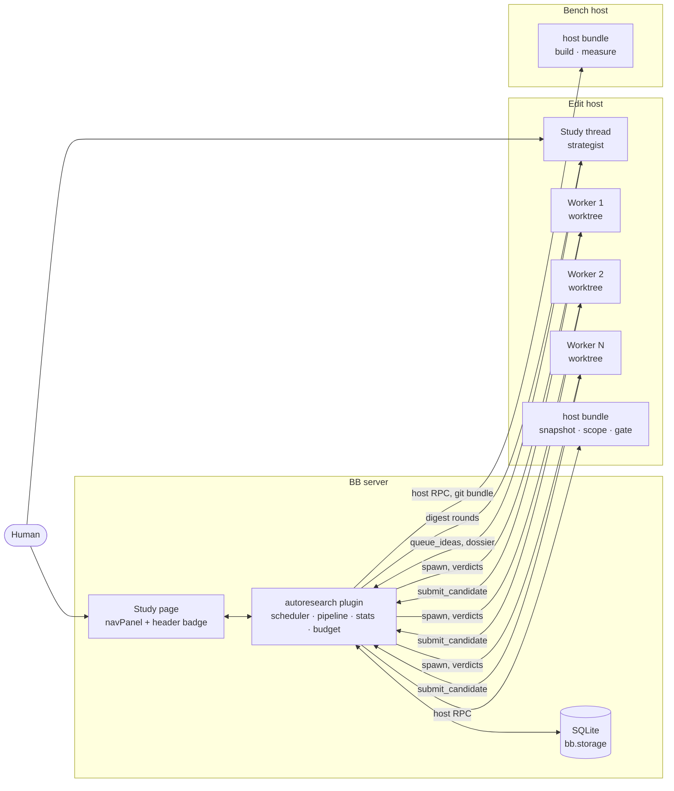
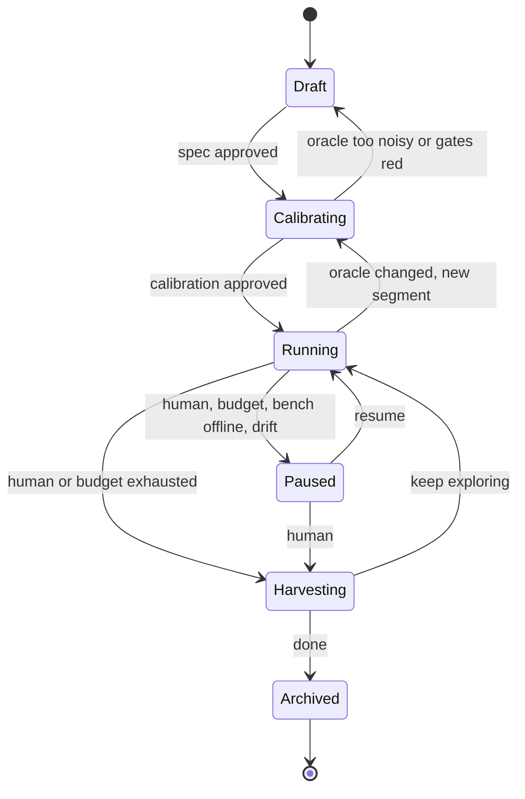
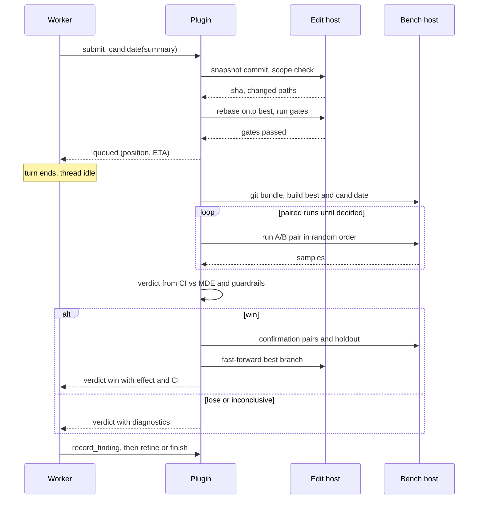

# Autoresearch for BB

> Autoresearch works like a merge queue. The CI is a benchmark, and the authors are short-lived agents. The plugin runs the loop, measures every candidate, and decides what to keep. Agents only propose changes and explain what they learned.

## Problem

We want an agent to improve one measurable property of a codebase over hours or days, for example p99 latency, test-suite runtime, or bundle size. It should keep only changes that really help.

The simple form is one long-lived agent that edits, benchmarks, and decides, in a loop. It fails in predictable ways:

- **The agent decides on its own results.** It runs the benchmark, reads the numbers, and chooses to keep. Noise, wishful reading, and edits to the benchmark all go unchecked.
- **Context grows without limit.** Every iteration adds to the transcript. Compaction loses detail, and the agent slowly forgets what it already tried.
- **It's serial.** One agent and one working tree. Most wall time is the agent thinking, while the benchmark machine sits idle.
- **Measurements are taken on the wrong hardware.** The benchmark runs wherever the agent runs, usually a laptop. That isn't the production architecture, and other work on the same machine adds noise.
- **The output is a messy branch.** Hundreds of commits and reverts that someone then has to untangle by hand.

BB already has the building blocks: worktrees, cheap threads, multiple providers, remote machines, plugins with a server, a host daemon and UI. A design built for BB can fix each of these.

## Goals

- A **study** runs unattended for days. The human sets its direction but doesn't drive it.
- Every keep or discard is a **statistical decision made by the plugin** against a pinned oracle, on suitable hardware.
- Agents think **in parallel**, and timing runs happen **one at a time** on quiet machines.
- **Nothing is lost.** Every attempt, win or lose, can be inspected and revisited.
- The result is **a set of reviewable PRs**. Each PR's contribution is measured by removing it from the final result and benchmarking again.

## Non-goals

- Hyperparameter sweeps with no code change. They can be expressed as a study, but they aren't the target.
- Multi-objective Pareto search. v1 optimizes one primary metric and treats others as guardrails.
- Studies that span projects, or that are shared across users.
- Replacing CI. Gates reuse your test commands, they don't replace your pipeline.

## Principles

1. **The plugin runs the loop; agents make the judgment calls.** Scheduling, retries, budgets, and verdicts are plugin code. There's no "never stop" prompt.
2. **The plugin owns the oracle.** Agents submit candidates. They can't edit the benchmark, can't keep a regression, and can't touch protected files.
3. **Many short-lived workers, not one long-lived agent.** One worker gets one idea, a fresh context, and its own worktree, and is archived when done. Long context stops being a problem.
4. **Edit in parallel, measure one at a time.** N worktrees edit at once, and each benchmark machine runs one measurement at a time.
5. **Git stores every experiment.** Every candidate is a commit kept under a ref. Nothing is lost to a revert.
6. **Humans steer the list of ideas, not a chat.** You change direction by editing the idea queue, scope, and budget. Chat is optional.
7. **Output is evidence.** PRs carry measured contributions with confidence intervals.

With concurrency 1, the same design reduces to a classic serial loop. It isn't a separate mode.

## Concepts

| Term | Meaning |
|---|---|
| **Study** | A long-running optimization effort: objective, metric, guardrails, scope, oracle, budget. |
| **Oracle** | How a commit is judged: `build`, `gate` (correctness), `measure` (metrics). Pinned by hash. |
| **Segment** | A period of a study with a fixed oracle version. Changing the oracle starts a new segment. |
| **Idea** | A queued thing to try, with a rationale, a theme, a priority, and a source. |
| **Worker** | A short-lived agent thread that works on one idea in its own worktree. |
| **Strategist** | The agent role that maintains the idea queue and the dossier. It runs in the study thread. |
| **Candidate** | One submitted attempt: a commit plus its samples and verdict. |
| **Verdict** | `win`, `lose`, `inconclusive`, `gate_failed`, `conflict`, or `rejected` (scope). |
| **Best** | The current best commit. Only the plugin advances it, by promoting a winning candidate. |
| **Finding** | What a worker learned: outcome, why, and when the idea would be worth revisiting. |
| **Dossier** | The strategist's running map of the codebase: hot paths, what's been learned, dead ends. |
| **Bench host** | A BB machine dedicated to measurement. It runs one measurement at a time. |
| **Harvest** | Turning base→best into reviewable PRs with contributions measured by removing each one (ablation). |

## Architecture



### Components

- **Plugin server.** The scheduler, the candidate pipeline, statistics, budget enforcement, the SQLite state, RPC for the UI, and the CLI. It's the only component allowed to advance `best`.
- **Host bundle (`bb.host`).** One full-trust Node entry that runs on every machine the study uses. On edit hosts it snapshots worktrees, checks scope, rebases, and runs gates. On bench hosts it builds, runs measurements, and reports machine health. It streams progress back to the server through host signals.
- **Study thread.** One visible thread per study. It starts as the conversation that creates the study. After that it's where strategist rounds run and where the human talks to the study.
- **Worker threads.** Hidden threads, one per idea. Each runs in its own managed worktree, branched from `best`.
- **Frontend.** A Studies nav panel, the study page, and a header badge on study and worker threads.

## Study lifecycle



- **Draft.** The `study-create` skill interviews the human, reads the code, and drafts the spec and oracle commands. It submits them with `study_propose`. The plugin validates them and shows them on the study page for approval.
- **Calibrating.** The plugin runs the gates on the base commit, then runs repeated base-vs-base (A/A) measurements. The result is the noise floor, the smallest detectable effect, and the cost of one evaluation. The human approves, or tunes the oracle and calibrates again.
- **Running.** Workers are spawned, candidates evaluated, and the strategist runs rounds. The study stays in this state for days.
- **Paused.** No new workers start. Workers already running finish their current submission. A pause triggered by the system (budget, bench offline, noise drift) always notifies the human.
- **Harvesting.** Ablations run and PRs are drafted. The study can go back to Running afterwards.

## Candidate pipeline

Each submission goes through one pipeline, all in plugin code.



1. **Snapshot.** The plugin commits the worker's worktree for it and records the SHA. It also writes the ref `refs/studies/<slug>/c/<n>`. Every submission gets a ref, whatever the verdict.
2. **Scope check.** Changed paths must all fall under `editable`, and none may fall under `protected`. Diff size must be within limits. If not, the verdict is `rejected` and nothing is measured.
3. **Rebase.** If `best` moved since the worker started, the plugin rebases the candidate onto the current `best`. A conflict returns verdict `conflict`, and the worker resolves it, since it has the context.
4. **Gate.** Correctness commands run on the edit host. They run in parallel across workers, since gates don't need a quiet machine. A failure returns verdict `gate_failed` with the last lines of output.
5. **Queue.** The worker gets a ticket with its queue position and an estimated wait, then ends its turn. Waiting never holds a tool call open.
6. **Measure.** The bench host measures the candidate against the current `best` using the protocol in [The oracle](#the-oracle).
7. **Decide.** The plugin applies the decision rule, then the guardrails.
8. **Promote.** Wins get a confirmation measurement with fresh samples and a holdout check. The plugin then squashes the candidate into one commit and fast-forwards `studies/<slug>/best`. Running workers are told that `best` moved. They'll be rebased when they next submit.
9. **Report.** The plugin sends the verdict to the worker as a message, which starts its next turn. The message carries the effect, CI, guardrail deltas, and diagnostics.

Promotions are serialized per study, so `best` is a linear chain where each commit is one promoted idea.

## The oracle

### Spec

A study spec is authored as TOML and stored in plugin storage, versioned and hash-pinned. It isn't kept in the repo, so workers can't reach it. The benchmark harness can live in the repo, but those paths must be listed as `protected`. Their content hash is part of the oracle version.

```toml
[study]
slug = "routing-p99"
objective = "Reduce p99 latency of the routing filter under the replay workload."
base = "main"

[metric]
name = "p99_us"
unit = "us"
direction = "lower"

[[guardrail]]
name = "rss_mb"
max_regression = "5%"

[[guardrail]]
name = "throughput_rps"
max_regression = "2%"

[scope]
editable = ["source/filters/routing/**", "source/common/matcher/**"]
protected = ["bench/**", "test/**"]

[oracle]
build = "bazel build //source/exe:envoy-static -c opt"
gate = ["bazel test //test/filters/routing/... -c opt"]
measure = "bench/replay.sh --workload=prod-sample"
noise = "noisy"                 # deterministic | noisy | expensive
bench_hosts = ["bench-x86-01"]

[oracle.holdout]
measure = "/srv/holdout/replay.sh --workload=holdout-a"   # lives on the bench host only

[budget]
max_workers = 4
max_candidates = 200
max_bench_hours = 24
deadline = "2026-10-16"

[agents]
strategist = { provider = "claude-code" }
worker = { provider = "codex" }
max_submissions_per_worker = 3
```

`measure` prints `METRIC name=value` lines, plus optional `DIAG` lines (phase timings, profile summaries) that are passed to agents as diagnostics.

### Noise classes

| Class | Examples | Protocol | Bench lock |
|---|---|---|---|
| `deterministic` | Bundle size, instruction counts, allocation counts | One run. Wins if strictly better beyond a tolerance. | No. Runs on any host. |
| `noisy` | Latency, test runtime, throughput | Paired, interleaved, sequential test against `best`. | Yes, one measurement per bench host. |
| `expensive` | Model training, long load tests | One run per candidate, compared against the calibrated noise floor. Wins are confirmed with k extra runs. | Yes. |

### Measurement protocol for `noisy`

- The plugin builds `best` once per promotion and caches the build on the bench host. Candidates are built fresh.
- Each side gets `w` warmup runs.
- **Paired, interleaved runs.** Each pair runs `best` and the candidate back to back, in random order. Machine drift hits both sides of a pair equally and cancels out.
- **Statistic.** The plugin takes the paired relative difference for each pair and computes a bootstrap confidence interval of the median.
- **Sequential decision.** After `n_min` pairs, it stops early when the result is clear:
  - clearly worse (the CI is entirely on the regression side): `lose`
  - clearly better (the lower bound clears the minimum detectable effect): `win`
  - still ambiguous at `n_max` pairs: `inconclusive`

  Most candidates are clear losses, so stopping early saves most of the bench time.
- **Confirmation.** A `win` is measured again with fresh pairs before promotion. Many candidates against a noisy benchmark produce false wins by chance, and a false promotion compounds.

### Calibration and drift

Calibration runs the full protocol with base against itself (A/A), several times. It produces a report like this:

> Detects changes of 1.8% or more with 20 pairs. About 6 minutes per evaluation, so about 10 evaluations per hour per bench host. Gates take 3 minutes on the edit host.

If the minimum detectable effect is larger than any plausible win, the study goes back to Draft. That costs minutes instead of a week of tokens.

During Running, a schedule repeats an A/A run on `best` every N evaluations. If noise grows past 2× the calibrated level, the study pauses and notifies the human. A disturbed bench machine would otherwise hand out random verdicts.

### Guardrails and holdout

- **Guardrails** are secondary metrics with limits relative to `best`. A candidate that wins on the primary metric but breaks a guardrail is a `lose`, and the reason is attached.
- **Holdout** is a workload kept only on the bench host. It's evaluated on candidates about to be promoted. Workers never see its inputs or numbers, only pass or fail. It catches changes that special-case the benchmark input.

## Scheduling

### How many workers

Throughput depends on two durations: how long a worker thinks before it submits (T_think), and how long the bench takes per evaluation (T_eval). The scheduler aims for:

`W = min(max_workers, ceil(T_think / T_eval) + 1)`

It learns both durations online. It doesn't spawn a worker while the bench queue is at least `W` deep. This backpressure keeps workers from waiting hours for a verdict.

### What to try next

- Ideas are taken in strategist priority order. Ideas the human pins go first.
- **Diversity.** At most `ceil(W / 2)` workers run on the same theme at once.
- **No repeats.** An idea whose lineage already lost isn't assigned again unless the strategist explicitly re-queues it as a variation.
- **Ideas can start from a candidate.** An idea may name a losing candidate's ref as its base, for example "combine c/12 and c/19, both near misses". This works because nothing is reverted away.

### When the strategist runs

The plugin starts a strategist round in the study thread when one of these happens:

- K verdicts have arrived since the last round.
- Fewer ready ideas remain than `W`.
- **Stall:** no win in the last N verdicts. The round prompt then asks for structurally different directions.
- The human sends a message.

Only one round runs at a time. Each round prompt starts with a self-contained digest built by the plugin: recent verdicts, findings, the idea board, best's diagnostics, and budget. So the thread can be compacted without losing study state.

## Agents

### Strategist (study thread)

- **Model.** A strong reasoning model. It runs rarely and its decisions shape everything else.
- **Inputs.** The round digest, the dossier, and the findings, which it can search with tools.
- **Responsibilities.**
  - keep the idea queue full and diverse
  - retire dead directions
  - maintain the dossier
  - draft harvest groupings
  - answer the human
- **Not responsible for.** Verdicts, scheduling, or editing code.

### Worker

- **Spawn.** The plugin spawns a hidden thread in a managed worktree, branched from `studies/<slug>/best` or from the idea's starting ref. It uses the spec's provider and model and is placed in the study's thread section. Its metadata is `{ study, role: "worker", idea }`.
- **Brief.** The spawn prompt includes:
  - the objective, scope, and rules
  - the dossier
  - best's diagnostics
  - the assigned idea with related findings
  - its limits: max submissions and turn cap
- **Loop.**
  1. Understand the code.
  2. Edit, then run a fast local check.
  3. Call `submit_candidate`, then go idle.
  4. Read the verdict message, then refine or stop.
- **Exit.** `finish` refuses until `record_finding` has been called. Once the worker finishes, the plugin archives the thread and removes the worktree. Candidate refs are kept.
- **Timeouts.** A worker idle past a deadline gets one nudge. If it's still idle after that, it's stopped and the idea is marked `abandoned`.

### Tools

| Tool | Role | Purpose |
|---|---|---|
| `submit_candidate` | worker | Submit the worktree with a summary. Returns a ticket. The verdict arrives later as a message. |
| `record_finding` | worker | Outcome, what was learned, when the idea would be worth revisiting, evidence. |
| `propose_idea` | worker | Add an idea it noticed but won't pursue. The strategist triages it. |
| `request_profile` | worker | Profile `best` or its own candidate on the bench host. This uses bench time and counts against the budget. |
| `finish` | worker | End the assignment. |
| `study_propose` | creator | Submit a spec and oracle for validation and approval. |
| `queue_ideas` | strategist | Add or reorder ideas, each with a rationale, theme, and optional starting ref. |
| `retire_idea` | strategist | Close a direction, with a reason. |
| `update_dossier` | strategist | Replace the dossier. |
| `search_findings` | strategist | Search findings and candidates by text, theme, or verdict. |
| `propose_harvest` | strategist | Propose how to group promotions into changesets. |

No agent has a keep, discard, or promote tool. Concurrency, budget, the oracle, and pausing are human controls.

The tool set depends on the role. `bb.agents.configure` selects tools from the thread's metadata, and then the plugin checks the role again against its own `threads` table on every call. Thread metadata can be written by the thread's own agent, so it can't be the only check.

## Git model

| Ref | Contents |
|---|---|
| `studies/<slug>/best` | Branch. Linear. The first commit is the segment base. Each later commit is one promoted idea, squashed, with a message carrying the idea title, effect, CI, and candidate id. |
| `refs/studies/<slug>/c/<n>` | Every submitted candidate, win or lose. |
| `refs/studies/<slug>/segment/<k>` | The baseline commit of each oracle segment. |
| `studies/<slug>/w/<n>` | Each worker's worktree branch. Deleted when the worker is archived. |

- Workers' managed worktrees share the project's object store on the edit host, so candidates are visible locally without pushing.
- A remote bench host keeps its own clone of the project. Candidates reach it as a `git bundle` covering `best..candidate`, sent through host RPC. That's small for typical diffs and well under the 32 MiB input limit.
- **Nothing is pushed to origin before harvest.**

## Harvest

Harvest turns base→best into reviewable PRs, and backs each one with a measurement.

1. **Group.** The strategist proposes changesets from the promotion commits on `best`, grouped by theme.
2. **Ablate.** For each changeset S, the plugin builds `best` with S reverted and measures it against `best`. The result is S's contribution with a CI.
   - If reverting S conflicts or breaks gates, something else depends on S. That edge is recorded.
   - If removing S costs nothing, S is dropped, unless it's a simplification the human wants anyway.
3. **Check alone.** The plugin applies each independent changeset to the base and runs gates on it.
4. **Draft PRs.** Independent changesets become one PR each. Dependent changesets become a stack in dependency order. Each PR body includes:
   - what changed and why
   - the contribution measured by ablation
   - the standalone effect
   - linked findings
   - a link to the study

   All PRs start as drafts.
5. **Report.** The plugin exports a Markdown study report: the trajectory, the wins, the notable losses and why they lost, the dossier, and the calibration.

The sum of the measured contributions should roughly equal the total gain. A large gap means the changes interact, and the report says so.

## Human surface

### Study page

A **Studies** nav panel lists every study with its state, best vs. base, and budget spent. The study page has these tabs:

- **Overview.** A trajectory chart (every candidate as a dot, best as a step line), best vs. base with CI, state, budget, and controls (pause, resume, concurrency, harvest).
- **Ideas.** A board: queued, running, won, lost, abandoned. You can add, reorder, pin, or veto.
- **Candidates.** A filterable table. Each row opens its diff, samples, verdict, and worker thread.
- **Findings.** A searchable list.
- **Oracle.** The spec, its version history, calibration reports, and approval for oracle changes.
- **Bench.** Machines, queue, health, and drift checks.
- **Harvest.** Proposed changesets, ablation results, and the drafted PRs.

Live updates use `bb.realtime` signals, and the page refetches through `bb.rpc`.

### Threads

- The **study thread** is visible, and it's the one place to talk to the study. A header badge shows `run 84 · best −23.4% ±1.1 · 3 workers · queue 2`.
- **Worker threads** are hidden and grouped in a thread section per study. The study page links to them. Their header badge shows `routing-p99 · idea #31 · submission 2/3 · queued 4th`.
- Workers aren't children of the study thread. Otherwise child lifecycle notices would start a strategist turn every time a worker exits.

### CLI

```bash
bb study list
bb study show routing-p99
bb study calibrate routing-p99
bb study start|pause|resume routing-p99
bb study ideas add routing-p99 "Precompile header matchers into a trie"
bb study workers routing-p99
bb study harvest routing-p99
bb study archive routing-p99
```

### Notifications

Milestones reach the human through the study thread: a new best, a stall, a budget threshold, a broken oracle, or noise drift. The plugin posts them as part of a strategist round, and the thread then shows as unread. A direct push or Slack channel is an open question.

## Data model

SQLite through `bb.storage.database()`:

| Table | Key columns |
|---|---|
| `studies` | id, slug, project_id, state, spec_version, best_sha, budget, created_at |
| `spec_versions` | study_id, version, spec_toml, oracle_hash, approved_at |
| `segments` | study_id, k, baseline_sha, oracle_hash, noise_floor, mde, eval_seconds |
| `ideas` | id, study_id, title, rationale, theme, source, priority, status, start_ref |
| `threads` | thread_id, study_id, role, idea_id, state, submissions, spawned_at |
| `candidates` | id, study_id, idea_id, thread_id, sha, parent_sha, against_sha, verdict, effect, ci_lo, ci_hi, metrics_json |
| `samples` | candidate_id, pair, side, metric, value, host_id, at |
| `findings` | id, study_id, idea_id, candidate_id, outcome, learned, revisit_if |
| `events` | Append-only audit log of every state change and decision |

The dossier is stored as a versioned text blob per study. Git refs are the source of truth for code, and SQLite for everything else.

## BB integration map

| Need | BB surface | Stability |
|---|---|---|
| Role-specific agent tools | `bb.agents.registerTool`, `bb.agents.configure` | Public |
| Workers in their own worktrees | `bb.sdk.threads.spawn` with a host environment and managed worktree from a named base branch, `visibility: "hidden"`, `sectionId`, `pluginMetadata`, `providerId`, `model` | Public |
| Deliver verdicts | `bb.sdk.threads.send` with `mode: "auto"` | Public |
| React to idle, failure, rate limits | `thread.idle`, `thread.failed`, `turn.failed` events; `bb.sdk.threads.retry` with `sendAt` | Public |
| Pause a study's threads | `message.dispatch` hook returning `wait`; `recheck` on resume | Experimental |
| Git, gates, builds, benchmarks on machines | `bb.host` entry with `bb.hosts.experimental_client`, host signals for progress | Experimental |
| State | `bb.storage.database()` (SQLite), `bb.storage.kv` | Public |
| Drift checks, sweeps, reconciliation | `bb.background.schedule`, `bb.background.service` | Public |
| UI | `navPanel`, `threadHeader`, `threadPanelAction`; `bb.rpc`, `bb.realtime` | Public |
| CLI | `bb.cli` | Public |
| Study creation and harvest prompts | `skills/study-create`, `skills/study-harvest` | Public |
| Keep the study thread small | `bb.sdk.threads.compact` | Public |
| Clean up workers | `bb.sdk.threads.archive` | Public |

## Failure handling

| Failure | Behavior |
|---|---|
| Bench host offline | The pipeline pauses at the measure step. Workers keep editing until backpressure stops new spawns. The human is notified after a grace period. |
| Host worker restarts mid-measurement | The plugin reconciles from SQLite. The in-flight measurement restarts from scratch, and partial samples are discarded. |
| Plugin reload or server restart | On load, the plugin registers handlers, then reconciles every study: running workers, queued candidates, in-flight host calls. Handlers are idempotent. |
| Gates fail on `best` | The oracle or the environment is broken. The study pauses and the human is notified. |
| Flaky gate | One automatic retry. The flake rate is tracked and shown on the Bench tab. |
| Noise drift | The study pauses after a failed A/A check. The human is notified. |
| Worker stuck or looping | One nudge, then the worker is stopped, the idea marked `abandoned`, and the worktree removed. |
| Provider rate limit | `turn.failed` with a rate-limit category triggers a retry at the window reset. The scheduler lowers `W` while limits are tight. |
| Budget exhausted | No new workers start. Running workers finish their current submission. The study pauses and proposes a harvest. |

## Security and trust

- **Oracle commands are arbitrary code.** Build, gate, and measure run with full trust on edit and bench hosts. Bench hosts should be dedicated machines without credentials beyond what the build needs.
- **Scope is enforced at submission, not at edit time.** Workers can read anything in their worktree, the same as any agent thread, so keep secrets out of the project.
- **Metadata can be forged.** Tool gating checks the plugin's own `threads` table, not only thread metadata.
- **Holdout data never enters agent context.** Workers only see a pass or fail.
- **Nothing leaves the machine before harvest,** and harvest PRs start as drafts.

## Budget and cost

- **Limits.** `max_workers`, `max_candidates`, `max_bench_hours`, `deadline`. Token or dollar limits too, if BB exposes per-thread usage to plugins (see [Open questions](#open-questions)).
- **Cost per evaluation.** Calibration estimates bench time per evaluation up front, so the study page can project spend before Running starts.
- **Where tokens go.** Workers dominate token spend, because each one relearns part of the codebase. The dossier and brief are the main lever. Track tokens per accepted win as the efficiency metric.
- **Cheap rejections.** Scope rejection, rebase conflicts, and gate failures all cost no bench time. Stopping early cuts bench time on clear losers.

## Phasing

### M0: test the main assumption

The main assumption: short-lived workers with good briefs, judged by the plugin, match or beat one long-lived agent on the same token budget.

- [ ] Spec import, approval, and A/A calibration on the local host
- [ ] Pipeline: snapshot, scope check, gate, paired measurement against `best`, verdict, promotion
- [ ] Worker spawn, brief, verdict message, `record_finding`, `finish`, archive
- [ ] Strategist rounds in the study thread from plugin-built digests
- [ ] `bb study show` and `bb study ideas add`
- [ ] Head-to-head on a reference benchmark against a serial single-agent loop

**Exit:** equal or better improvement at equal tokens, and a measured false-win rate.

### M1: parallel

- [ ] `W > 1` workers, bench queue, backpressure, adaptive `W`
- [ ] Rebase on submit, `conflict` verdict handled by the worker
- [ ] Sequential testing and confirmation runs
- [ ] Diversity and no-repeat rules
- [ ] Study page v1: Overview, Ideas, Candidates

**Exit:** bench busy more than 80% of Running time. Time to target clearly below M0 at similar tokens per win.

### M2: remote bench and trust

- [ ] Bench hosts through `bb.host`, `git bundle` transfer, cached `best` builds
- [ ] Machine health checks, drift checks, holdout, guardrails
- [ ] Oracle versioning and segments

**Exit:** a study runs a full day on a remote x86 bench host without a human stepping in.

### M3: harvest and operations

- [ ] Ablation, dependency detection, draft PRs and stacks, study report
- [ ] Budgets, usage-window awareness, notifications
- [ ] Findings, Oracle, Bench, and Harvest tabs

**Exit:** a harvested PR set where measured contributions add up to the total gain within the CI.

## How we know it works

| Measure | Target |
|---|---|
| Time to a target improvement vs. a serial single-agent loop on the same benchmark | Clearly lower from M1 |
| Tokens per accepted win | Equal or lower than the serial loop |
| False-win rate: promotions that fail a later independent measurement | Below 5% |
| Bench utilization while Running | Above 80% |
| Harvest accuracy: sum of ablation contributions vs. total gain | Within the CI |
| Human interventions per day of Running | Trending to zero apart from steering |

## Alternatives considered

1. **One long-lived agent, re-prompted when idle.** Rejected. The agent owns its verdicts, its context grows without limit, and it can't run in parallel.
2. **An LLM director that spawns delegates.** Rejected for control flow. Scheduling, retries, and budgets expressed as prompts are fragile and cost tokens at every step. LLM judgment stays where it pays off, in the strategist.
3. **Spec and oracle as files in the repo.** They'd be reviewed with the code. But they'd sit within the workers' reach and show up in diffs. Chosen instead: plugin storage, plus `protected` paths for any harness code in the repo.
4. **Agents run the benchmark themselves.** Rejected. Parallel workers would compete for the machine, the hardware would be wrong, and the numbers couldn't be verified.
5. **A dedicated merge worker for rebase conflicts.** Deferred. The submitting worker already has the context to resolve its own conflict.
6. **Workers as child threads of the study thread.** Rejected. Child lifecycle notices would start a strategist turn on every worker exit. Thread sections and metadata group them instead.

## Open questions

1. Can plugins read per-thread token or cost usage? Token budgets and tokens per win depend on it.
2. What notification channel should be the default: study-thread attention only, or a push or Slack path a plugin can use directly?
3. What are the host RPC limits for long calls? Benchmarks of 30 minutes or more need to know the maximum call duration, how cancellation works, and whether progress can stream through signals.
4. Do hidden threads count against concurrency limits? Is a link from the study page enough for users to find them?
5. Is `threads.compact` enough for the study thread, or should the plugin replace it with a fresh thread that starts from a digest?
6. Does mixing providers across workers improve idea diversity enough to justify the setup? Test this in M1.
7. Where should gates run by default: the edit host (parallel, no extra machine) or a separate gate pool (keeps laptops quiet)?
8. For `expensive` oracles, what's the right number of confirmation runs, given that a single evaluation can take an hour?
