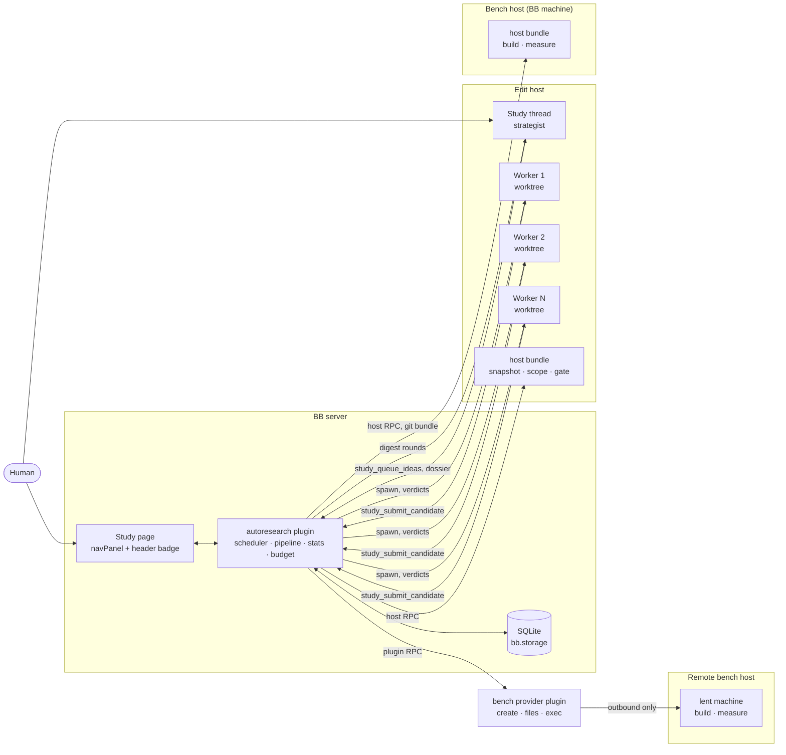
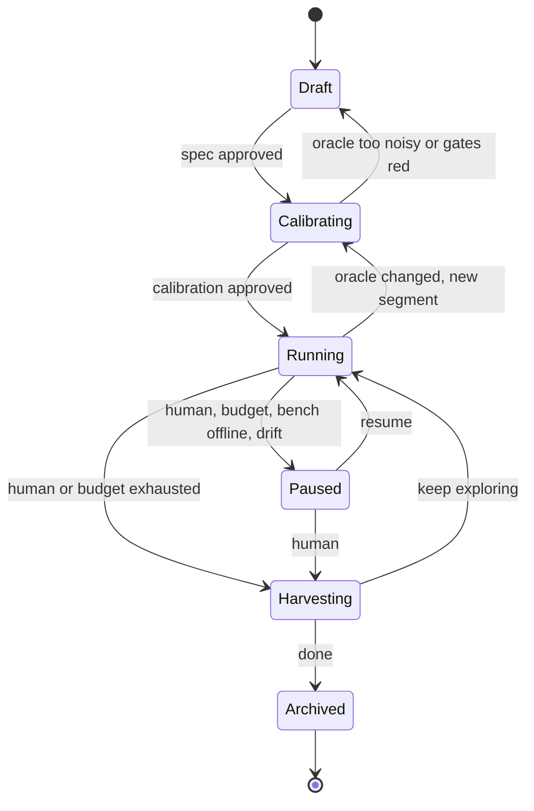
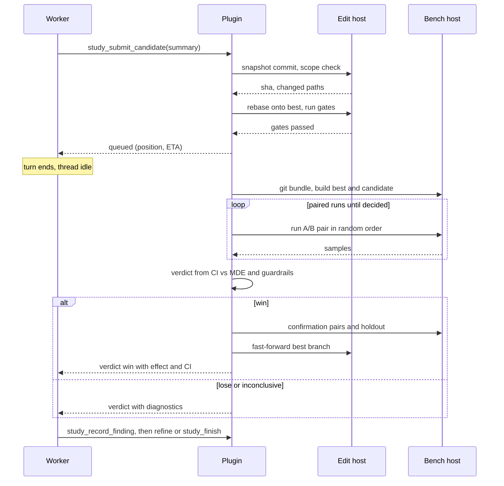

# Autoresearch for BB

> Autoresearch works like a merge queue. The CI is a benchmark, and the authors are short-lived agents. The plugin runs the loop, measures every candidate, and decides what to keep. Agents only propose changes and explain what they learned.

## Status

All four milestones are built (BB 0.45, plugin SDK 0.6.14). Each was smoke-tested live on toy repositories on one MacBook. With v0.2.2 it also ran once on a real workload: a blind comparison against another autoresearch loop on a real-world CLI performance task, from the same starting commit (5.4× against the other loop's 3.9× on that benchmark, in about 3.6× the wall time; one run of each). The exit criteria:

| Milestone | Exit criterion | Validated? |
|---|---|---|
| M0: test the main assumption | Equal or better improvement than a serial single-agent loop at equal tokens, and a measured false-win rate | **No.** The head-to-head against a serial loop was never run. False-win rates are measured in simulation only (stats and expensive-class tests). |
| M1: parallel | Bench busy > 80% of Running time; time to target clearly below M0 at similar tokens per win | **No.** Toy studies reached 85% in steady state when eval > think, but they are too short; no real workload, no M0 comparison. |
| M2: remote bench and trust | A study runs a full day on a remote x86 bench host without a human stepping in | **No.** Only one BB machine existed; the remote path ran against the server's own machine in clone mode for minutes. |
| M3: harvest and operations | A harvested PR set whose measured contributions add up to the total gain within the CI | **On a toy only.** Harvest h4 of `toy-m3b`: sum of contributions +290.7% ± 1.4% vs measured total +293.9% (CI half-width of the gap 3.7%). See [the M3 notes](release-notes.md#v010-m3-harvest-and-operations). |

This document is the design: what the plugin does and why. How each version was built, every deviation from this design, the live checks and the known issues are in the [release notes](release-notes.md); the user guide is [guide.md](guide.md), the bench provider contract [bench-providers.md](bench-providers.md), and what 1.0 promises to keep stable [stability.md](stability.md).

Since M3 the plugin gained a human interface pass (one way of expressing improvement, approval and publishing in the app), cumulative guardrails judged on a CI, a read-only Live view with CI bands and replay, single-machine mode, and remote bench hosts lent by bench provider plugins; the release notes have one section per version.

What has not been exercised live at all: GitHub publishing (only against a mock `gh`), provider usage windows (this machine's providers report none), rate-limit retries (no rate limit occurred), and remote edit hosts (not built). Remote bench hosts ran live on the local example provider and on one cloud sandbox provider kept outside this repository.

## Problem

We want an agent to improve one measurable property of a codebase over hours or days, for example p99 latency, test-suite runtime, or bundle size. It should keep only changes that really help.

The simple form is one long-lived agent that edits, benchmarks, and decides, in a loop. It fails in predictable ways:

- **The agent decides on its own results.** It runs the benchmark, reads the numbers, and chooses to keep. Noise, wishful reading, and edits to the benchmark all go unchecked.
- **Context grows without limit.** Every iteration adds to the transcript. Compaction loses detail, and the agent slowly forgets what it already tried.
- **It's serial.** One agent and one working tree. Most wall time is the agent thinking, while the benchmark machine sits idle.
- **Measurements are taken on the wrong hardware.** The benchmark runs wherever the agent runs, usually a laptop. That isn't the production architecture, and other work on the same machine adds noise.
- **The output is a messy branch.** Hundreds of commits and reverts that someone then has to untangle by hand.

BB already has the building blocks: worktrees, cheap threads, multiple providers, remote machines, plugins with a server, a host daemon and UI. A design built for BB can fix each of these.

## Goals

- A **study** runs unattended for days. The human sets its direction but doesn't drive it.
- Every keep or discard is a **statistical decision made by the plugin** against a pinned oracle, on suitable hardware.
- Agents think **in parallel**, and timing runs happen **one at a time** on quiet machines.
- **Nothing is lost.** Every attempt, win or lose, can be inspected and revisited.
- The result is **a set of reviewable PRs**. Each PR's contribution is measured by removing it from the final result and benchmarking again.

## Non-goals

- Hyperparameter sweeps with no code change. They can be expressed as a study, but they aren't the target.
- Multi-objective Pareto search. v1 optimizes one primary metric and treats others as guardrails.
- Studies that span projects, or that are shared across users.
- Replacing CI. Gates reuse your test commands, they don't replace your pipeline.
- Judging the benchmark. Whether the benchmark represents the production workload, platform and inputs is the user's call. The plugin measures what it is given and adds no consensus modes, platform warnings or holdout nudges.

## Principles

1. **The plugin runs the loop; agents make the judgment calls.** Scheduling, retries, budgets, and verdicts are plugin code. There's no "never stop" prompt.
2. **The plugin owns the oracle.** Agents submit candidates. They can't edit the benchmark, can't keep a regression, and can't touch protected files.
3. **Many short-lived workers, not one long-lived agent.** One worker gets one idea, a fresh context, and its own worktree, and is archived when done. Long context stops being a problem.
4. **Edit in parallel, measure one at a time.** N worktrees edit at once, and each benchmark machine runs one measurement at a time.
5. **Git stores every experiment.** Every candidate is a commit kept under a ref. Nothing is lost to a revert.
6. **Humans steer the list of ideas, not a chat.** You change direction by editing the idea queue, scope, and budget. Chat is optional.
7. **Output is evidence.** PRs carry measured contributions with confidence intervals.

With concurrency 1, the same design reduces to a classic serial loop. It isn't a separate mode.

### Who owns what

- **The plugin owns the trust boundary:** every measurement and gate, verdicts and promotion to `best`, budgets, the bench machines (calibration, locks, remote hosts), and the evidence record. An agent asking "is X better than Y?" always gets the plugin's answer, never its own.
- **Agents own judgment and prose,** with skills and the repository's own tools: ideas, findings, commit messages and titles, and turning a finished study into PRs (grouping, splitting, stacking, descriptions, publishing when the human asks).
- **The user owns the benchmark.** A study optimizes the benchmark it is given. Whether that benchmark represents production (workload, inputs, hardware) is the user's responsibility; the holdout is an optional mechanism the user configures, not a guarantee.

## Concepts

| Term | Meaning |
|---|---|
| **Study** | A long-running optimization effort: objective, metric, guardrails, scope, oracle, budget. |
| **Oracle** | How a commit is judged: `build`, `gate` (correctness), `measure` (metrics). Pinned by hash. |
| **Segment** | A period of a study with a fixed oracle version. Changing the oracle starts a new segment. |
| **Idea** | A queued thing to try, with a rationale, a theme, a priority, and a source. |
| **Worker** | A short-lived agent thread that works on one idea in its own worktree. |
| **Strategist** | The agent role that maintains the idea queue and the dossier. It runs in the study thread. |
| **Candidate** | One submitted attempt: a commit plus its samples and verdict. |
| **Verdict** | `win`, `lose`, `inconclusive`, `gate_failed`, `conflict`, or `rejected` (scope). |
| **Best** | The current best commit. Only the plugin advances it, by promoting a winning candidate. |
| **Finding** | What a worker learned: outcome, why, and when the idea would be worth revisiting. |
| **Dossier** | The strategist's running map of the codebase: hot paths, what's been learned, dead ends. |
| **Bench host** | A machine that measures: the edit machine, another BB machine, or a remote machine. It runs one measurement at a time. |
| **Bench provider** | A separate BB plugin that lends short-lived machines over a small RPC contract ([bench-providers.md](bench-providers.md)). |
| **Remote bench host** | One machine lent by a bench provider, driven by the BB server. Each is its own bench host with its own calibration. |
| **Harvest** | Turning base→best into reviewable PRs with contributions measured by removing each one (ablation). |

## Architecture



### Components

- **Plugin server.** The scheduler, the candidate pipeline, statistics, budget enforcement, the SQLite state, RPC for the UI, and the CLI. It's the only component allowed to advance `best`.
- **Host bundle (`bb.host`).** One full-trust Node entry that runs on every machine the study uses. On edit hosts it snapshots worktrees, checks scope, rebases, and runs gates. On bench hosts it builds, runs measurements, and reports machine health. It streams progress back to the server through host signals.
- **Study thread.** One visible thread per study. It starts as the conversation that creates the study. After that it's where strategist rounds run and where the human talks to the study.
- **Worker threads.** Hidden threads, one per idea. Each runs in its own managed worktree, branched from `best`.
- **Frontend.** A Studies nav panel, the study page, and a header badge on study and worker threads.
- **Bench providers (optional).** Other BB plugins that lend remote machines; the plugin server drives those machines through them (see [Remote bench hosts](#remote-bench-hosts)).

## Study lifecycle



- **Draft.** The `study-create` skill interviews the human, reads the code, and drafts the spec and oracle commands. It submits them with `study_propose`. The plugin validates them and shows them on the study page for approval.
- **Calibrating.** The plugin runs the gates on the base commit, then runs repeated base-vs-base (A/A) measurements. The result is the noise floor, the smallest detectable effect, and the cost of one evaluation. The human approves, or tunes the oracle and calibrates again.
- **Running.** Workers are spawned, candidates evaluated, and the strategist runs rounds. The study stays in this state for days.
- **Paused.** No new workers start. Workers already running finish their current submission. A pause triggered by the system (budget, bench offline, noise drift) always notifies the human.
- **Harvesting.** Ablations run and PRs are drafted. The study can go back to Running afterwards.

## Candidate pipeline

Each submission goes through one pipeline, all in plugin code.



1. **Snapshot.** The plugin commits the worker's worktree for it and records the SHA. It also writes the ref `refs/studies/<slug>/c/<n>`. Every submission gets a ref, whatever the verdict.
2. **Scope check.** Changed paths must all fall under `editable`, and none may fall under `protected`. Diff size must be within limits. If not, the verdict is `rejected` and nothing is measured.
3. **Rebase.** If `best` moved since the worker started, the plugin rebases the candidate onto the current `best`. A conflict returns verdict `conflict`, and the worker resolves it, since it has the context.
4. **Gate.** Correctness commands run on the edit host. They run in parallel across workers, since gates don't need a quiet machine, unless that machine is also a bench host: then they would compete for CPU with the timing runs, and single-machine mode (see [Scheduling](#scheduling)) queues them for the bench lock instead. A failure returns verdict `gate_failed` with the last lines of output.
5. **Queue.** The worker gets a ticket with its queue position and an estimated wait, then ends its turn. Waiting never holds a tool call open.
6. **Measure.** The bench host measures the candidate against the current `best` using the protocol in [The oracle](#the-oracle).
7. **Decide.** The plugin applies the decision rule, then the guardrails.
8. **Promote.** Wins get a confirmation measurement with fresh samples and a holdout check. The plugin then squashes the candidate into one commit and fast-forwards `studies/<slug>/best`. Running workers are told that `best` moved. They'll be rebased when they next submit.
9. **Report.** The plugin sends the verdict to the worker as a message, which starts its next turn. The message carries the effect, CI, guardrail deltas, and diagnostics.

Promotions are serialized per study, so `best` is a linear chain where each commit is one promoted idea.

## The oracle

### Spec

A study spec is authored as TOML and stored in plugin storage, versioned and hash-pinned. It isn't kept in the repo, so workers can't reach it. The benchmark harness can live in the repo, but those paths must be listed as `protected`. Their content hash is part of the oracle version.

```toml
[study]
slug = "routing-p99"
objective = "Reduce p99 latency of the routing filter under the replay workload."
base = "main"

[metric]
name = "p99_us"
unit = "us"
direction = "lower"

[[guardrail]]
name = "rss_mb"
max_regression = "5%"            # per step: a candidate vs the current best
max_total_regression = "10%"     # in total: best vs the segment base (default: max_regression)

[[guardrail]]
name = "throughput_rps"
direction = "higher"
max_regression = "2%"

[scope]
editable = ["source/filters/routing/**", "source/common/matcher/**"]
protected = ["bench/**", "test/**"]
ignore = ["bazel-*/", "*.pyc"]   # untracked build outputs snapshots never commit (default: common ones)

[oracle]
build = "bazel build //source/exe:envoy-static -c opt"
gate = ["bazel test //test/filters/routing/... -c opt"]
measure = "bench/replay.sh --workload=prod-sample"
noise = "noisy"                 # deterministic | noisy | expensive
bench_hosts = ["bench-x86-01"]
single_machine = "auto"         # auto | on | off: gates share the bench lock with measurements (see Scheduling)
quiet_bench = false             # hold new worker turns on a machine while it measures

[oracle.holdout]
measure = "/srv/holdout/replay.sh --workload=holdout-a"   # lives on the bench host only

[budget]
max_workers = 4
max_candidates = 200
max_bench_hours = 24
deadline = "2026-10-16"

[agents]
strategist = { provider = "claude-code" }
worker = { provider = "codex" }
max_submissions_per_worker = 3

[git]
identity = "repo"               # repo | plugin: who the plugin's commits in the repo are by
```

`measure` prints `METRIC name=value` lines, plus optional `DIAG` lines (phase timings, profile summaries) that are passed to agents as diagnostics.

### Noise classes

| Class | Examples | Protocol | Bench lock |
|---|---|---|---|
| `deterministic` | Bundle size, instruction counts, allocation counts | One run. Wins if strictly better beyond a tolerance. | No. Runs on any host. |
| `noisy` | Latency, test runtime, throughput | Paired, interleaved, sequential test against `best`. | Yes, one measurement per bench host. |
| `expensive` | Model training, long load tests | One run per candidate, compared against the calibrated noise floor. Wins are confirmed with k extra runs. | Yes. |

### Measurement protocol for `noisy`

- The plugin builds `best` once per promotion and caches the build on the bench host. Candidates are built fresh.
- Each side gets `w` warmup runs.
- **Paired, interleaved runs.** Each pair runs `best` and the candidate back to back, in random order. Machine drift hits both sides of a pair equally and cancels out.
- **Statistic.** The plugin takes the paired relative difference for each pair and computes a bootstrap confidence interval of the median.
- **Side runs.** Each side of a pair can be several runs of `measure`, keeping each metric's best value (`side_runs`, chosen at calibration so a side lasts at least `min_side_seconds`).
- **Sequential decision.** After `n_min` pairs, it stops early when the result is clear:
  - clearly worse (the CI is entirely on the regression side): `lose`
  - clearly better (the lower bound clears the minimum detectable effect): `win`
  - it can no longer win (the upper bound is below the minimum detectable effect): `inconclusive` (futility)
  - still ambiguous at `n_max` pairs: `inconclusive`

  Before `n_min`, a clear loss can stop it from 3 pairs, when a stricter interval is entirely below zero. Most candidates are clear losses, so stopping early saves most of the bench time.
- **Confirmation.** A `win` is measured again with fresh pairs before promotion. Many candidates against a noisy benchmark produce false wins by chance, and a false promotion compounds. A win whose CI's lower bound is several times the threshold skips it: no chance fluctuation gets that far.

### Calibration and drift

Calibration runs the full protocol with base against itself (A/A), several times. It produces a report like this:

> Detects changes of 1.8% or more with 20 pairs. About 6 minutes per evaluation, so about 10 evaluations per hour per bench host. Gates take 3 minutes on the edit host.

If the minimum detectable effect is larger than any plausible win, the study goes back to Draft. That costs minutes instead of a week of tokens.

During Running, a schedule repeats an A/A run on `best` every N evaluations. If noise grows past 2× the calibrated level, the study pauses and notifies the human. A disturbed bench machine would otherwise hand out random verdicts. While it is paused for drift, nothing more is measured on that machine.

Relative noise also grows when runs get shorter: a benchmark that got 5× faster is noisier relative to itself on the same, quiet machine. When best's runs drop well below their calibrated length, the plugin recalibrates on best by itself (a new segment with the same oracle) instead of pausing.

### Guardrails and holdout

- **Guardrails** are secondary metrics with two limits. **Per step**, a candidate may be at most `max_regression` worse than the current `best`. **In total**, `best` after the promotion may be at most `max_total_regression` (default: `max_regression`) worse than the segment base, so small regressions can't creep across many kept wins: ten promotions that each add 4.9% memory pass a 5% per-step limit and end 61% above the base. The total is the promotion chain base → best compounded, with the candidate's own step on top.
- Guardrails get the primary metric's statistics. A guardrail **breaks** only when its whole CI is beyond a limit, and then a win is a `lose` with the reason in words ("rss 3.1% worse than best, within the 5.0% limit; 5.4% worse than the segment base, beyond the 5.0% total limit"). When the CI straddles a limit it is **inconclusive**: not a rejection, but flagged in the verdict, on the page (warn state) and in the strategist's digest. The same rule applies to every noise class: paired bootstrap CIs for `noisy`, the tolerance band for `deterministic`, and t·σ bands from calibrated per-run noise for `expensive`.
- Calibration measures each guardrail's A/A noise and the CI half-width an evaluation gets, and warns when that exceeds the limit: such a guardrail can never be shown within it.
- Workers and the strategist see each guardrail's remaining headroom under its total limit.
- **Holdout** is a workload kept only on the bench host. It's evaluated on candidates about to be promoted. Workers never see its inputs or numbers, only pass or fail. It catches changes that special-case the benchmark input.

## Scheduling

### How many workers

Throughput depends on two durations: how long a worker thinks before it submits (T_think), and how long the bench takes per evaluation (T_eval). The scheduler aims for:

`W = min(max_workers, ceil(T_think / T_eval) + 1)`

It learns both durations online. It doesn't spawn a worker while the bench queue is at least `W` deep. This backpressure keeps workers from waiting hours for a verdict.

### One machine for everything

The common case is a laptop: the edit host is also the bench host. Gates (tests, type checks, renders) running next to a timing run add noise to it. **Single-machine mode** (`[oracle] single_machine`, default `"auto"`) removes that source of noise:

- Gates take the same per-host bench lock as measurements, in one queue with them, oldest first. A gate and a measurement never overlap on that machine.
- `"auto"` turns it on when a bench host is the edit machine (`"local"`, or the edit host's own name or id) and the noise class takes the bench lock; `"on"` and `"off"` force it.
- Gate spans are bench intervals: utilization counts them, and so does the overlap audit.
- `T_eval` becomes gate + measure time per candidate, because both occupy the bench. Candidates waiting to gate already count as bench queue for backpressure.
- Calibration runs the base gates under the lock too, and reports the time a candidate occupies the bench.

`quiet_bench = true` goes one step further: while a measurement runs on a machine, a worker turn that would start there waits (BB's `message.dispatch` hook). Turns already running are not interrupted, and a held turn waits for at most one measurement, so a busy bench never starves the workers.

Neither setting changes how a commit is judged, so neither is part of the oracle hash.

### What to try next

- Ideas are taken in strategist priority order. Ideas the human pins go first.
- **Diversity.** At most `ceil(W / 2)` workers run on the same theme at once.
- **No repeats.** An idea whose lineage already lost isn't assigned again unless the strategist explicitly re-queues it as a variation.
- **Ideas can start from a candidate.** An idea may name a losing candidate's ref as its base, for example "combine c/12 and c/19, both near misses". This works because nothing is reverted away.

### When the strategist runs

The plugin starts a strategist round in the study thread when one of these happens:

- K verdicts have arrived since the last round.
- Fewer ready ideas remain than `W`.
- **Stall:** no win in the last N verdicts. The round prompt then asks for structurally different directions.
- The human sends a message.

Only one round runs at a time. Each round prompt starts with a self-contained digest built by the plugin: recent verdicts, findings, the idea board, best's diagnostics, and budget. So the thread can be compacted without losing study state.

## Remote bench hosts

A laptop measures one candidate at a time, and it is also where the agents and gates run. Cloud machines can run the same benchmark, often more quietly, but the ones that are cheap to lend usually can't be BB machines: they only allow outbound calls. A **bench provider** is a separate BB plugin that lends such machines through a small contract ([bench-providers.md](bench-providers.md)): create, status, list and destroy by labels, move files, run processes. The provider is a thin transport; git, seeding, calibration and scheduling stay in bb-autoresearch, which runs ordinary shell commands on the machine.

- **Slots.** Each `[[oracle.remote_bench]]` entry keeps `hosts` machines measuring. Each machine is its own bench host. A machine goes `creating → joining → calibrating → ready → retiring → gone`; the cost guard allows one machine per slot plus one replacement.
- **Joining.** The seed is built and scanned for credentials on the edit host first, so a refused seed never costs a machine. Then: create, wait until ready, upload the seed, a shallow git bundle of the study base (so a machine never needs the full history), best as a delta bundle, and `setup`. Candidates follow as delta bundles of a few KiB.
- **Calibration per host.** The study's calibration calibrates its machines with every other bench host. A machine that joins later runs an A/A on best alone, and then measures with its own noise floor and win threshold, never below the segment's. A machine noisier than `max_mde` is replaced.
- **Rotation and leaving.** A replacement starts before a machine's lifetime ends, calibrates, and only then takes its slot; the old machine finishes what it measures and is destroyed. A machine that is suspended, gone or failed, or whose call finds it gone, leaves at once and is never reused: it may come back on different hardware.
- **Reloads keep machines.** A plugin update in the middle of a study must not throw away calibrated machines. Unloading keeps every `ready` machine in the database. The next instance re-adopts one only when its provider still lists it as ready and a probe finds its bench repository and seed; until then it takes no work, and one that can't be verified within ten minutes leaves. Machines that were joining, calibrating or retiring are destroyed at unload. Pausing and archiving destroy machines as before; a disabled plugin's machines end with their lifetime, or at the next load.
- **Orphans.** Machines carry the study id and slot as labels. At load, on pause and archive, and every ten minutes, the fleet lists each provider's machines and destroys those no live row uses.
- **Seeds and base bundles.** They are content addressed and built once: a seed per segment baseline and seed inputs (the command, `seed_allow` and the cores), so a spec change that leaves those alone reuses it. Files no non-archived study uses are deleted at load and when a study is archived; `bb study bench` reports what is on disk.
- **Trust.** Nothing on a lent machine holds the user's credentials: the BB server reaches it only through the provider, and the seed is refused when anything in it looks like a credential (paths and rules are reported, never the values).

## Agents

### Strategist (study thread)

- **Model.** A strong reasoning model. It runs rarely and its decisions shape everything else.
- **Inputs.** The round digest, the dossier, and the findings, which it can search with tools. Its own environment can be any checkout of the project, so every round says where best is and how to read it through git without switching branches (see [v0.2.3](release-notes.md#v023)).
- **Responsibilities.**
  - keep the idea queue full and diverse
  - retire dead directions
  - maintain the dossier
  - draft harvest groupings
  - answer the human
- **Not responsible for.** Verdicts, scheduling, or editing code.

### Worker

- **Spawn.** The plugin spawns a hidden thread in a managed worktree, branched from `studies/<slug>/best` or from the idea's starting ref. It uses the spec's provider and model and is placed in the study's thread section. Its metadata is `{ study, role: "worker", idea }`.
- **Brief.** The spawn prompt includes:
  - the objective, scope, and rules
  - the dossier
  - best's diagnostics
  - the assigned idea with related findings
  - its limits: max submissions and turn cap
- **Loop.**
  1. Understand the code.
  2. Edit, then run a fast local check.
  3. Call `study_submit_candidate`, then go idle.
  4. Read the verdict message, then refine or stop.
- **Exit.** `study_finish` refuses until `study_record_finding` has been called. Once the worker finishes, the plugin archives the thread and removes the worktree. Candidate refs are kept.
- **Timeouts.** A worker idle past a deadline gets one nudge. If it's still idle after that, it's stopped and the idea is marked `abandoned`.

### Tools

| Tool | Role | Purpose |
|---|---|---|
| `study_submit_candidate` | worker | Submit the worktree with a summary. Returns a ticket. The verdict arrives later as a message. |
| `study_record_finding` | worker | Outcome, what was learned, when the idea would be worth revisiting, evidence. |
| `study_propose_idea` | worker | Add an idea it noticed but won't pursue. The strategist triages it. |
| `study_request_profile` | worker | Profile `best` or its own candidate on the bench host. This uses bench time and counts against the budget. |
| `study_finish` | worker | End the assignment. |
| `study_propose` | creator | Submit a spec and oracle for validation and approval. |
| `study_queue_ideas` | strategist | Add or reorder ideas, each with a rationale, theme, and optional starting ref. |
| `study_retire_idea` | strategist | Close a direction, with a reason. |
| `study_update_dossier` | strategist | Replace the dossier. |
| `study_search_findings` | strategist | Search findings and candidates by text, theme, or verdict. |
| `study_propose_harvest` | strategist | Propose how to group promotions into changesets. |

Every agent tool carries the `study_` prefix so it can't collide with another plugin's tools. No agent has a keep, discard, or promote tool. Concurrency, budget, the oracle, and pausing are human controls.

The tool set depends on the role. `bb.agents.configure` selects tools from the thread's metadata, and then the plugin checks the role again against its own `threads` table on every call. Thread metadata can be written by the thread's own agent, so it can't be the only check.

## Git model

| Ref | Contents |
|---|---|
| `studies/<slug>/best` | Branch. Linear. The first commit is the segment base. Each later commit is one promoted idea, squashed, with a message carrying the idea title, effect, CI, and candidate id. |
| `refs/studies/<slug>/c/<n>` | Every submitted candidate, win or lose. |
| `refs/studies/<slug>/segment/<k>` | The baseline commit of each oracle segment. |
| `studies/<slug>/w/<n>` | Each worker's worktree branch. Deleted when the worker is archived. |

- Workers' managed worktrees share the project's object store on the edit host, so candidates are visible locally without pushing.
- A bench host on another BB machine keeps its own clone of the project. Candidates reach it as a `git bundle` covering `best..candidate`, sent through host RPC. That's small for typical diffs and well under the 32 MiB input limit. A remote bench host starts from a shallow bundle of the study base instead, and gets the same delta bundles through its provider.
- **Nothing is pushed to origin before harvest.**
- **Commit identity.** The plugin's commits in the repository (worker snapshots, prepared candidates, promotions, harvest commits) are authored and committed as `[git] identity` says. `"repo"` (the default) is the identity git resolves in the repository on the edit host (`user.name` and `user.email`, repo-local config first, then global), so a work repo carries the user's work identity; with none configured the plugin falls back to `autoresearch <autoresearch@bb.local>` and says so in the calibration report and a notice. `"plugin"` always uses that identity. The server resolves it on the edit host and passes it explicitly to every commit, so bench clones, which only receive commits as bundles, see exactly the edit host's commits. It isn't part of the oracle hash.

## Harvest

Harvest turns base→best into reviewable PRs, and backs each one with a measurement.

1. **Group.** The strategist proposes changesets from the promotion commits on `best`, grouped by theme.
2. **Ablate.** For each changeset S, the plugin builds `best` with S reverted and measures it against `best`. The result is S's contribution with a CI.
   - If reverting S conflicts or breaks gates, something else depends on S. That edge is recorded.
   - If removing S costs nothing, S is dropped, unless it's a simplification the human wants anyway.
3. **Check alone.** The plugin applies each independent changeset to the base and runs gates on it.
4. **Draft PRs.** Independent changesets become one PR each. Dependent changesets become a stack in dependency order. Each PR body includes:
   - what changed and why
   - the contribution measured by ablation
   - the standalone effect
   - linked findings
   - a link to the study

   All PRs start as drafts.
5. **Report.** The plugin exports a Markdown study report: the trajectory, the wins, the notable losses and why they lost, the dossier, and the calibration.

The sum of the measured contributions should roughly equal the total gain. A large gap means the changes interact, and the report says so.

## Human surface

### Study page

A **Studies** nav panel lists every study with its state, what needs the human, best vs. base, and budget spent; its sidebar entry carries a count of what needs the human. The study page is the primary surface: what you see first is the state and what the study is doing now, then **Needs you** (pending approvals, system pauses, drift alarms, a failed calibration, a harvest ready for review), then best vs. base and what is running. The study page has these tabs:

- **Live.** The default tab while the study runs: workers picking up ideas and moving through their phases with their last action, candidate cards moving through tests and the bench to a verdict, each measurement's CI band narrowing to the decision, the bench hosts, the ideas up next in pick order, a feed of what just happened, and one worker's transcript at a time. Read only. The same view opens beside the study thread (see Threads), and any study can be replayed in it from its recorded events.
- **Overview.** Needs you, best vs. base in words with raw values and CI, what's running now, a trajectory chart (every candidate as a mark, best as a step line), secondary metrics and guardrails against their limits, budget, controls (pause, resume, concurrency, harvest, archive), and notices that each name the action they ask for.
- **Ideas.** A board: queued, running, won, lost, abandoned. You can add, reorder, pin, or veto.
- **Candidates.** A filterable table. Each row opens its diff, its measurement's CI band (how the verdict formed), samples, verdict, and worker thread.
- **Findings.** A searchable list.
- **Oracle.** The spec, its version history, calibration reports, and approval of specs and calibrations.
- **Bench.** Machines, queue, health, and drift checks.
- **Harvest.** Proposed changesets, their contributions as shares of the gain, dependencies in words, PR previews, keep/drop for droppable changesets, and publishing the drafted PRs.

Deliberate steps (approving a spec, approving a calibration and starting, publishing, archiving) run from the page behind a confirmation that states exactly what will happen, or from the CLI; both paths are equivalent and audited the same way (see the threat model).

Every number follows one convention: **better is positive, in the metric's own terms** ("74.7% fewer ops (4.0×)", "+74.7%"), with the raw values next to it ("210,802 → 53,300 opcodes"). See [v0.1.0: human interface](release-notes.md#v010-human-interface).

Live updates use `bb.realtime` signals, and the page refetches through `bb.rpc`. The Live view also applies small typed deltas (stage changes, phases, pair progress, verdicts) locally, throttled per study.

### Threads

- The **study thread** is visible, and it's the one place to talk to the study. A header badge shows `run 84 · best −23.4% ±1.1 · 3 workers · queue 2`, and a **Live** button opens the Live view in the thread's right split pane, so the human can watch while talking to the strategist.
- **Worker threads** are hidden and grouped in a thread section per study. The study page links to them. Their header badge shows `routing-p99 · idea #31 · submission 2/3 · queued 4th`.
- Workers aren't children of the study thread. Otherwise child lifecycle notices would start a strategist turn every time a worker exits.

### CLI

```bash
bb study list
bb study show routing-p99
bb study calibrate routing-p99
bb study start|pause|resume routing-p99
bb study ideas add routing-p99 "Precompile header matchers into a trie"
bb study workers routing-p99
bb study harvest routing-p99
bb study archive routing-p99
```

### Notifications

Milestones reach the human as notices: a new best, a stall, a budget threshold, a broken oracle, noise drift, a rate limit, and a harvest that is ready. Each notice shows on the study page and in `bb study show`, marks the study thread unread (without starting a turn), and rides along in the next strategist round. BB gives plugins no push or Slack channel (see [the M3 notes](release-notes.md#v010-m3-harvest-and-operations)).

## Data model

SQLite through `bb.storage.database()`:

| Table | Key columns |
|---|---|
| `studies` | id, slug, project_id, state, spec_version, best_sha, budget, created_at |
| `spec_versions` | study_id, version, spec_toml, oracle_hash, approved_at |
| `segments` | study_id, k, baseline_sha, oracle_hash, noise_floor, mde, eval_seconds |
| `ideas` | id, study_id, title, rationale, theme, source, priority, status, start_ref |
| `threads` | thread_id, study_id, role, idea_id, state, submissions, spawned_at |
| `candidates` | id, study_id, idea_id, thread_id, sha, parent_sha, against_sha, verdict, effect, ci_lo, ci_hi, metrics_json |
| `samples` | candidate_id, pair, side, metric, value, host_id, at |
| `findings` | id, study_id, idea_id, candidate_id, outcome, learned, revisit_if |
| `bench_hosts` | study_id, host_id, mode (shared, clone, remote), active, noise_floor, mde, drift and health state |
| `remote_hosts` | One row per remote machine: provider, slot, provider id, state, expiry, home, seed, its own calibration |
| `remote_artifacts` | Seeds and base bundles built on the edit host: key, state, path, sha256, size |
| `events` | Append-only audit log of every state change and decision; the Live view and its replay are built on it |

The dossier is stored as a versioned text blob per study. Git refs are the source of truth for code, and SQLite for everything else.

## BB integration map

| Need | BB surface | Stability |
|---|---|---|
| Role-specific agent tools | `bb.agents.registerTool`, `bb.agents.configure` | Public |
| Workers in their own worktrees | `bb.sdk.threads.spawn` with a host environment and managed worktree from a named base branch, `visibility: "hidden"`, `sectionId`, `pluginMetadata`, `providerId`, `model` | Public |
| Deliver verdicts | `bb.sdk.threads.send` with `mode: "auto"` | Public |
| React to idle, failure, rate limits | `thread.idle`, `thread.failed`, `turn.failed` events; `bb.sdk.threads.retry` with `sendAt` | Public |
| Pause a study's threads | `message.dispatch` hook returning `wait`; `recheck` on resume | Experimental |
| Git, gates, builds, benchmarks on machines | `bb.host` entry with `bb.hosts.experimental_client`, host signals for progress | Experimental |
| Remote machines from bench provider plugins | `bb.sdk.plugins.callRpc` to the provider's `bb.rpc` methods | Public |
| State | `bb.storage.database()` (SQLite), `bb.storage.kv` | Public |
| Drift checks, sweeps, reconciliation | `bb.background.schedule`, `bb.background.service` | Public |
| UI | `navPanel`, `threadHeader`, `threadPanelAction`; `bb.rpc`, `bb.realtime`; `ThreadChat` (`variant="timeline"`) for a worker's transcript | Public |
| What a worker is doing now (live view) | `experimental_thread.events` and `bb.sdk.threads.events.list` (tool items only) | Experimental |
| CLI | `bb.cli` | Public |
| Study creation and harvest prompts | `skills/study-create`, `skills/study-harvest` | Public |
| Keep the study thread small | `bb.sdk.threads.compact` | Public |
| Clean up workers | `bb.sdk.threads.archive` | Public |

## Failure handling

| Failure | Behavior |
|---|---|
| Bench host offline | The pipeline pauses at the measure step. Workers keep editing until backpressure stops new spawns. The human is notified after a grace period. |
| Host worker restarts mid-measurement | The plugin reconciles from SQLite. The in-flight measurement restarts from scratch, and partial samples are discarded. |
| Plugin reload or server restart | On load, the plugin registers handlers, then reconciles every study: running workers, queued candidates, in-flight host calls. Handlers are idempotent. Calibrated remote machines are kept across the reload and re-adopted once verified (see [Remote bench hosts](#remote-bench-hosts)). |
| Remote machine lost | The machine leaves at its first failed call or status poll and is never reused; a measurement on it restarts from scratch elsewhere, and a replacement joins. |
| Gates fail on `best` | The oracle or the environment is broken. The study pauses and the human is notified. |
| Flaky gate | One automatic retry. The flake rate is tracked and shown on the Bench tab. |
| Noise drift | The study pauses after a failed A/A check. The human is notified. |
| Worker stuck or looping | One nudge, then the worker is stopped, the idea marked `abandoned`, and the worktree removed. |
| Provider rate limit | `turn.failed` with a rate-limit category triggers a retry at the window reset. The scheduler lowers `W` while limits are tight. |
| Budget exhausted | No new workers start. Running workers finish their current submission. The study pauses and proposes a harvest. |

## Security and trust

- **Oracle commands are arbitrary code.** Build, gate, and measure run with full trust on edit and bench hosts. Bench hosts should be dedicated machines without credentials beyond what the build needs.
- **Scope is enforced at submission, not at edit time.** Workers can read anything in their worktree, the same as any agent thread, so keep secrets out of the project.
- **Metadata can be forged.** Tool gating checks the plugin's own `threads` table, not only thread metadata.
- **Holdout data never enters agent context.** Workers only see a pass or fail.
- **Nothing leaves the machine before harvest,** and harvest PRs start as drafts.

### Threat model

**What the plugin protects against.** Accidental or casual metric gaming by agents through the tools and context they are given:

- editing the benchmark, tests, or harness: scope check at submission, protected paths hashed into the oracle;
- keeping a regression or a lucky number: the plugin owns every verdict, with paired sequential tests and confirmation runs;
- special-casing the benchmark input: the holdout, whose inputs and numbers never enter agent context (only pass or fail);
- widening their own resources: control RPCs are clamped to the approved spec (concurrency can only go down);
- approving their own oracle: a revised spec from the study thread stays pending until it is approved, the CLI's approval commands refuse a study's own worker and strategist threads, and every approval (in the app or the CLI) names the exact spec version it approves and is audited;
- doing any of this unnoticed: every human control is an append-only `control.*` event with the caller information BB provides and the study agent turns running at that moment, plus a notice (and an unread study thread when an agent turn was running).

**What it cannot protect against on a full-access local machine.** An agent with a shell running as the user can do anything the user can:

- BB gives plugins no caller-thread identity for RPC: the app, the `bb` CLI, and agents are all `client`, so an agent can call the plugin's RPC with `bb plugin rpc call`.
- The CLI's thread id comes from the invoking shell's environment; an agent can drop it and look like the human.
- Plugin forms (`bb.ui.requestInput`) can be answered with `bb thread interactions respond`, so a form is no stronger an approval channel.
- With a `local` bench host, the holdout's files sit on the same disk the agents can read.
- Nothing stops it from editing the plugin's SQLite database or source, or pushing.

**In-app and CLI approval are equivalent.** Approving a spec, approving a calibration and starting, and publishing a harvest can be done on the Studies page (RPC with an explicit `confirm: true`, sent only from a dialog that states what will happen) or with the CLI. Neither path is stronger: BB cannot tell an agent from a human on any of them (RPC callers are all `client`, the CLI's thread id comes from the shell, forms can be answered from a shell), so a CLI-only rule only made the human's path longer. What makes approval trustworthy is the same on both paths: the action is deliberate (a confirmation, or a typed command), it approves a specific version (a stale page is refused), it is recorded as an append-only `control.*` event with the caller information BB gives and the study agent turns running at that moment, and it raises a notice the human sees on the page.

There, the defenses are detection (the audit trail above) and isolation: a separate bench machine that holds the holdout, and agent permission modes and sandboxes that don't allow arbitrary shell access. A study whose results matter should run its bench on a machine its workers can't reach.

## Budget and cost

- **Limits.** `max_workers`, `max_candidates`, `max_bench_hours`, `deadline`, and `max_tokens` (BB exposes per-thread token usage to plugins; dollar cost is not exposed per thread, see [the M3 notes](release-notes.md#v010-m3-harvest-and-operations)).
- **Cost per evaluation.** Calibration estimates bench time per evaluation up front, so the study page can project spend before Running starts.
- **Where tokens go.** Workers dominate token spend, because each one relearns part of the codebase. The dossier and brief are the main lever. Track tokens per accepted win as the efficiency metric.
- **Cheap rejections.** Scope rejection, rebase conflicts, and gate failures all cost no bench time. Stopping early cuts bench time on clear losers.

## Phasing

### M0: test the main assumption

The main assumption: short-lived workers with good briefs, judged by the plugin, match or beat one long-lived agent on the same token budget.

- [x] Spec import, approval, and A/A calibration on the local host
- [x] Pipeline: snapshot, scope check, gate, paired measurement against `best`, verdict, promotion
- [x] Worker spawn, brief, verdict message, `study_record_finding`, `study_finish`, archive
- [x] Strategist rounds in the study thread from plugin-built digests
- [x] `bb study show` and `bb study ideas add`
- [ ] Head-to-head on a reference benchmark against a serial single-agent loop

**Exit:** equal or better improvement at equal tokens, and a measured false-win rate.

### M1: parallel

- [x] `W > 1` workers, bench queue, backpressure, adaptive `W`
- [x] Rebase on submit, `conflict` verdict handled by the worker
- [x] Sequential testing and confirmation runs
- [x] Diversity and no-repeat rules
- [x] Study page v1: Overview, Ideas, Candidates
- [ ] Exit criterion on a real workload (the toy smoke tests are too short to show it; see [the M1 notes](release-notes.md#v010-m1-parallel))

**Exit:** bench busy more than 80% of Running time. Time to target clearly below M0 at similar tokens per win.

### M2: remote bench and trust

- [x] Bench hosts through `bb.host`, `git bundle` transfer, cached `best` builds
- [x] Machine health checks, drift checks, holdout, guardrails
- [x] Oracle versioning and segments
- [ ] Exit criterion: not run, because only one BB machine exists (see [the M2 notes](release-notes.md#v010-m2-remote-bench-and-trust))

**Exit:** a study runs a full day on a remote x86 bench host without a human stepping in.

### M3: harvest and operations

- [x] Ablation, dependency detection, draft PRs and stacks, study report
- [x] Budgets, usage-window awareness, notifications
- [x] Findings, Oracle, Bench, and Harvest tabs
- [ ] Exit criterion on a real workload (met on a toy; see [the M3 notes](release-notes.md#v010-m3-harvest-and-operations))

**Exit:** a harvested PR set where measured contributions add up to the total gain within the CI.

## How we know it works

| Measure | Target |
|---|---|
| Time to a target improvement vs. a serial single-agent loop on the same benchmark | Clearly lower from M1 |
| Tokens per accepted win | Equal or lower than the serial loop |
| False-win rate: promotions that fail a later independent measurement | Below 5% |
| Bench utilization while Running | Above 80% |
| Harvest accuracy: sum of ablation contributions vs. total gain | Within the CI |
| Human interventions per day of Running | Trending to zero apart from steering |

## Alternatives considered

1. **One long-lived agent, re-prompted when idle.** Rejected. The agent owns its verdicts, its context grows without limit, and it can't run in parallel.
2. **An LLM director that spawns delegates.** Rejected for control flow. Scheduling, retries, and budgets expressed as prompts are fragile and cost tokens at every step. LLM judgment stays where it pays off, in the strategist.
3. **Spec and oracle as files in the repo.** They'd be reviewed with the code. But they'd sit within the workers' reach and show up in diffs. Chosen instead: plugin storage, plus `protected` paths for any harness code in the repo.
4. **Agents run the benchmark themselves.** Rejected. Parallel workers would compete for the machine, the hardware would be wrong, and the numbers couldn't be verified.
5. **A dedicated merge worker for rebase conflicts.** Deferred. The submitting worker already has the context to resolve its own conflict.
6. **Workers as child threads of the study thread.** Rejected. Child lifecycle notices would start a strategist turn on every worker exit. Thread sections and metadata group them instead.

## Open questions

1. ~~Can plugins read per-thread token or cost usage?~~ Answered in M3: tokens yes (the thread's `thread/tokenUsage/updated` events, read with `bb.sdk.threads.events.list`), dollars no. `budget.max_tokens` and tokens per win are built on it.
2. ~~What notification channel should be the default?~~ Answered in M3: study-thread attention is the only channel. The SDK has no push, notification, or Slack API for plugins; `bb.sdk.system.attention()` only reads the global "needs attention" flag.
3. ~~What are the host RPC limits for long calls?~~ Answered in M2: a call is capped at 30 minutes, input at 32 MiB and output at 8 MiB. Long commands run as host background jobs polled in short calls, cancelled through `jobCancel`, with progress through host signals (see [the M2 notes](release-notes.md#v010-m2-remote-bench-and-trust)).
4. Do hidden threads count against concurrency limits? Is a link from the study page enough for users to find them?
5. Is `threads.compact` enough for the study thread, or should the plugin replace it with a fresh thread that starts from a digest?
6. Does mixing providers across workers improve idea diversity enough to justify the setup? Test this in M1.
7. Where should gates run by default: the edit host (parallel, no extra machine) or a separate gate pool (keeps laptops quiet)?
8. For `expensive` oracles, what's the right number of confirmation runs, given that a single evaluation can take an hour? M2 chose k = 3 with Student-t thresholds (simulated: 1.4% false wins, 71% of 3σ effects found, 1.15 runs per no-effect candidate). Revisit with real long-running benchmarks.

## Credits

Inspired by [karpathy/autoresearch](https://github.com/karpathy/autoresearch) and [davebcn87/pi-autoresearch](https://github.com/davebcn87/pi-autoresearch).
